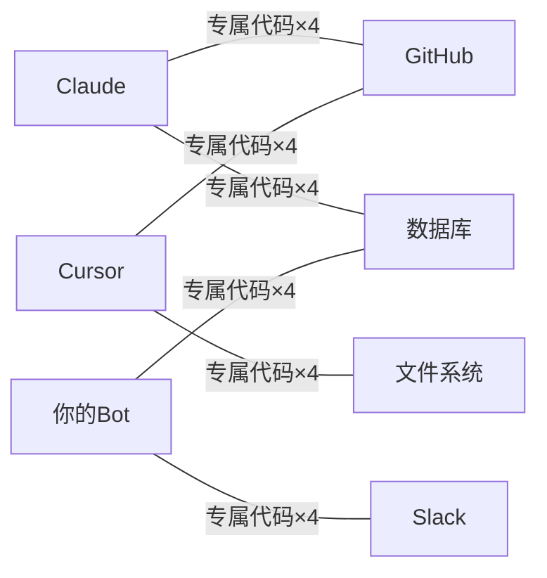
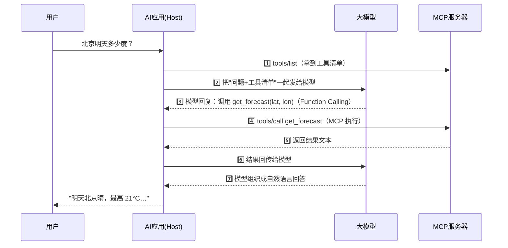
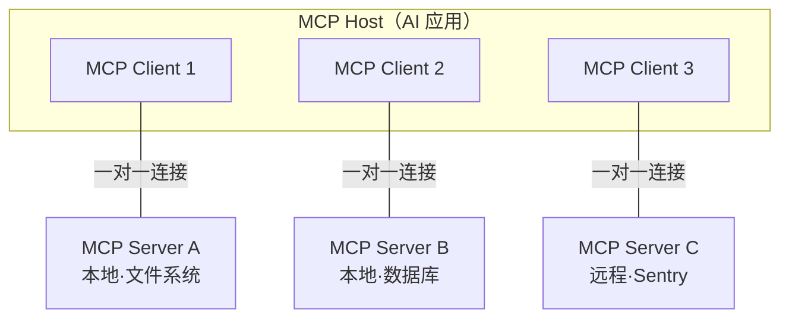
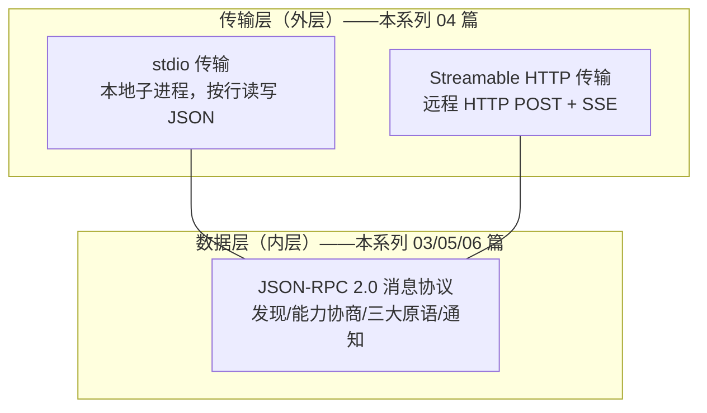

# 01 - 认识 MCP：AI 世界的 USB-C 接口

> 本篇是纯理论篇，回答三个问题：为什么需要 MCP？MCP 到底是什么？它经历了什么版本演进？
> 建议阅读时间 15 分钟。读完你将能给别人把 MCP 讲清楚，并且能识别"网上教程是不是过时的"。

[← 目录](README.md) · [下一篇：第一个 MCP Server →](02-第一个MCPServer.md)

---

## 1. 为什么需要 MCP：M×N 的集成地狱

先看没有 MCP 之前的世界。假设有 3 个 AI 应用（Claude、Cursor、你自己开发的 ChatBot），都想连接 4 种外部系统（GitHub、数据库、文件系统、Slack）。

**没有统一协议时**，每个 AI 应用都要为每个外部系统写一套专属对接代码：



这就是经典的 **M×N 问题**：M 个应用 × N 个系统 = M×N 套对接代码。每接入一个新系统，M 个应用各改一遍；每发布一个新应用，N 个系统各适配一遍。

**有了 MCP**，就变成了 **M+N**：应用只要实现一次 MCP 客户端，系统只要实现一次 MCP 服务器，中间靠标准协议对话。

```mermaid
graph LR
    subgraph 应用侧（各自实现一次 MCP 客户端）
        A1[Claude]
        A2[Cursor]
        A3[你的Bot]
    end
    P((MCP<br/>标准协议))
    subgraph 系统侧（各自实现一次 MCP 服务器）
        S1[GitHub]
        S2[数据库]
        S3[文件系统]
    end
    A1 --- P
    A2 --- P
    A3 --- P
    P --- S1
    P --- S2
    P --- S3
```

从 12 套对接代码变成 3+3=6 套，而且两边的数量可以独立增长——这就是一个协议存在的价值。

### 一个更贴切的类比

官方的比喻是 **USB-C 接口**：

> USB-C 之前，安卓手机用 Micro-USB、苹果用 Lightning、相机用 Mini-USB……每种设备一根线。USB-C 出现后，"一头是电脑，一头是任何设备"成了统一约定。MCP 就是 AI 应用的 USB-C：一头是 AI 应用（Host），一头是任何数据源/工具（Server）。

这个类比还有后半句值得展开：**USB-C 不仅能传数据，还能传电、传视频**。MCP 也不只传"工具调用"，它统一了三类上下文的交换方式（下面第 4 节的三大原语）。

## 2. MCP 是什么：一句话定义

> **MCP（Model Context Protocol，模型上下文协议）是一个开放标准，定义了 AI 应用与外部数据源、工具、工作流之间的通信协议。**

拆开这句话里的每个关键词：

| 关键词 | 含义 |
|---|---|
| **开放标准** | 规范公开在 [modelcontextprotocol.io](https://modelcontextprotocol.io)，任何人可实现，不绑定某家厂商（虽然由 Anthropic 发起，但已移交中立基金会治理） |
| **协议** | 它只规定"消息怎么交换"，不规定"消息怎么被使用"。它不含任何大模型调用逻辑 |
| **AI 应用** | 规范里叫 Host——Claude Desktop、Cursor、VS Code、ZCode 这类产品，以及你自己写的 AI Agent |
| **外部系统** | 数据库、文件、SaaS API、本地命令……任何能被程序操作的东西 |

**MCP ≠ 大模型技术**。这是新手最常见的误解。MCP 服务器里**没有 AI、不需要 API Key**，它就是一个普通的网络程序（很多就是几行代码），只不过它的"用户"不是人类，而是 AI 应用。理解了这一点，"MCP 开发"其实就是一种特殊场景的后端/工具开发。

## 3. MCP 不是什么：三个常见混淆

### 3.1 MCP ≠ Function Calling（函数调用）

Function Calling 是大模型 API 层面的能力：你把函数描述发给模型，模型决定"该调哪个函数"并输出参数。**模型只输出意图，真正执行函数的是你的代码。**

MCP 解决的是**执行层的标准化**：谁提供这些函数？多个 AI 应用怎么共享同一批函数？答案就是 MCP 服务器。

两者是上下游关系，真实工作流是这样的：



记住分工：**大模型负责"决定调什么"，MCP 负责"真正调得到"**。

### 3.2 MCP ≠ Agent Skills

2025 年底出现的 Agent Skills（如 Claude Skills）是"给 AI 的说明书"——Markdown 文件教模型怎么完成特定任务，无代码。MCP 是"给 AI 的可执行接口"——真调代码、碰真实系统。**说明书写得再好也执行不了 SQL**，两者互补。

### 3.3 MCP ≠ 普通 API/插件

你可能会问：OpenAPI/Swagger 也是接口标准，为什么要再造一个？核心差异有三点：

1. **消费者是模型而不是人**。MCP 的工具 `description`、参数说明都是写给 LLM 看的"使用文档"，写法直接影响模型会不会用、用得对不对（第 05 篇细讲"描述工程"）。
2. **发现机制内建**。客户端不需要看文档，直接 `tools/list` 就能拿到全部接口描述与 JSON Schema——接口是"自描述"的。
3. **上下文交换不止于调用**。MCP 还定义了资源（数据上下文）、提示模板、用户确认（Elicitation）等 AI 场景特有的原语，普通 API 标准不管这些。

## 4. 架构：三个角色 + 两层模型

### 4.1 三个角色



| 角色 | 是什么 | 例子 |
|---|---|---|
| **Host（宿主）** | AI 应用本体，管理一个或多个 Client | Claude Desktop、Cursor、ZCode、你的 Agent |
| **Client（客户端）** | Host 内部的一个组件，维护**一条**到服务器的连接 | VS Code 连 Sentry 服务器时创建的 Client 对象 |
| **Server（服务器）** | 提供上下文与工具的程序 | 文件系统服务器、GitHub 服务器、你自己写的待办服务器 |

三条关键规则，面试和排错都会用到：

1. **Client 与 Server 一对一**。Host 连 3 个服务器 = 创建 3 个独立 Client，互不干扰。
2. **本地/远程只是传输不同，Server 本体没变**。用 stdio 传输（子进程）时习惯叫"本地服务器"；用 Streamable HTTP 传输时叫"远程服务器"。同一个业务逻辑可以两种方式暴露。
3. **本地 stdio 服务器通常只服务一个客户端**（每次连接启动一个新进程），远程 HTTP 服务器通常服务很多客户端。

### 4.2 两层模型：数据层 + 传输层

MCP 规范刻意分成两层：



- **数据层**：定义消息的 JSON 结构和语义——基于 [JSON-RPC 2.0](https://www.jsonrpc.org/)，包含版本与能力发现、三大原语的方法（`tools/list`、`tools/call`、`resources/read`、`prompts/get`…）、通知机制等。**换传输方式不用改业务代码**。
- **传输层**：定义消息"怎么送到对端"。官方只有两种：**stdio**（标准输入输出，本地子进程）和 **Streamable HTTP**（HTTP POST + 可选 SSE 流，远程）。授权（OAuth）也归这一层。

分层的好处：同一个服务器，今天在 Claude Desktop 里以本地子进程方式跑（stdio），明天就能原样部署到服务器给整个团队用（HTTP），业务代码零改动。

## 5. MCP 能交换什么：服务端三大原语 + 客户端能力

### 5.1 服务端三大原语

MCP 服务器可以对外提供三类东西，这是整个协议最核心的设计：

| 原语 | 是什么 | 控制方 | 典型例子 | 发现/使用方法 |
|---|---|---|---|---|
| **Tools（工具）** | 可执行的操作，模型自主决定调用 | **模型**（model-controlled） | 查数据库、发消息、执行 SQL | `tools/list` → `tools/call` |
| **Resources（资源）** | 只读的上下文数据 | **应用**（app-controlled） | 文件内容、API 响应、Schema | `resources/list` → `resources/read` |
| **Prompts（提示模板）** | 预写的交互模板 | **用户**（user-controlled） | "/code-review" 这类斜杠命令 | `prompts/list` → `prompts/get` |

**控制方不同**是设计精髓：

- 工具由模型决定用不用（所以描述写得好不好，直接影响模型的选择）；
- 资源由应用决定要不要加载进上下文（像"附件"，应用可以把某个资源内容塞进对话）；
- 提示模板由用户显式触发（像聊天应用里的快捷指令）。

一个数据库 MCP 服务器可以同时提供三者：`query_database` 工具（模型调）、`schema://mydb` 资源（应用挂载表结构）、`sql-expert` 提示模板（用户点选后注入 few-shot 示例）。

### 5.2 客户端侧能力：Elicitation

协议也定义了"服务器反过来向客户端/用户要东西"的能力：

- **Elicitation（征求输入）**：服务器在执行工具时，请求用户补充信息或确认操作（"确定要删除这 3 条记录吗？"）。在 2026-07-28 协议中通过 MRTR 模式实现（第 06 篇详解）。

### 5.3 已弃用的能力（重要！）

协议版本 `2026-07-28` 起，以下客户端特性被**正式弃用**（SEP-2577），新项目不应再使用：

| 弃用特性 | 官方替代方案 |
|---|---|
| **Roots**（客户端告知服务器可访问的目录范围） | 通过工具参数、资源 URI 或服务器配置传递目录 |
| **Sampling**（服务器反向请求客户端代为调 LLM） | 服务器直接集成 LLM 提供商 API |
| **Logging**（协议级日志通知） | stdio 服务器写 stderr；HTTP 服务器用 OpenTelemetry |

如果你看到还在教 Roots/Sampling 的教程，就知道那是 `2026-07-28` 之前的内容了。

## 6. 版本演进史：为什么网上教程经常"对不上"

MCP 发布于 2024 年 11 月 25 日（Anthropic 博客宣布），两年内协议演进了 5 个版本。**理解这条时间线，你就知道任何一篇教程/代码/报错属于哪个"时代"**：

| 版本 | 时间 | 关键变化 |
|---|---|---|
| `2024-11-05` | 2024-11 | 首发：initialize 握手、三大原语、stdio + HTTP+SSE 传输 |
| `2025-03-26` | 2025-03 | OAuth 2.1 授权、**Streamable HTTP** 取代 HTTP+SSE、工具标注（annotations） |
| `2025-06-18` | 2025-06 | 结构化工具输出（outputSchema）、Elicitation（征求用户输入）、MCP Resource 链接 |
| `2025-11-25` | 2025-11 | Task（长任务）雏形、Tasks 扩展概念、客户端/服务器概念文档重构 |
| **`2026-07-28`** | 2026-07 | **大改版（详见下表）**，官方称现代化（modern era） |

`2026-07-28` 版本的核心变化——这也是本系列与旧教程的根本分界线：

| 变化 | 旧（legacy 时代 ≤2025-11-25） | 新（modern 时代 2026-07-28） |
|---|---|---|
| 会话模型 | 有状态：`initialize` 握手建立会话，之后消息依赖连接状态 | **无状态**：每个请求自带 `_meta`（协议版本+客户端信息+能力），服务器不依赖历史 |
| 发现方式 | 强制 `initialize` 握手 | 可选的 `server/discover` 请求（结果可缓存 ttlMs） |
| 服务器→客户端交互 | 服务器可直接发 JSON-RPC 请求（sampling/roots/elicitation） | **MRTR**（多轮次请求）：把"要输入"嵌入结果（`InputRequiredResult`），客户端带答案重发原请求 |
| 变更通知 | 服务器随时推送 | **订阅制**：客户端 `subscriptions/listen` 声明想收哪些，服务器确认后定向推送 |
| HTTP 传输 | `Mcp-Session-Id` 会话头 + GET 独立 SSE 流 + `Last-Event-ID` 续传 | 全部移除：单端点、每请求独立、新增 `Mcp-Method`/`Mcp-Name` 等元数据头 |
| 缓存 | 无协议级缓存 | 响应携带 `ttlMs`/`cacheScope`，一等公民 |

**双时代兼容**是官方给的现实方案：SDK 同时支持两代协议（`serveStdio` 等入口自动协商），客户端先发 modern 请求试探，收到特定报错再回退 `initialize` 握手。第 03 篇会把这个协商流程代码化。

## 7. 生态现状（2026-11）

- **客户端支持**：Claude（Desktop/Code/App）、ChatGPT、Cursor、VS Code（Copilot）、ZCode、MCPJam 等。
- **官方 SDK**：TypeScript（v2）、Python、Java（Spring AI）、Kotlin、Go、C#、Ruby、Rust，全部开源在 [github.com/modelcontextprotocol](https://github.com/modelcontextprotocol)。
- **服务器生态**：[awesome-mcp-servers](https://github.com/punkpeye/awesome-mcp-servers) 收录 1.5 万+ 社区服务器；官方参考实现在 [modelcontextprotocol/servers](https://github.com/modelcontextprotocol/servers)。
- **官方 Registry**：MCP 服务器注册表已上线，服务器可自助发布元数据（第 09 篇实操）。
- **调试工具**：MCP Inspector（Web/CLI/TUI）支持双时代协议测试、负载测试。

## 8. 踩坑 FAQ

**Q1：MCP 和 LangChain 这类 Agent 框架什么关系？**
LangChain/LlamaIndex 是"编排框架"——帮你管理提示词、记忆、Agent 循环。MCP 是"连接协议"——帮你标准化外部工具接入。二者不冲突：LangChain Agent 也可以通过 MCP 客户端接入 MCP 服务器。

**Q2：写 MCP 服务器需要大模型 API Key 吗？**
不需要。MCP 服务器是纯业务程序。只有当你写"AI 应用"（Host）时才需要 Key（第 07 篇）。

**Q3：2026-07-28 之后老服务器（2025 协议）还能用吗？**
能。官方设计了双时代兼容：新版 SDK 的客户端会先尝试 modern 请求，失败则回退到 `initialize` 握手。老服务器继续跑，新客户端照样连——但反过来，只实现旧协议的服务器无法享受新特性（无状态、缓存头、元数据头）。

**Q4：stdio 和 Streamable HTTP 怎么选？**
个人本地工具/桌面客户端集成 → stdio（零网络配置，随客户端启停）。团队共享、远程部署、Web 客户端 → Streamable HTTP。第 04 篇有完整对比表。

**Q5：一个工具是一个 HTTP 接口吗？不是吧？**
不是。MCP 服务器把 N 个工具打包为一个"端点"（stdio 是一个子进程，HTTP 是一个 `/mcp` URL）。客户端通过 `tools/list` 拿到工具清单，通过 `tools/call` 按名字调用——**协议层只有一个端点，工具是消息里的名字**。

## 参考链接

- [What is MCP?（官方介绍）](https://modelcontextprotocol.io/docs/2026-07-28/getting-started/intro)
- [Architecture overview（官方架构页）](https://modelcontextprotocol.io/docs/2026-07-28/learn/architecture)
- [MCP 规范 2026-07-28](https://modelcontextprotocol.io/specification/2026-07-28) · [Key Changes](https://modelcontextprotocol.io/specification/2026-07-28/changelog)
- [Anthropic 发布公告（2024-11）](https://www.anthropic.com/news/model-context-protocol)
- [microsoft/mcp-for-beginners](https://github.com/microsoft/mcp-for-beginners)

---

**下一篇**我们动手：20 分钟写出你的第一个 MCP 服务器并用官方 Inspector 调试。

[← 目录](README.md) · [下一篇：第一个 MCP Server →](02-第一个MCPServer.md)
