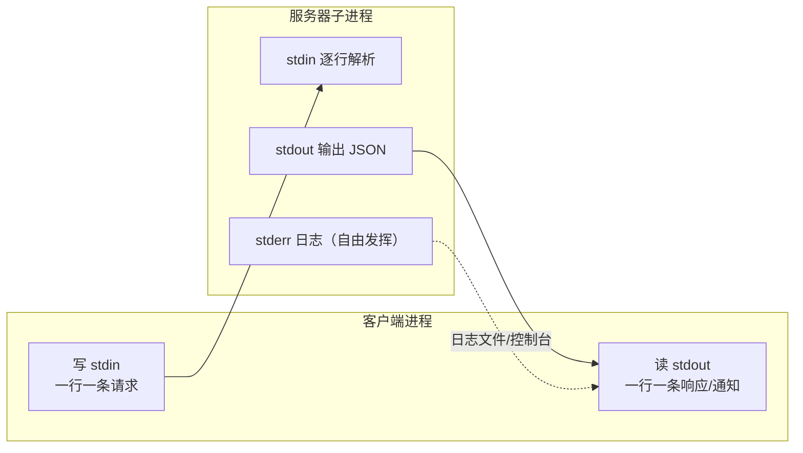
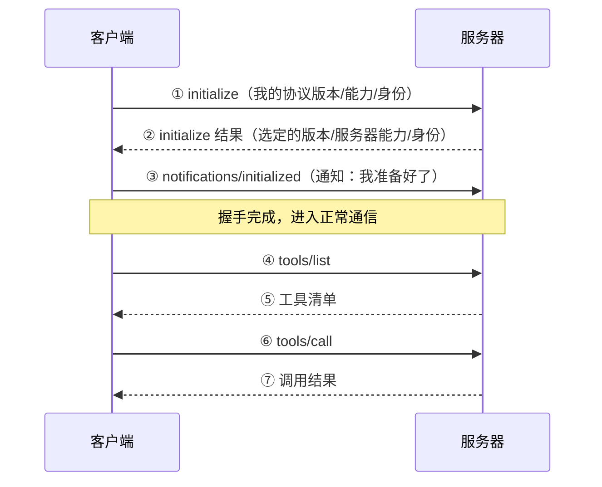
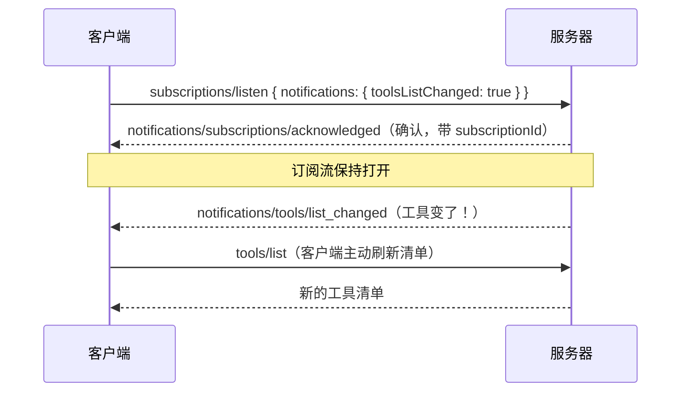
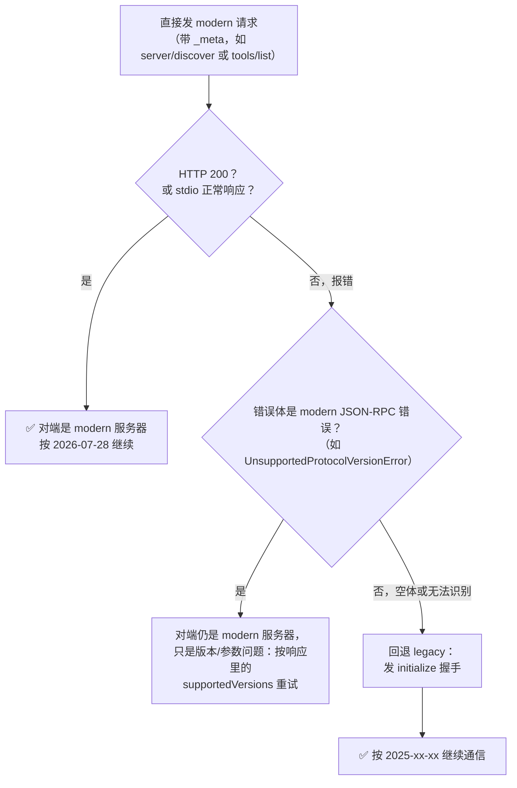

# 03 - 协议内核：JSON-RPC 与消息流（全系列的灵魂篇）

> 用 65 行手写代码，不借任何 SDK，与你的 MCP 服务器完成一次完整对话。
> 看完本篇，"MCP" 对你来说不再是黑盒概念，而是你亲手写过的每一行 JSON。

[← 上一篇：第一个 MCP Server](02-第一个MCPServer.md) · [目录](README.md) · [下一篇：传输层 →](04-传输层stdio与StreamableHTTP.md)

---

## 1. 为什么要懂协议层

SDK 三行代码就能注册工具，为什么还要花一章学协议？因为**排错发生在协议层，而 SDK 把协议层藏起来了**。真实的开发场景：

- 服务器日志正常、客户端却说连接失败——你想知道消息到底发出去了没有；
- 报错 `-32602 Invalid params`——你需要读懂这是哪条消息缺了什么；
- 网上教程教的 `initialize` 握手，你的 SDK 版本里根本找不到这个 API——你需要分清"协议时代的差异"。

MCP 官方文档说得很直白：SDK 抽象掉了大部分细节，但**数据层协议是开发者最该理解的部分**。本章就把这层掀开。

## 2. JSON-RPC 2.0 速成：MCP 的通用语

MCP 数据层 100% 建立在 [JSON-RPC 2.0](https://www.jsonrpc.org/specification) 上。这不是 MCP 发明的协议，而是一个存在 15 年、被广泛使用的轻量 RPC 规范——好消息是你学一次终身受用。

### 2.1 三种消息

**① 请求（Request）**——带 `id`，期待响应：

```json
{
  "jsonrpc": "2.0",
  "id": 1,
  "method": "tools/list",
  "params": {}
}
```

**② 响应（Response）**——用相同的 `id` 关联请求，要么 `result` 要么 `error`（二选一）：

```json
{
  "jsonrpc": "2.0",
  "id": 1,
  "result": { "tools": [ ... ] }
}
```

```json
{
  "jsonrpc": "2.0",
  "id": 2,
  "error": { "code": -32602, "message": "Invalid params: ..." }
}
```

**③ 通知（Notification）**——**没有 `id` 字段**，单向发送、不期待任何响应：

```json
{
  "jsonrpc": "2.0",
  "method": "notifications/initialized"
}
```

`id` 的有无是三种消息的分水岭：有 `id` 是请求，带 `result`/`error` 是响应，两者皆无是通知。之后读任何 MCP 消息，先看这三个字段就能判断它是谁、想干什么。

### 2.2 错误码体系

| 码 | 名字 | 什么时候出现 |
|---|---|---|
| `-32700` | Parse error | JSON 本身格式错了（比如 stdout 被日志污染） |
| `-32600` | Invalid request | 不是合法的 JSON-RPC 消息 |
| `-32601` | Method not found | 调了服务器没实现的方法 |
| `-32602` | Invalid params | 参数缺失/类型错（比如缺 `_meta`） |
| `-32603` | Internal error | 服务器内部异常 |
| `-32020` | HeaderMismatch（MCP 扩展） | HTTP 头与请求体不一致（04 篇实测） |

MCP 自定义错误码在 `-32020` ~ `-32060` 区间。排错第一步永远是看 `error.code` 和 `error.message`。

## 3. stdio 传输的帧格式：一行一条 JSON

协议规定了**说什么**（JSON-RPC），传输层规定**怎么送达**。stdio 传输极其简单粗暴：

- 客户端启动服务器**子进程**；
- 每条 JSON-RPC 消息就是**一行文本**（UTF-8，以 `\n` 结尾），客户端写进服务器进程的 stdin；
- 服务器同样按行把响应/通知写到 stdout；
- 服务器的日志走 stderr（不参与协议）。



用记事本思维看就是"两个进程互相贴纸条，一张纸条一行"。这个模型简单到可以徒手实现——第 6 节我们就干这个。

> 为什么 stdout 是雷区，现在从协议层看就彻底明白了：stdout 上的每一行都会被客户端 `JSON.parse`，一行"Server started at 2026-11-19"就会让解析器当场翻车（`-32700`）。

## 4. legacy 时代：initialize 握手（必须能读懂）

≤2025-11-25 的协议是**有状态**的：连接建立后，客户端必须先握手，服务器才知道"你是谁、你能什么、我们说哪个版本的协议"。

完整握手序列（这就是 mini-client 实际发出的消息）：



①的完整消息长这样：

```json
{
  "jsonrpc": "2.0",
  "id": 1,
  "method": "initialize",
  "params": {
    "protocolVersion": "2025-11-25",
    "capabilities": { "elicitation": {} },
    "clientInfo": { "name": "mini-client", "version": "1.0.0" }
  }
}
```

- `protocolVersion`：客户端说"我支持这个版本"，服务器响应里返回**最终选定**的版本（协商结果）。
- `capabilities`：客户端声明自己支持哪些客户端侧特性（比如能处理 elicitation）。服务器响应里同样带 `capabilities`，声明 tools/resources/prompts 等。**双方都不会调用对方没声明的能力**。
- `clientInfo`：名字和版本，纯调试用途。

为什么要读懂 legacy？三个理由：① 海量存量服务器还是旧协议；② SDK 底层兼容逻辑会"探测-回退"到握手模式；③ 读懂它你才明白 2026-07-28 到底改了什么。

## 5. modern 时代：无状态设计与 `_meta`

2026-07-28 把协议翻新成**无状态**：每个请求自带处理所需的全部元数据，服务器不从历史消息里推断任何东西。变化体现在三处：

### 5.1 每个请求都带 `_meta` 信封

```json
{
  "jsonrpc": "2.0",
  "id": 2,
  "method": "tools/call",
  "params": {
    "name": "add_todo",
    "arguments": { "text": "买牛奶" },
    "_meta": {
      "io.modelcontextprotocol/protocolVersion": "2026-07-28",
      "io.modelcontextprotocol/clientInfo": {
        "name": "example-client", "version": "1.0.0"
      },
      "io.modelcontextprotocol/clientCapabilities": { "elicitation": {} }
    }
  }
}
```

`_meta` 里的三个 `io.modelcontextprotocol/*` 键就是原来握手携带的信息——版本、身份、能力——现在**每条请求都重申一遍**。缺了它，服务器会直接拒绝（04 篇实测报错 `-32602 ... missing the required per-request envelope key(s): _meta`）。

无状态带来实际收益：HTTP 场景下任何一台无粘性会话的负载均衡节点都能处理任意请求；中间件（网关、监控）无需解析完整会话即可路由。

### 5.2 `server/discover`：一次拿全服务器信息

握手变成了一个**可选、可缓存**的普通请求：

```json
{
  "jsonrpc": "2.0",
  "id": 1,
  "method": "server/discover",
  "params": {
    "_meta": {
      "io.modelcontextprotocol/protocolVersion": "2026-07-28",
      "io.modelcontextprotocol/clientInfo": { "name": "example-client", "version": "1.0.0" },
      "io.modelcontextprotocol/clientCapabilities": {}
    }
  }
}
```

响应（官方示例）：

```json
{
  "jsonrpc": "2.0",
  "id": 1,
  "result": {
    "resultType": "complete",
    "supportedVersions": ["2026-07-28"],
    "capabilities": {
      "tools": { "listChanged": true },
      "resources": {}
    },
    "_meta": {
      "io.modelcontextprotocol/serverInfo": { "name": "example-server", "version": "1.0.0" }
    },
    "ttlMs": 3600000,
    "cacheScope": "public"
  }
}
```

解读三个新字段：

- `supportedVersions`：服务器支持的版本列表，客户端按需重试；
- `ttlMs` / `cacheScope`：**协议级缓存**——这个响应可缓存 1 小时、可公开共享。对多客户端访问的热门远程服务器，发现结果根本不用每次现查；
- `capabilities.tools.listChanged: true`：声明"工具列表可能变化，我支持变更通知"，对应 5.3 的订阅。

### 5.3 通知改为订阅制

旧协议里服务器想发通知就发；新协议改成**客户端先订阅、服务器只推送订阅过的类型**：



注意最后两步：通知只负责"喊一声"，**客户端收到后仍要自己重新 `tools/list`**——通知不携带数据本体（best-effort，传输断了就丢，客户端需容忍）。

### 5.4 双时代协商：客户端的探测流程

一个客户端怎么同时兼容两种服务器？官方规范给出的流程：



`serveStdio` 等入口帮你的服务器自动实现了对端的等价逻辑。这也是 02 篇双时代测试能同时通过的原因。

## 6. 实操：65 行手写 MCP 客户端

现在亲手验证上面的一切。**不安装任何 MCP 依赖**，只靠 Node 内置模块，与 02 篇的待办服务器完成完整对话。

新建 `mini-client.mjs`（本系列配套仓库里位于 `lab/src/mini-client.mjs`）：

```javascript
// 迷你 MCP 客户端：不依赖任何 SDK，只靠 Node 原生能力完成一次完整的 MCP 对话。
// 运行：node mini-client.mjs build/todo-server.js

import { spawn } from "node:child_process";

const serverPath = process.argv[2];
if (!serverPath) {
  console.error("用法：node mini-client.mjs <server.js 路径>");
  process.exit(1);
}

// ---------- 第 1 步：把 MCP 服务器当作子进程启动，接上它的 stdin/stdout ----------
const child = spawn("node", [serverPath], { stdio: ["pipe", "pipe", "inherit"] });

let buffer = "";
const pending = new Map(); // id -> resolve
child.stdout.on("data", (chunk) => {
  buffer += chunk.toString();
  let newlineIndex;
  // MCP 的 stdio 传输：每条消息就是一行 JSON
  while ((newlineIndex = buffer.indexOf("\n")) !== -1) {
    const line = buffer.slice(0, newlineIndex).trim();
    buffer = buffer.slice(newlineIndex + 1);
    if (!line) continue;
    const message = JSON.parse(line);
    if (message.id !== undefined && pending.has(message.id)) {
      pending.get(message.id)(message);
      pending.delete(message.id);
    } else {
      // 没有 id 的消息 = 通知，服务器单方面发来，不需要回答
      console.error("← [通知]", JSON.stringify(message));
    }
  }
});

let nextId = 0;
function send(message) {
  child.stdin.write(JSON.stringify(message) + "\n");
}

// 发送请求并等待"同 id"的响应（JSON-RPC 的请求-响应关联机制）
function request(method, params) {
  return new Promise((resolve, reject) => {
    const id = ++nextId;
    pending.set(id, resolve);
    send({ jsonrpc: "2.0", id, method, params });
  });
}

// ---------- 第 2 步：legacy 时代握手（initialize → 通知 initialized） ----------
const init = await request("initialize", {
  protocolVersion: "2025-11-25",
  capabilities: {},
  clientInfo: { name: "mini-client", version: "1.0.0" },
});
console.error("→ 握手成功，服务器版本支持:", init.result.protocolVersion);
send({ jsonrpc: "2.0", method: "notifications/initialized" }); // 通知，无 id、无响应

// ---------- 第 3 步：发现工具 ----------
const tools = await request("tools/list", {});
console.error("→ 服务器提供的工具:", tools.result.tools.map((t) => t.name).join(", "));

// ---------- 第 4 步：调用工具 ----------
const addResult = await request("tools/call", {
  name: "add_todo",
  arguments: { text: "读完《深入理解 MCP》第 3 章" },
});
console.error("→ add_todo 结果:", addResult.result.content[0].text);

const listResult = await request("tools/call", {
  name: "list_todos",
  arguments: { filter: "open" },
});
console.error("→ list_todos 结果:", listResult.result.content[0].text);

// ---------- 第 5 步：收尾 ----------
child.stdin.end();
await new Promise((resolve) => child.on("close", resolve));
console.error("连接已关闭");
```

运行（02 篇的项目编译产物；配套仓库里在 `lab/` 下执行）：

```cmd
node src/mini-client.mjs build/todo-server.js
```

**实测输出**：

```
todo MCP server running on stdio
→ 握手成功，服务器版本支持: 2025-11-25
→ 服务器提供的工具: add_todo, list_todos, complete_todo, delete_todo
→ add_todo 结果: 已添加 [1] 读完《深入理解 MCP》第 3 章
→ list_todos 结果: [1] ⬜ 读完《深入理解 MCP》第 3 章
连接已关闭
```

### 6.1 这 65 行里藏着 MCP 客户端的全部骨架

| 代码段 | 对应协议概念 |
|---|---|
| `spawn(...)` + `stdio: ["pipe","pipe","inherit"]` | stdio 传输：子进程 + 三条标准流（stderr 直接透传到控制台） |
| `buffer` + 按 `\n` 切分 | 传输层的"一行一条消息"帧格式 |
| `pending` Map + `id` 匹配 | JSON-RPC 请求-响应关联 |
| `message.id !== undefined` 判断 | 三种消息的分型（请求/响应/通知） |
| `request("initialize", ...)` | legacy 握手（02 篇的 `serveStdio` 在对面接住了它） |
| `notifications/initialized` 无 id 直发 | 通知语义 |
| `tools/list` → `tools/call` | 原语的两段式：先发现、再使用 |

### 6.2 升级实验：把 mini-client 改成 modern 客户端

把手里的工具练熟练——三个改法，每个都是一次协议练习：

1. **去掉握手直接通信**：删掉第 2 步，直接发 `tools/list`（带 `_meta` 信封）。实测可行——`server/discover` 本来就是可选的，`serveStdio` 能接住 modern 请求。
2. **改调 `server/discover`**：观察响应里的 `capabilities`、`ttlMs`、`cacheScope`（04 篇有完整实测报文）。
3. **制造协议错误**：`tools/call` 时故意不带 `_meta`、调一个不存在的工具名 `hello`，观察服务器返回的 `-32602` 和 `-32601` 错误体——亲手造出第 2 节错误码表里的每一种错误。

> 建议把 mini-client 保存为长期排错工具：任何"SDK 连不上"的问题，先跑一次 mini-client，把协议层行为和 SDK 层行为分开看，问题立刻收敛一半。

## 7. 消息速查表（收藏备用）

### 7.1 服务器实现的方法（客户端 → 服务器）

| 方法 | 作用 | 归属 |
|---|---|---|
| `server/discover` | 查询服务器身份/能力/支持版本（modern，可选） | 发现 |
| `initialize` | 握手协商（legacy，必经） | 发现 |
| `tools/list` / `tools/call` | 工具发现 / 工具调用 | Tools |
| `resources/list` / `resources/read` | 资源发现 / 读取 | Resources |
| `resources/subscribe` / `resources/unsubscribe` | 订阅某资源变更 | Resources |
| `prompts/list` / `prompts/get` | 提示模板发现 / 获取 | Prompts |
| `completion/complete` | 参数自动补全建议 | Utilities |
| `subscriptions/listen` | 开启通知订阅流（modern） | Notifications |
| `ping` | 心跳探测 | Utilities |

### 7.2 服务器发出的通知（无 id）

| 通知 | 触发时机 |
|---|---|
| `notifications/tools/list_changed` | 工具清单变化（需订阅） |
| `notifications/resources/list_changed` | 资源清单变化 |
| `notifications/resources/updated` | 某个被订阅的资源内容变了 |
| `notifications/prompts/list_changed` | 提示模板清单变化 |
| `notifications/progress` | 长操作的进度（随响应流走） |
| `notifications/initialized` | **客户端发的**：legacy 握手完成 |
| `notifications/cancelled` | **客户端发的**：取消某个请求（仅 stdio） |

### 7.3 客户端实现的方法（服务器 → 客户端，经 MRTR）

| 方法 | 作用 |
|---|---|
| `elicitation/create` | 向用户征求输入/确认（06 篇详解） |

## 8. 踩坑 FAQ

**Q1：我的服务器响应请求很慢，客户端超时了，协议层有什么办法？**
正常响应之外，服务器可以在最终响应前先发 `notifications/progress`（带 progressToken），客户端显示进度条（05 篇实操）。本质上 JSON-RPC 没有超时语义，超时是客户端实现的行为，可通过 SDK 配置调整。

**Q2：`_meta` 和 JSON-RPC 的 `params` 是什么关系？会不会冲突？**
`_meta` 是每个请求/结果对象上的保留字段，MCP 用它装协议元数据（版本/身份/能力/订阅 id 等），业务参数在 `params` 里。JSON-RPC 规范不认识 `_meta`，MCP 层做了扩展约定。自己扩展协议时也把自定义键放进 `_meta`（键名用反向域名格式）。

**Q3：为什么我照网上教程写的 `initialize` 握手，对面 SDK 服务器没反应？**
最常见原因：`protocolVersion` 日期服务器不支持。用 mini-client 实验过就懂——服务器会在 initialize 响应里返回它选定的版本，且 2026-07-28 服务器对未知版本有明确的拒绝/降级逻辑。对照报错里的 `supportedVersions` 改请求。

**Q4：JSON-RPC 能批量发请求吗（一次发送数组）？**
JSON-RPC 2.0 规范支持批量，但 MCP 明确不使用批量——stdio 一行一条，HTTP 一 POST 一条。别在 MCP 里用批量，省得两边都懵。

**Q5：客户端发的 `notifications/initialized` 我的服务器要处理吗？**
用 SDK 就不用管（框架处理）。手写协议层时，它只是个"流程标记"，收到后从"握手阶段"切到"正常阶段"即可，**不需要回复**（通知无 id）。

**Q6：stdio 下消息超大（比如工具返回一张大图）怎么办？**
帧格式对长度无限制（一行可以很长），但受双方缓冲区限制（SDK 默认 10MB，可配）。大内容更推荐拆分或改用资源链接引用（05 篇）。

## 参考链接

- [JSON-RPC 2.0 规范](https://www.jsonrpc.org/specification)
- [MCP 规范：基本协议（2026-07-28）](https://modelcontextprotocol.io/specification/2026-07-28/basic)（含无状态设计、错误码）
- [版本协商与向后兼容](https://modelcontextprotocol.io/specification/2026-07-28/basic/versioning)
- [server/discover 规范](https://modelcontextprotocol.io/specification/2026-07-28/server/discover)
- [订阅模式规范](https://modelcontextprotocol.io/specification/2026-07-28/basic/patterns/subscriptions)
- [本系列配套 mini-client 代码](lab/src/mini-client.mjs)

---

**下一篇**进入传输层：stdio 与 Streamable HTTP 全面对比，用 curl 裸调 MCP 服务器，把服务器从本地推到远程。

[← 上一篇：第一个 MCP Server](02-第一个MCPServer.md) · [目录](README.md) · [下一篇：传输层 →](04-传输层stdio与StreamableHTTP.md)
