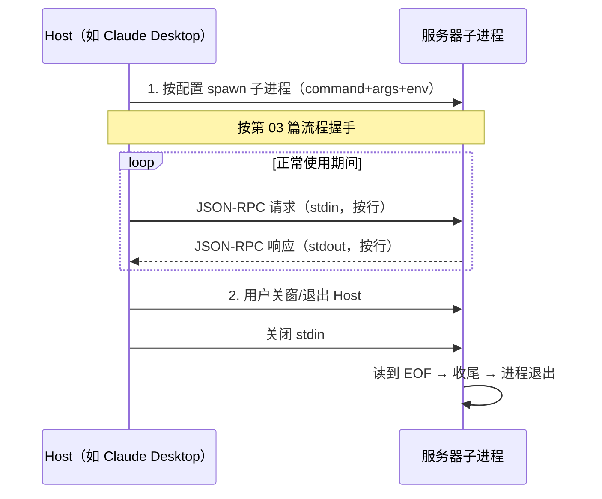
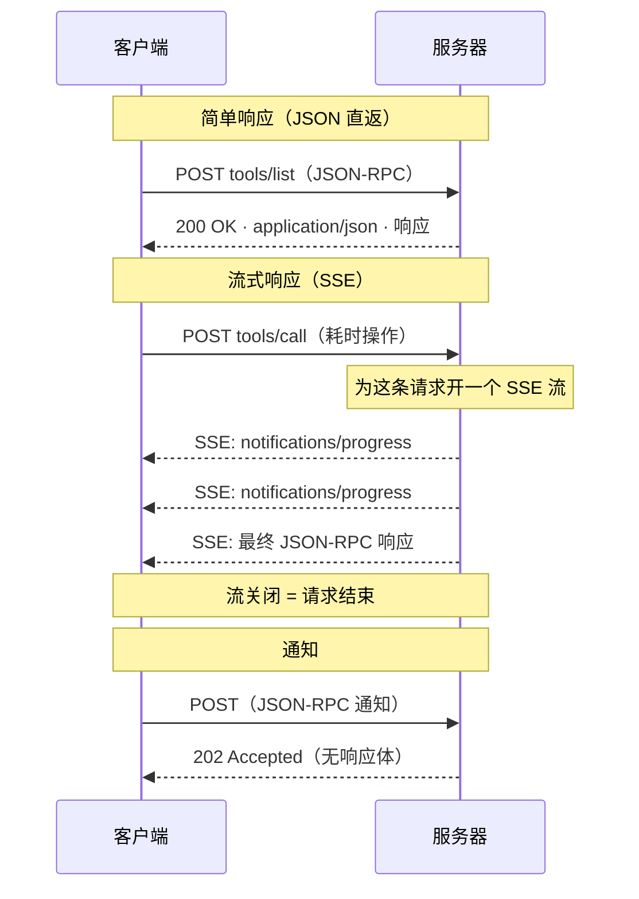

# 04 - 传输层：stdio 与 Streamable HTTP

> 同一份业务代码，如何既是本地子进程、又是远程 HTTP 服务？
> 本篇用 curl 裸调 MCP 服务器（所有报文均为实测），把传输层彻底讲透。

[← 上一篇：协议内核](03-协议内核JSONRPC与消息流.md) · [目录](README.md) · [下一篇：三大原语深入 →](05-服务器进阶三大原语深入.md)

---

## 1. 为什么传输层值得单独一章

第 03 篇讲清了"消息说什么"，传输层回答"消息怎么送到"。这不是实现细节——它是你**部署架构的决策点**：

- 你的工具只想给自己在 Claude Desktop 里用？→ stdio，5 分钟搞定；
- 你要给整个团队/多个 AI 应用共享一个工具服务？→ Streamable HTTP，涉及部署、认证、安全；
- 你被"连接超时""SSE 被 nginx 缓冲""403 Forbidden"卡住？→ 答案都在这一篇。

## 2. 两种传输全景对比

| 维度 | stdio | Streamable HTTP |
|---|---|---|
| 场景 | 本地个人工具 | 远程共享服务、Web 客户端 |
| 连接形态 | 子进程 stdin/stdout | HTTP POST 到单一 MCP 端点 |
| 生命周期 | 随客户端启停（客户端断开→进程退出） | 独立进程，长期运行，服务多个客户端 |
| 并发客户端 | 通常 1 个 | 多个 |
| 认证 | 无网络层认证（信任本机） | HTTP 认证（Bearer/API Key/OAuth） |
| 性能 | 最优（无网络开销） | 每请求一次 HTTP 往返 |
| 调试难度 | 需要 Inspector/子进程工具 | **curl 就能调**（最直观） |
| 典型报错 | stdout 污染、路径不对 | 403（Origin 校验）、-32020（头不匹配）、超时 |

**选型口诀**：个人本地用 stdio，共享远程用 HTTP。两者业务层代码完全一致——只换"启动入口"。

## 3. stdio 的生命周期与工程细节



工程要点：

1. **`env` 继承**：子进程默认继承客户端的环境变量（所以你可以用环境变量给服务器传配置，如 API Key）。手写 spawn 时若不显式继承，PATH 丢失会导致 node/java 找不到。
2. **工作目录**：子进程的工作目录默认继承客户端进程，**与服务器代码所在目录无关**——所以服务器代码里打开文件要用绝对路径，或在配置里显式设 `cwd`。
3. **Windows 陷阱**：`.cmd`/`.bat` 脚本（如全局安装的 `mcp-server-xxx.cmd`）在 spawn 时需要 shell 或显式全路径；官方客户端一般已处理，手写客户端要注意。
4. **优雅退出**：服务器收到 stdin EOF 后应尽快退出，不要留后台僵尸进程；SDK 已处理，自己手写时要记得。

## 4. Streamable HTTP 规范精读（2026-07-28 版）

### 4.1 核心模型：单端点 + 每消息一 POST

服务器只提供**一个** MCP 端点（如 `https://example.com/mcp`）。客户端把每条 JSON-RPC 消息作为独立的 HTTP POST 发出：



三个必须记住的规则：

1. **Accept 头必须同时声明两种类型**：`Accept: application/json, text/event-stream`——服务器自选回哪种，客户端两种都要支持；
2. **关闭 SSE 流 = 取消请求**。客户端断开连接，服务器应尽快停止工作（2026-07-28 用这种"连接即取消"替代了旧协议的 `notifications/cancelled` 通知）；
3. **长通知走订阅**：变更通知不在普通请求流上，客户端要发 `subscriptions/listen` 请求，其响应是一个**长开的 SSE 流**。

### 4.2 请求元数据头（2026-07-28 新增）

规范把关键 JSON-RPC 字段"镜像"到 HTTP 头，让网关/负载均衡**不解析请求体**就能路由：

| 头 | 来源 | 适用 |
|---|---|---|
| `MCP-Protocol-Version` | `_meta.protocolVersion` | 所有请求（必须） |
| `Mcp-Method` | `method` | 所有请求（必须） |
| `Mcp-Name` | `params.name` 或 `params.uri` | tools/call、resources/read、prompts/get |
| `Mcp-Param-{name}` | 标注了 `x-mcp-header` 的工具参数 | 按需 |

**为什么这么设计**：网络中间件可以按头做路由/限流/审计（例如按 `Mcp-Name` 限流某个工具），而不用解析并信任请求体。相应地，服务器**必须校验头与体一致**，防止"中间件按头路由、服务器按体执行"被利用——不一致就返回 `400 + -32020 HeaderMismatch`。

**实测样例**（本篇 6.2 节验证过的报文）：

```http
POST /mcp HTTP/1.1
Host: 127.0.0.1:3002
Content-Type: application/json
Accept: application/json, text/event-stream
MCP-Protocol-Version: 2026-07-28
Mcp-Method: tools/call
Mcp-Name: add_todo

{"jsonrpc":"2.0","id":2,"method":"tools/call","params":{"name":"add_todo","arguments":{"text":"验证 HTTP 传输"},"_meta":{...}}}
```

> 注意 `Mcp-Name` 等头值含非 ASCII 字符时需用 Base64 哨兵格式 `=?base64?...?=` 编码（SDK 客户端自动处理，手写时留意）。

### 4.3 对比：2025-11-25 及以前的 HTTP 有什么不同

| 机制 | ≤2025-11-25 | 2026-07-28 |
|---|---|---|
| 会话 | `Mcp-Session-Id` 响应头，客户端带回来，DELETE 端点结束会话 | **移除**（无状态） |
| GET 独立 SSE 流 | 有（接收服务器主动消息） | **移除** |
| 服务器在 SSE 流上发独立请求 | 允许 | 禁止（改走 MRTR） |
| 流断线续传 | `Last-Event-ID` | 不支持 |
| `notifications/cancelled` | HTTP 上可用 | 不可用（断流即取消） |

看老代码时按这张表"翻译"。SDK 的处理：`NodeStreamableHTTPServerTransport` 等类是 legacy 传输（实测仅支持 ≤2025-11-25 握手），`createMcpHandler` 是 modern 入口且自动兼容双时代。

### 4.4 必做的安全配置（规范强制/强烈建议）

1. **校验 `Origin` 头**：有 Origin 且非法 → 403（防 DNS rebinding：恶意网页让你的浏览器向 `http://127.0.0.1:3001/mcp` 发请求）；
2. **本地服务器只绑 127.0.0.1**，不要 0.0.0.0；
3. **远程服务器实施认证**（Bearer Token / OAuth，08 篇实操）。

## 5. 实操一：HTTP 版待办服务器（legacy 兼容模式）

同一个 todo 业务，换传输只需换"启动外壳"。新建 `todo-server-http.mjs`：

```javascript
// Streamable HTTP 版本（legacy 兼容模式）：
// NodeStreamableHTTPServerTransport 支持 2025-11-25 及以下协议握手
import { createServer } from "node:http";
import {
  localhostHostValidation,
  localhostOriginValidation,
  NodeStreamableHTTPServerTransport,
} from "@modelcontextprotocol/node";
import { McpServer } from "@modelcontextprotocol/server";
import { z } from "zod";

const todos = [];
let nextId = 1;

function createTodoServer() {
  const server = new McpServer({ name: "todo-http", version: "1.0.0" });
  server.registerTool("add_todo", {
    title: "新增待办",
    description: "向待办清单中添加一条新待办事项",
    inputSchema: z.object({ text: z.string().min(1).describe("待办内容") }),
  }, async ({ text }) => {
    todos.push({ id: nextId++, text, done: false });
    return { content: [{ type: "text", text: `已添加 [${nextId - 1}] ${text}` }] };
  });
  server.registerTool("list_todos", {
    title: "列出待办",
    description: "列出当前所有待办事项",
    inputSchema: z.object({}),
  }, async () => {
    const lines = todos.map((t) => `[${t.id}] ${t.done ? "✅" : "⬜"} ${t.text}`);
    return { content: [{ type: "text", text: lines.join("\n") || "（空）" }] };
  });
  return server;
}

// ---------- 安全护栏（规范要求：校验 Origin，绑定 127.0.0.1） ----------
const validateHost = localhostHostValidation();
const validateOrigin = localhostOriginValidation();

createServer(async (req, res) => {
  if (!validateHost(req, res) || !validateOrigin(req, res)) return;

  // 无状态模式：每个请求独立创建 server/transport 对
  const server = createTodoServer();
  const transport = new NodeStreamableHTTPServerTransport({ sessionIdGenerator: undefined });
  await server.connect(transport);
  await transport.handleRequest(req, res);
}).listen(3001, "127.0.0.1", () => {
  console.error("todo MCP server (Streamable HTTP) on http://127.0.0.1:3001/mcp");
});
```

要点：`sessionIdGenerator: undefined` 表示不启用协议级会话（每请求独立一对 server/transport）——这是无状态部署的标准姿势。

### 5.1 curl 调试：亲眼看到协议

把请求体存成文件 `init-request.json`：

```json
{"jsonrpc":"2.0","id":1,"method":"initialize","params":{"protocolVersion":"2025-11-25","capabilities":{},"clientInfo":{"name":"curl","version":"1.0.0"}}}
```

启动服务器，然后（Windows CMD 下 JSON 含引号，务必用 `--data-binary @文件` 而不是内联字符串）：

```cmd
node todo-server-http.mjs
:: 另开一个终端
curl -s -X POST http://127.0.0.1:3001/mcp -H "Content-Type: application/json" -H "Accept: application/json, text/event-stream" --data-binary @init-request.json
```

**实测响应**：

```
event: message
data: {"result":{"protocolVersion":"2025-11-25","capabilities":{"tools":{"listChanged":true}},"serverInfo":{"name":"todo-http","version":"1.0.0"}},"jsonrpc":"2.0","id":1}

HTTP/1.1 200 OK
content-type: text/event-stream
x-accel-buffering: no
```

两个观察点：
- 响应是 **SSE 流**（`event:`/`data:` 帧）而非裸 JSON——这就是"Streamable"的含义：服务器可以选择流式应答；
- `x-accel-buffering: no` 头是规范建议的：告诉 nginx 等反代**不要缓冲**此响应。

继续用 `tools/call` 请求文件 POST 一次，实测得到：

```
event: message
data: {"result":{"content":[{"type":"text","text":"已添加 [1] 验证 HTTP 传输"}]},"jsonrpc":"2.0","id":2}
```

> **为什么用 curl 学协议最好**：报文一级一级全是明文，SSE 帧、状态码、响应头一览无余。以后遇到"SDK 连不上"，先用 curl 裸调一次定位是传输问题还是协议问题。

## 6. 实操二：现代无状态模式（2026-07-28）

新建 `todo-server-http2.mjs`——业务代码一个字不改，换用 `createMcpHandler`：

```javascript
// 现代无状态 HTTP 服务器（2026-07-28 风格）：
// createMcpHandler(工厂) → fetch handler → toNodeHandler 挂到 node:http
import { createServer } from "node:http";
import { toNodeHandler } from "@modelcontextprotocol/node";
import { createMcpHandler, McpServer } from "@modelcontextprotocol/server";
import { z } from "zod";

const todos = [];
let nextId = 1;

// 工厂：createMcpHandler 每个请求都会调用一次，必须返回全新实例
function createTodoServer(ctx) {
  const server = new McpServer({ name: "todo-http2", version: "1.0.0" });
  server.registerTool(/* …与 5 节完全相同的两个工具，此处省略… */);
  return server;
}

// createMcpHandler 返回 web 标准 fetch handler，自动兼容 modern + legacy 双时代
const handler = createMcpHandler(createTodoServer);

createServer(toNodeHandler(handler)).listen(3002, "127.0.0.1", () => {
  console.error("todo MCP server (modern) on http://127.0.0.1:3002/mcp");
});
```

API 三件套，各司其职：

| API | 角色 |
|---|---|
| `createMcpHandler(factory)` | 协议入口：每请求调一次工厂，内含 modern/legacy 自动兼容、`_meta` 校验、元数据头校验 |
| `toNodeHandler(handler)` | 适配层：web 标准 `fetch` handler → Node `(req,res)` |
| `localhostHostValidation()` 等 | 安全护栏（生产可换成自定义白名单版本） |

### 6.1 curl 实测：modern 协议全程

**① tools/list**（请求体带 `_meta` 信封，存 `tools-list-request.json`）：

```cmd
curl -s -X POST http://127.0.0.1:3002/mcp -H "Content-Type: application/json" -H "Accept: application/json, text/event-stream" -H "MCP-Protocol-Version: 2026-07-28" -H "Mcp-Method: tools/list" --data-binary @tools-list-request.json
```

实测响应（注意三个新字段）：

```json
{
  "result": {
    "tools": [ ...4 个工具... ],
    "resultType": "complete",
    "ttlMs": 0,
    "cacheScope": "private",
    "_meta": { "io.modelcontextprotocol/serverInfo": { "name": "todo-http2", "version": "1.0.0" } }
  },
  "jsonrpc": "2.0", "id": 1
}
```

**② tools/call**（请求体务必带 `_meta`，存 `tools-call-modern-request.json`）：

```cmd
curl -s -X POST http://127.0.0.1:3002/mcp -H "Content-Type: application/json" -H "Accept: application/json, text/event-stream" -H "MCP-Protocol-Version: 2026-07-28" -H "Mcp-Method: tools/call" -H "Mcp-Name: add_todo" --data-binary @tools-call-modern-request.json
```

实测：`{"result":{"content":[{"type":"text","text":"已添加 [1] 验证 HTTP 传输"}],"resultType":"complete",...},"jsonrpc":"2.0","id":2}` ✅

### 6.2 三个"故意犯错"实验（实测报错）

**实验①：请求体忘带 `_meta`**（去掉 `_meta` 字段重发）：

```json
{"jsonrpc":"2.0","error":{"code":-32602,"message":"Invalid params: the MCP-Protocol-Version header names protocol revision 2026-07-28, but the request is missing the required per-request envelope key(s): _meta","data":{"envelope":{"missing":["_meta"]}}},"id":2}
```

→ `error.data.envelope.missing` 精确告诉缺什么。**手写 HTTP 客户端最常见的错就是忘了 `_meta`**。

**实验②：头与体不一致**（`Mcp-Name: wrong_name`，体里是 `add_todo`）：

```json
{"jsonrpc":"2.0","error":{"code":-32020,"message":"Bad Request: the request headers and body disagree: the body carries params.name=\"add_todo\" but the Mcp-Name header names \"wrong_name\"","data":{...}},"id":2}
```

→ `-32020 HeaderMismatch` 如规范所述被严格执行。这既是安全特性也是排错线索：看到 -32020，对照报文里的 `data.mismatch` 检查头的生成逻辑。

**实验③：wrong `MCP-Protocol-Version`**（如改成 `2099-01-01`）→ `400 + UnsupportedProtocolVersionError`，响应里列服务器支持的版本，客户端据此重试（03 篇协商流程的真实形态）。

## 7. 从本地到远程：部署要点清单

把 3002 端口的服务器搬到真实服务器上，按这张清单逐项核对：

| 项目 | 做法 |
|---|---|
| 绑定地址 | 生产必须 0.0.0.0 时，前面必须有认证层；纯内网工具可继续 127.0.0.1 + 隧道 |
| 反向代理 | nginx 配 `proxy_buffering off;`（或信任服务器发的 `X-Accel-Buffering: no`）；SSE 流的 `proxy_read_timeout` 调大 |
| Origin 校验 | 从 `localhostOriginValidation()` 换成 `originValidation(["你的域名"])` |
| 认证 | 最简：网关注入 API Key，服务器校验 `Authorization` 头（08 篇实操 OAuth 全流程） |
| 优雅启停 | 容器化部署用 SIGTERM 触发 handler.close() 清理长连接 |
| 健康检查 | 对 `/mcp` POST 一个 `ping` 方法（JSON-RPC 心跳），200 即健康 |
| 多实例扩展 | 无状态模式（本篇写法）天然可水平扩展；legacy 有会话模式需要粘性路由 |

> 规范明确：**不支持 `Last-Event-ID` 续传**。订阅流断了客户端要自己重新 `subscriptions/listen` + 主动拉一次数据补漏（best-effort 通知 + 轮询兜底）。

## 8. 踩坑 FAQ

**Q1：curl 直接调 MCP 报 400/403？**
400：缺 `MCP-Protocol-Version`/`Mcp-Method` 头，或体里缺 `_meta`（modern 模式）。403：Origin 校验拒绝——curl 默认不发 Origin 头所以能过；浏览器发的 Origin 不在白名单就 403。分不清时先看响应体，modern 服务器会返回带 `error.code` 的 JSON。

**Q2：SSE 流收不到数据，卡住直到超时？**
九成是反向代理在缓冲。nginx 加 `proxy_buffering off`，或确认服务器响应带了 `X-Accel-Buffering: no`（本篇实测两处都有）。CDN/企业网关同理。

**Q3：为什么我的服务器每请求都新建实例，两个工具间"记不住"上一次的数据？**
无状态模式按请求创建 server/transport，**业务状态要放在实例外面**（模块级变量、数据库、Redis）。本篇 `todos`/`nextId` 就在工厂函数外面——刻意的设计，不是疏忽。需要"会话内记忆"的场景，用外置存储；多用户隔离与状态外置的完整实现见 **11 篇**。

**Q4：stdio 服务器在 Claude Desktop 里配置了就是连不上，HTTP 反而通？**
优先查 spawn 三要素：command 是否全路径（`where node`）、args 是否绝对路径、配置 JSON 是否被正确加载（彻底重启客户端）。还可以用 Inspector 直接跑同一命令行，二分定位是"客户端配置问题"还是"服务器问题"。

**Q5：能不能既支持 stdio 又支持 HTTP？**
能，而且几乎免费：业务函数抽成独立模块，两个入口文件分别 `serveStdio(createServer)` 和 `createServer(toNodeHandler(createMcpHandler(createServer)))`。官方很多服务器就是这么发行的（一个包两种用法）。

**Q6：流式响应（SSE）什么时候会自动出现？**
`responseMode` 默认 `auto`：handler 在最终响应**之前**发出了相关消息（比如 progress），响应自动升级成 SSE 流；没有中间消息就直返 JSON。想强制流式/禁止流式，用 `responseMode: "sse" | "json"` 显式控制。

## 参考链接

- [规范：Streamable HTTP（2026-07-28）](https://modelcontextprotocol.io/specification/2026-07-28/basic/transports/streamable-http)（本篇规范依据）
- [规范：stdio](https://modelcontextprotocol.io/specification/2026-07-28/basic/transports/stdio)
- [规范：向后兼容](https://modelcontextprotocol.io/specification/2026-07-28/basic/versioning)
- [TS SDK @modelcontextprotocol/node 包](https://github.com/modelcontextprotocol/typescript-sdk)
- [本篇配套代码](lab/src/todo-server-http.mjs) · [现代版](lab/src/todo-server-http2.mjs)

---

**下一篇**回到服务器侧做深水区：三大原语的工程化设计、结构化输出、进度通知与动态工具列表。

[← 上一篇：协议内核](03-协议内核JSONRPC与消息流.md) · [目录](README.md) · [下一篇：三大原语深入 →](05-服务器进阶三大原语深入.md)
