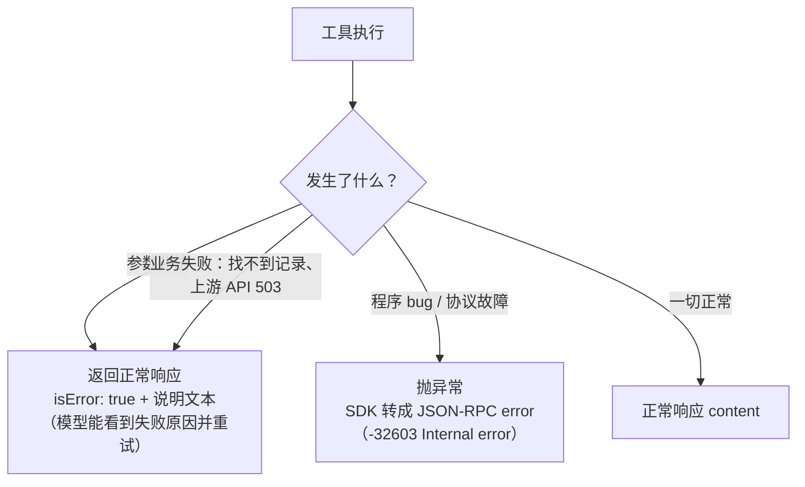

# 05 - 服务器进阶：三大原语深入

> 第 02 篇你只会写 Tools；本篇把 Tools 写"专业"（注解、结构化输出、进度、动态列表），
> 再补齐 Resources 和 Prompts，让一个服务器三原语齐备。所有 API 均基于 TS SDK v2.4.0 实测。

[← 上一篇：传输层](04-传输层stdio与StreamableHTTP.md) · [目录](README.md) · [下一篇：Elicitation 与 MRTR →](06-进阶交互Elicitation与MRTR.md)

---

## 1. 三大原语的"控制权"思维（设计总纲）

开始写代码前，先把 01 篇那张控制权表焊进脑子——**选错原语是 MCP 设计的头号失误**：

| 你要提供的东西 | 正确原语 | 反例（错误设计） |
|---|---|---|
| 执行操作：查库、发消息、部署 | **Tool** | 把"查询数据库"做成 Resource——模型没法主动调 |
| 提供上下文：文件内容、表结构、配置 | **Resource** | 把"项目规范文档"做成 Tool——模型要凭空猜调用时机 |
| 固定工作流：代码评审模板、周报生成 | **Prompt** | 把评审流程写进 Tool 的 description——浪费上下文且不可复用 |

一句话判据：**模型要"做"→Tool；应用要"读"→Resource；用户要"点"→Prompt。**

## 2. Tools 深入：从"能用"到"专业"

### 2.1 注解（annotations）：给客户端的行为提示

工具可以携带一组**提示性注解**，客户端据此调整交互（比如只读工具免确认）：

| 注解 | 含义 | 典型默认 |
|---|---|---|
| `title` | 人类可读名（区别于机器名 `name`） | — |
| `readOnlyHint` | 是否只读不写 | false |
| `destructiveHint` | 是否有破坏性（写/删） | true |
| `idempotentHint` | 重复调用结果是否相同 | false |
| `openWorldHint` | 是否与外部世界交互（联网等） | true |

```typescript
server.registerTool(
  "list_todos",
  {
    description: "列出待办",
    annotations: {
      title: "查看待办清单",
      readOnlyHint: true,        // 客户端可因此不弹确认框
      idempotentHint: true,      // 连点两次也无副作用
      destructiveHint: false,
    },
    inputSchema: z.object({ /* … */ }),
  },
  handler,
);
```

> 注解是 **hint 不是 guarantee**（模型可能说谎），客户端可以据此优化体验，但安全关键操作仍要靠人确认（08 篇）。

### 2.2 结构化输出（outputSchema）：给程序消费的双通道结果

文本 `content` 是给模型读的；当工具结果还要被**程序**二次处理（画图表、写文件、喂给下游 API）时，给模型解析 JSON 文本既浪费 token 又不可靠。`2025-06-18` 起协议支持**双通道**：

```typescript
server.registerTool(
  "structured_stats",
  {
    title: "结构化统计",
    description: "返回待办统计的结构化数据（演示 outputSchema）",
    inputSchema: z.object({}),
    // 声明输出的 JSON 形状——客户端可据此做类型校验
    outputSchema: z.object({
      total: z.number().describe("总数"),
      done: z.number().describe("已完成数"),
    }),
  },
  async () => {
    const output = { total: 3, done: 1 };
    return {
      content: [{ type: "text", text: `共 ${output.total} 条，完成 ${output.done} 条` }],
      structuredContent: output,   // ← 机器可读通道
    };
  },
);
```

实测调用结果（Inspector）：

```json
{
  "structuredContent": {
    "total": 3,
    "done": 1
  },
  "content": [{ "type": "text", "text": "共 3 条，完成 1 条" }]
}
```

规范约定：声明了 `outputSchema` 的工具**应该**同时返回两通道——文本给模型、结构体给程序，且二者语义一致。

### 2.3 错误语义：`isError`、异常、以及"什么算错误"

三种结局要分清：



- **可恢复错误（isError）**：模型是"读者"，它看到"找不到编号 99"会尝试换参数重试。这类失败**必须**作为正常响应返回。
- **不可恢复错误（异常）**：代码 bug、内存爆了——抛出去，让协议层报 -32603，客户端决定是否重试整个调用。

Python SDK 还有对应的 `ToolError` 异常类型（会被框架转为 isError 响应），TS 里直接构造响应即可。

### 2.4 进度通知：让长操作"活起来"

耗时操作（>10 秒的爬取/批处理）应该发 `notifications/progress`。v2 SDK 的姿势——工具回调的**第二个参数** `extra`：

```typescript
server.registerTool(
  "slow_import",
  {
    description: "导入大文件（演示进度通知）",
    inputSchema: z.object({ path: z.string() }),
  },
  async ({ path }, extra) => {
    const total = 100;
    for (let i = 1; i <= total; i++) {
      await doOneChunk(path, i);                    // 你的业务
      await extra.mcpReq.notify({                    // ← 每步发一次进度
        method: "notifications/progress",
        params: { progressToken: extra.mcpReq.id, progress: i, total, message: `已处理 ${i}/${total}` },
      });
    }
    return { content: [{ type: "text", text: `导入完成 ${total} 块` }] };
  },
);
```

实测确认（Inspector 调用含 progress 的工具，服务器 stderr 打出 `progress 通知已发送`）。协议细节：

- `progressToken` 用于把通知关联到"哪个请求的进度"——客户端发起长请求时在 `_meta` 里给 token，SDK 用请求 id 兜底；
- 通知顺着**该请求的响应流**走（HTTP 模式下正是 04 篇说的"流式响应自动升级"）；
- 客户端要不要展示进度是它的自由，通知是 best-effort。

`extra.mcpReq` 实测结构（v2.4.0，legacy era）——**记住它，06 篇的 elicitation 也从这里出发**：

```
extra = {
  sessionId: "…",      // 连接标识
  mcpReq: {
    id,                // 请求 id
    method,            // "tools/call"
    requestState: fn,  // MRTR 多轮状态（06 篇）
    signal,            // AbortSignal：客户端取消时触发
    send, notify, log, // 发响应 / 发通知 / 记日志
    elicitInput: fn,   // 向用户要输入（06 篇主角）
    requestSampling: fn// 反向调 LLM（已弃用，勿用于新代码）
  },
  http: {…}            // HTTP 传输时的原生请求上下文
}
```

### 2.5 动态工具列表 + 变更通知

工具可以运行时增删（比如"连接了打印机才出现 `print` 工具"）。SDK 提供：

```typescript
// 某个事件发生后
await server.sendToolListChanged();   // 广播 tools/list_changed 通知
// 对应还有 sendResourceListChanged / sendPromptListChanged / sendResourceUpdated
```

订阅侧的协议流（客户端 `subscriptions/listen` → 确认 → 通知）在 03 篇 5.3 节讲过；客户端声明了 `tools.listChanged` 能力后，收到通知会重新拉取清单。**老协议（≤2025-11-25）下这个通知是服务器单方面推的**，SDK 已帮你抹平差异。

## 3. Resources 深入：静态 URI 与 URI 模板

### 3.1 注册静态资源

```typescript
server.registerResource(
  "config",                        // 资源名
  "todo://config",                 // 自定义 scheme 的 URI
  { title: "应用配置", mimeType: "application/json" },
  async (uri) => ({
    contents: [{ uri: uri.href, text: JSON.stringify({ maxTodos: 100, theme: "dark" }) }],
  }),
);
```

要点：
- **URI 由你定义**：`file://`、`postgres://`、`todo://` 都行——它只是标识符，客户端不解析它，只透传给 `resources/read`；
- `mimeType` 帮客户端决定怎么呈现/编码；
- read 回调返回 `contents` 数组，文本资源用 `text` 字段；二进制用 `blob`（Base64）。

### 3.2 URI 模板：一份资源 schema，N 个实例

数据库场景天然需要"每张表一个资源"。用 `ResourceTemplate`：

```typescript
import { ResourceTemplate } from "@modelcontextprotocol/server";

server.registerResource(
  "todo-item",
  new ResourceTemplate("todo://item/{id}", { list: undefined }),
  { title: "单条待办", mimeType: "application/json" },
  async (uri, { id }) => {
    const todo = todos.find((t) => t.id === Number(id));
    if (!todo) throw new Error(`todo ${id} not found`);
    return { contents: [{ uri: uri.href, text: JSON.stringify(todo) }] };
  },
);
```

客户端 `resources/list` 时会看到模板 `todo://item/{id}`，配合 `completion/complete` 还能对 `{id}` 做自动补全（实现补全回调后）。

### 3.3 资源订阅：`resources/updated` 推送

客户端可以订阅某个具体资源，服务器在内容变化时推送：

```typescript
// 内容变化的地方调用（例如另一个工具改了数据之后）
await server.sendResourceUpdated({ uri: "todo://config" });
```

协议流：客户端 `resources/subscribe` → 服务器记录 → 变化时发 `notifications/resources/updated`（带 uri）→ 客户端重新 `resources/read`。同样是"喊一声+自己拉"的模式。

### 3.4 工具 vs 资源的实战判据

拿"数据库表结构"举例：模型每次对话都可能需要它 → 放 Resource，应用挂载一次省 token；模型**按需**才查的行数据 → 放 Tool（`query_rows`）。**Resource 是"常驻上下文候选"，Tool 是"按需动作"。**

## 4. Prompts：可复用的交互模板

```typescript
server.registerPrompt(
  "weekly-report",
  {
    title: "周报生成",
    description: "根据本周待办完成情况生成一份周报",
    argsSchema: z.object({
      audience: z.enum(["老板", "团队"]).default("团队").describe("报告给谁看"),
    }),
  },
  ({ audience }) => ({
    messages: [
      {
        role: "user" as const,
        content: {
          type: "text",
          text: `请根据以下待办清单数据，为${audience}生成一份简洁的周报…（完整指令）`,
        },
      },
    ],
  }),
);
```

理解三件事：

1. **Prompt 返回的是"消息"而不是"答案"**——它把一段精心设计的指令注入对话，然后由模型接着生成。所以它是 user-controlled 的"启动器"。
2. **argsSchema 支持参数**，客户端 UI 会渲染成表单；配合 `completion/complete` 可做下拉补全。
3. 什么值得做成 Prompt：有**固定套路**的交互（评审、翻译风格、周报格式）。一次性问题不值得封装。

## 5. 描述工程：description 是写给 LLM 的 API 文档

工具的 `description` 和参数 `.describe()` 直接决定模型**会不会用、用得对不对**。工程化写法：

### 5.1 好描述的四个要素

```typescript
// ❌ 差："查询天气"
// ✅ 好：
{
  description: "获取美国境内的实时天气预警（美国国家气象局数据）。" +
    "当用户询问某州的恶劣天气、风暴或预警时使用。" +
    "不支持美国以外的地区——海外请求请改用通用天气工具。",
  inputSchema: z.object({
    state: z.string().length(2)
      .describe("两个字母的州代码，例如 CA（加州）、NY（纽约州）。不要使用全名。"),
  }),
}
```

1. **做什么**（一句话能力边界）；
2. **什么时候用**（触发条件——"当用户询问…"）；
3. **什么时候不用**（负面边界——"不支持海外"能显著减少误调用）；
4. **参数怎么说清楚**（格式、示例、禁忌）。

### 5.2 粒度与命名

- **一个工具做一件事**。`manage_todos(action, id, text)` 这种万能工具看似省事，实则模型参数填错率飙升——拆成 add/list/complete/delete。
- **命名给模型看也给人看**：动词开头、领域清晰（`get_alerts`、`send_slack_message`）；避免 `do_stuff`、`handle_x`。
- **数量有意识控制**：每服务器 5~15 个工具是甜区；超过 20 个考虑拆分服务器或用 07 篇讲的 progressive discovery（客户端侧渐进发现）。

### 5.3 幂等与副作用设计

- 尽量让重复调用无害（幂等），用显式 id 定位目标（`complete_todo(id)`）而不是"完成最后一条"；
- 破坏性操作（删除、支付）配合 06 篇的 Elicitation 二次确认；
- 写操作返回"执行后的状态"（新 id、新数量），方便模型确认结果。

## 6. 综合实操：把待办服务器升级为三原语齐备

在 02 篇代码基础上追加三个注册（完整文件见配套仓库 `lab/src/todo-server.ts` 思路扩展，此处给出增量）：

```typescript
// ---------- Resource：应用配置 ----------
server.registerResource(
  "config",
  "todo://config",
  { title: "应用配置", mimeType: "application/json" },
  async (uri) => ({
    contents: [{
      uri: uri.href,
      text: JSON.stringify({ maxTodos: 100, features: ["filter", "undo"] }),
    }],
  }),
);

// ---------- Resource 模板：按 id 读单条 ----------
server.registerResource(
  "todo-item",
  new ResourceTemplate("todo://item/{id}", { list: undefined }),
  { title: "单条待办", mimeType: "application/json" },
  async (uri, { id }) => {
    const todo = todos.find((t) => t.id === Number(id));
    if (!todo) throw new Error(`todo ${id} not found`);
    return { contents: [{ uri: uri.href, text: JSON.stringify(todo) }] };
  },
);

// ---------- Prompt：周报模板 ----------
server.registerPrompt(
  "weekly-report",
  {
    title: "周报生成",
    description: "基于待办清单生成周报草稿",
    argsSchema: z.object({
      audience: z.enum(["老板", "团队"]).default("团队").describe("报告对象"),
    }),
  },
  ({ audience }) => ({
    messages: [{
      role: "user" as const,
      content: { type: "text", text:
        `请以${audience}为受众，把下列待办数据整理成周报，` +
        `格式：本周完成 / 进行中 / 风险。数据如下：\n` +
        todos.map((t) => `- [${t.id}] ${t.done ? "✅" : "⬜"} ${t.text}`).join("\n") },
    }],
  }),
);

// ---------- 动态工具演示：可开关的"撤销"工具 ----------
let undoEnabled = false;
server.registerTool(
  "toggle_undo",
  {
    description: "开启或关闭撤销功能（工具清单会随之变化）",
    inputSchema: z.object({ enable: z.boolean() }),
    annotations: { readOnlyHint: false },
  },
  async ({ enable }) => {
    if (enable === undoEnabled) {
      return { content: [{ type: "text", text: `撤销功能已经是${enable ? "开启" : "关闭"}状态` }] };
    }
    undoEnabled = enable;
    await server.sendToolListChanged();   // 广播清单变化
    return { content: [{ type: "text", text: `撤销功能已${enable ? "开启" : "关闭"}，工具清单已更新` }] };
  },
);
if (undoEnabled) {
  server.registerTool("undo_last", {
    description: "撤销最近一次修改（仅撤销开启时可用）",
    inputSchema: z.object({}),
  }, async () => ({ content: [{ type: "text", text: "（演示占位实现）" }] }));
}
```

### 验证清单

| 验证项 | Inspector 命令 | 期望 |
|---|---|---|
| 三原语同时列出 | `--method tools/list`、`--method resources/list`、`--method prompts/list` | 各自返回对应清单 |
| 读静态资源 | `--method resources/read --uri todo://config` | JSON 配置文本 |
| 读模板资源 | `--method resources/read --uri todo://item/1` | 第 1 条待办 |
| 拿提示模板 | `--method prompts/get --prompt-name weekly-report` | messages 数组 |
| 结构化输出 | 调 `structured_stats` | `structuredContent` 字段出现 |
| 动态列表 | 调 `toggle_undo` 后再 `tools/list` | 工具数变化 |

（Inspector CLI 的具体参数名以 `npx @modelcontextprotocol/inspector --cli --help` 输出为准；资源与模板类参数在 Web UI 里点选更方便。）

## 7. 踩坑 FAQ

**Q1：`registerTool` 报 deprecated 警告？**
v2 提供了旧签名兼容（裸对象 form），规范写法是 `inputSchema: z.object({...})` 整体包裹——把参数字段都放进一个 zod 对象里。

**Q2：模板资源读不存在的 id，客户端收到的是异常还是错误文本？**
模板回调抛异常会变成 JSON-RPC error（-32603 一类）。对"可预期失败"（id 不存在），更友好的做法是返回带说明的错误文本（isError 语义，02 篇第 3.3 节原则同样适用于资源读取——按你的客户端体验取舍）。

**Q3：`structuredContent` 客户端没收到？**
两个检查：① 你声明了 `outputSchema` 吗（旧客户端可能忽略结构体）；② 客户端支持协议版本 ≥2025-06-18 吗。双通道是"应该同时给"，不要只给结构体。

**Q4：progressToken 用请求 id 行吗？**
协议上客户端应显式给 token；SDK 在客户端没给时用请求 id 兜底，通知依然能关联（实测可行）。跨 SDK 客户端时建议按规范由客户端给 token，服务端从请求 `_meta` 里取。

**Q5：sendToolListChanged 在 HTTP 多客户端下，所有客户端都能收到吗？**
订阅制下只有**开了订阅流的客户端**收到；没订阅的客户端要靠下次 `tools/list` 的缓存 TTL 过期来更新。这正是 2026-07-28 把通知改订阅制的原因——无状态服务器无法"记着"所有连接要推什么。

**Q6：Resource 能替代 RAG 吗？**
Resource 是"服务器把数据按需递给应用"的通道，检索、切块、向量匹配仍然是你的业务逻辑（可以做在 Resource 的 read 回调里）。协议不管检索质量，只管递送。

## 参考链接

- [Server Concepts（官方三大原语详解）](https://modelcontextprotocol.io/docs/2026-07-28/learn/server-concepts)
- [规范：Tools](https://modelcontextprotocol.io/specification/2026-07-28/server/tools)（注解、结构化输出、x-mcp-header）
- [规范：Resources](https://modelcontextprotocol.io/specification/2026-07-28/server/resources) · [Prompts](https://modelcontextprotocol.io/specification/2026-07-28/server/prompts)
- [规范：进度模式](https://modelcontextprotocol.io/specification/2026-07-28/basic/patterns/progress)
- [规范：缓存工具](https://modelcontextprotocol.io/specification/2026-07-28/server/utilities/caching)

---

**下一篇**解锁服务器与用户的"对话权"：Elicitation 怎么让服务器开口向用户提问、MRTR 怎么让一次调用变成多轮往返、Tasks 怎么把长任务变成可轮询对象。

[← 上一篇：传输层](04-传输层stdio与StreamableHTTP.md) · [目录](README.md) · [下一篇：Elicitation 与 MRTR →](06-进阶交互Elicitation与MRTR.md)
