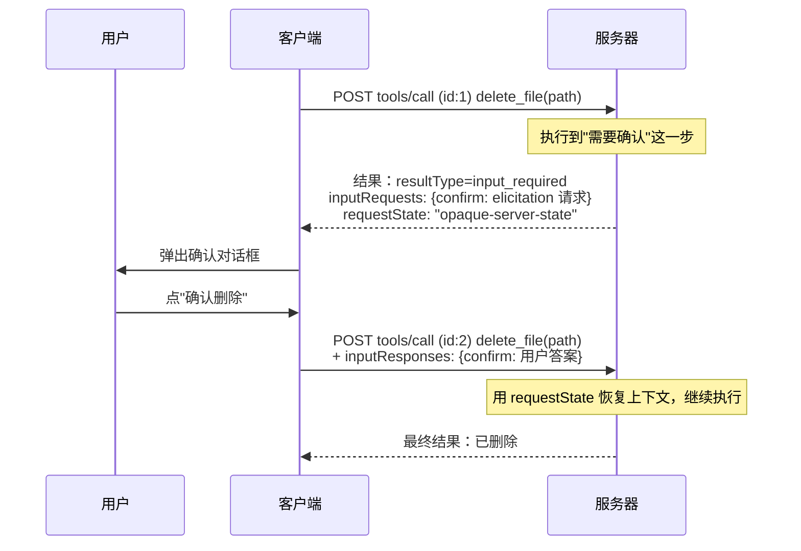
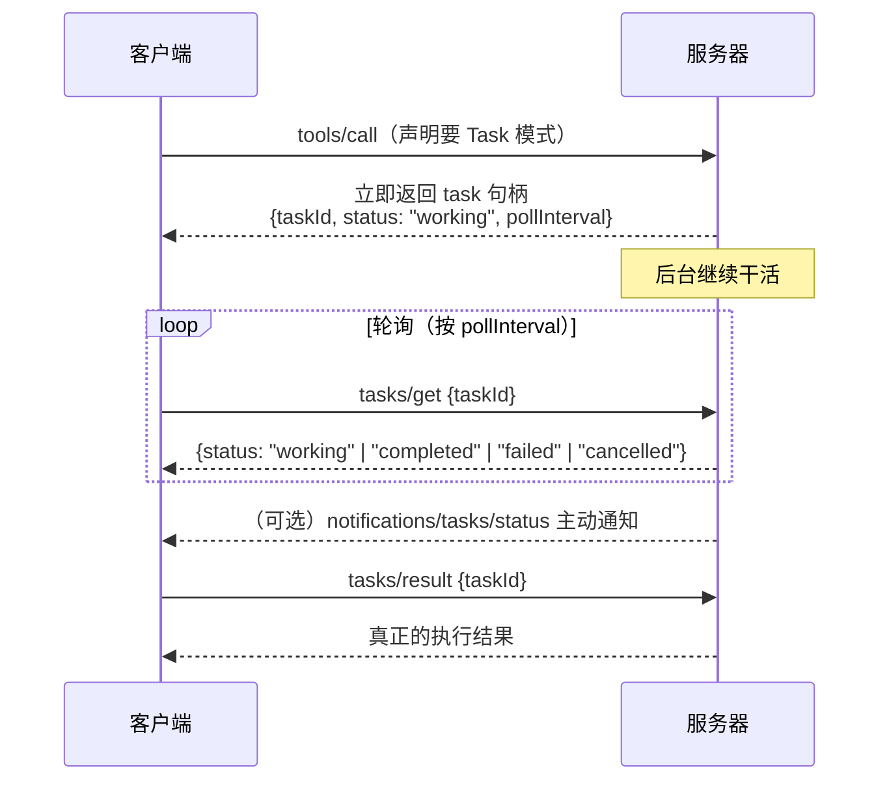

# 06 - 进阶交互：Elicitation、MRTR 与长任务

> 服务器如何向用户提问？如何把一次调用变成多轮往返？如何把 10 分钟的长任务变成可轮询的对象？
> 本篇的 Elicitation/MRTR 部分全部实测通过（服务端+客户端双端代码），Tasks 部分给出规范模型并标注 SDK 现状。

[← 上一篇：三大原语深入](05-服务器进阶三大原语深入.md) · [目录](README.md) · [下一篇：客户端开发实战 →](07-客户端开发实战.md)

---

## 1. 缺了这一环，MCP 只是"哑接口"

前五章的服务器都是"一问一答"：客户端调用，服务器执行，返回结果。真实业务会撞上三类墙：

| 场景 | 缺的能力 | 解法 |
|---|---|---|
| 删除数据库表前的最后确认 | 服务器**问用户** | Elicitation（征求确认） |
| 调用中发现缺参数（"要查哪个环境？"） | 服务器**问用户要输入** | Elicitation（表单收集） |
| 工具要跑 10 分钟（爬取/批处理/训练） | 请求**别堵死**在 HTTP 通道上 | Tasks（任务句柄+轮询） |

2026-07-28 协议用一个统一机制支撑前两者——**MRTR（Multi Round-Trip Requests，多轮次请求）**，用独立的**Tasks 扩展**支撑第三类。这就是本篇的主线。

## 2. MRTR：一次调用，多轮往返（SEP-2322）

### 2.1 设计动机：为什么不能让服务器直接发请求？

旧协议（≤2025-11-25）允许服务器在会话中主动向客户端发 JSON-RPC 请求（比如 elicitation）。这对**有状态连接**没问题，但对 2026-07-28 的**无状态 HTTP** 是灾难：服务器每请求创建的临时实例，根本没有"挂着的反向通道"可发。

MRTR 的解法极其聪明——**没有反向请求，只有"未完成的正向请求"**：



关键认知：**服务器从不主动发请求**。它只是把原请求"暂停"在一个中间态返回（`resultType: "input_required"`），并告诉客户端"你需要提供这些输入才能让我继续"。客户端收集完输入，**重发同一个请求**，附上答案。

### 2.2 消息形状（协议级，写给手写实现者）

第一次响应（服务器返回）：

```json
{
  "jsonrpc": "2.0", "id": 1,
  "result": {
    "resultType": "input_required",
    "inputRequests": {
      "confirm": {
        "method": "elicitation/create",
        "params": {
          "message": "确定要删除待办 1 吗？此操作不可撤销。",
          "requestedSchema": {
            "type": "object",
            "properties": {
              "confirm": { "type": "boolean", "description": "true=确认删除，false=取消" }
            },
            "required": ["confirm"]
          }
        }
      }
    },
    "requestState": "opaque-server-state（不透明字符串）"
  }
}
```

第二次请求（客户端重发）：

```json
{
  "jsonrpc": "2.0", "id": 2,
  "method": "tools/call",
  "params": {
    "name": "confirm_delete",
    "arguments": { "id": 1 },
    "inputResponses": {
      "confirm": { "action": "accept", "content": { "confirm": true } }
    }
  },
  "_meta": { "io.modelcontextprotocol/protocolVersion": "2026-07-28", "...": "..." }
}
```

三个要点：

1. **`inputRequests` 是键值对**，key 由服务器起名（如 `confirm`），客户端回传时按同名 key 放进 `inputResponses`——这就是"多个问题一次收集"的方式；
2. **`requestState` 是服务器铸造的不透明状态**，客户端原样回传。服务器用它恢复"第一轮执行到哪了"——因为无状态服务器每请求新建实例，业务上下文只能靠这个串携带；
3. 嵌入的请求**没有 JSON-RPC 壳**（没有 `jsonrpc`/`id` 字段），是裸的 `params` 结构。

> ⚠️ 安全红线（SDK 文档原文警告）：**`requestState` 会经客户端之手回来，是"攻击者可控制的输入"**。如果它会影响授权或业务决策，必须做完整性保护（HMAC/AEAD 签名），服务器必须拒绝校验失败的 state。SDK 不会替你做。08 篇安全专题会展开。

### 2.3 Elicitation 两种模式

| 模式 | 机制 | 适用 |
|---|---|---|
| **Form 模式** | `requestedSchema`（受限 JSON Schema）→ 客户端渲染表单收集 | 结构化输入、确认框 |
| **URL 模式** | 给出一个 URL，客户端打开浏览器让用户在网页上完成操作 | 登录授权、复杂交互（支付） |

Form 模式的 schema 是**受限子集**：只支持基本类型（string/number/boolean/enum）和有限嵌套，不支持数组/composition 关键字——因为要保证任何客户端都能渲染出标准 UI。

## 3. 实操：Elicitation 双端全流程（已验证）

### 3.1 服务端：两轮写法的工具

```javascript
// probe-elicitation-server.mjs（节选，完整见配套代码）
import { McpServer, inputRequired } from "@modelcontextprotocol/server";
import { serveStdio } from "@modelcontextprotocol/server/stdio";
import { z } from "zod";

server.registerTool(
  "confirm_delete",
  {
    description: "删除待办（需要用户确认，演示 Elicitation/MRTR）",
    inputSchema: z.object({ id: z.number().int().positive() }),
  },
  async ({ id }, extra) => {
    const responses = extra.mcpReq.inputResponses ?? null;

    if (!responses) {
      // ---------- 第 1 轮：向用户要确认 ----------
      return inputRequired({
        inputRequests: {
          confirm: inputRequired.elicit({
            message: `确定要删除待办 ${id} 吗？此操作不可撤销。`,
            requestedSchema: z.object({
              confirm: z.boolean().describe("true=确认删除，false=取消"),
            }),
          }),
        },
        requestState: JSON.stringify({ id }),  // ⚠️ 生产环境要 HMAC 保护！
      });
    }

    // ---------- 第 2 轮：客户端带着答案重新进入 ----------
    const answer = responses.confirm?.content?.confirm;   // 实测形状：{action:"accept", content:{confirm:true}}
    if (answer === true) {
      return { content: [{ type: "text", text: `已删除待办 ${id}` }] };
    }
    return { content: [{ type: "text", text: `已取消删除待办 ${id}` }] };
  },
);
```

API 解读：

- `inputRequired(...)`：构造 `InputRequiredResult`（必须提供 inputRequests 或 requestState 至少一个，否则抛 TypeError）；
- `inputRequired.elicit({message, requestedSchema})`：构造嵌入的 form elicitation 请求，**zod schema 会被自动转成受限 wire schema**（实测转出了 `$schema`/`required` 等）；
- **同一个回调函数会被多次进入**：第 1 轮 `extra.mcpReq.inputResponses` 为空，第 2 轮起携带客户端回传的答案。SDK 默认最多重进 8 轮（`inputRequired.maxRounds`，可在 McpServer options 配）；
- 2025-era（legacy）连接时 SDK 的 **legacy shim 会自动代客户端完成**（服务器侧自问自答），所以同一份 handler 双时代都能跑——实测 06 的探针跑的就是这个机制在 modern 客户端下的行为。

### 3.2 客户端：声明能力 + 注册回答处理器

```javascript
// probe-elicitation-client.mjs（节选，完整见配套代码）
import { Client } from "@modelcontextprotocol/client";
import { StdioClientTransport } from "@modelcontextprotocol/client/stdio";

const client = new Client(
  { name: "elicit-probe-client", version: "1.0.0" },
  {
    versionNegotiation: { mode: "auto" },
    capabilities: { elicitation: { form: {} } },   // ← 必须声明，否则 -32021
  },
);

// 收到服务器的提问时怎么回答（真实客户端在这里弹 UI/表单）
client.setRequestHandler("elicitation/create", async (request) => {
  console.log("message:", request.params.message);
  // 按 requestedSchema 渲染表单…此处模拟用户点"确认"
  return { action: "accept", content: { confirm: true } };
});

await client.connect(transport);
const result = await client.callTool({ name: "confirm_delete", arguments: { id: 1 } });
console.log(result.content[0].text);   // "已删除待办 1"
```

三个实测确认的行为：

1. **能力声明是硬门槛**：不声明 `elicitation: { form: {} }`，服务器发起 elicitation 时客户端 SDK 直接抛 `MissingRequiredClientCapabilityError`（错误码 `-32021`，`data.requiredCapabilities` 精确告诉你缺什么）。这正是 03 篇讲的"双方不调用对方没声明的能力"的强制化实现；
2. **`callTool` 对应用层是"一次调用"**：MRTR 的重试循环由 SDK 自动完成（客户端代码无感知），`elicitation/create` 处理器的返回值被自动装进重试请求；
3. 回答对象是 `{ action: "accept" | "decline" | "cancel", content?: {...} }`——accept 带内容，decline 表示"我看到了但拒绝"，cancel 表示"用户取消了整个流程"。服务器端拿到 `responses.confirm.content` 前应先检查 `action`。

### 3.3 实测完整日志（探针双端输出）

```
elicit-probe server on stdio
== 进入工具 ==
  round: 1（第一次）
== 客户端收到提问 ==
  message: 确定要删除待办 1 吗？此操作不可撤销。
  requestedSchema: {"type":"object","properties":{"confirm":{"type":"boolean","description":"true=确认删除，false=取消"}},"required":["confirm"],...}
== 进入工具 ==
  round: ≥2（客户端带回答案）
  inputResponses: {"confirm":{"action":"accept","content":{"confirm":true}}}
  用户回答: true
== callTool 第一次返回 ==
{ "content": [{ "type": "text", "text": "已删除待办 1" }] }
```

一次 `callTool`，底层两次 HTTP/stdio 往返 + 一次用户交互。这就是 MRTR。

## 4. Tasks：把长任务变成可轮询对象

### 4.1 问题与模型

一个 10 分钟的数据导出，放进普通 HTTP 请求会发生什么？要么超时断连（结果丢失），要么连接挂着浪费资源。Tasks 扩展（SEP-1686）的方案：**服务器立即返回一个"任务句柄"，客户端凭句柄轮询状态、最后取结果**：



要点：

- **任务句柄是持久的**：客户端断线重连后仍可凭 taskId 继续轮询（这正是"长任务"的价值）；
- 状态机：`working → (completed | failed | cancelled)`；
- `tasks/get` 只看状态，`tasks/result` 取结果（结果可能很大，分开取）；
- 通知（如果客户端订阅了）只是"催一下"，轮询才是确定性保障。

### 4.2 SDK 现状与建议（截至 2026-11）

**诚实声明**：Tasks 是协议**扩展**（extension），不是核心协议，且 2026-07-28 版本对其字段做了调整（`execution.taskSupport`/`capabilities.tasks` 等字段在新 codec 的清理清单中），SDK v2.4.0 的 Tasks API 仍在随 SEP-1686/SEP-2127 演进。本章不给"抄了就能跑"的任务化代码——**写之前请先查你手上 SDK 版本的对应文档**（`@modelcontextprotocol/server` 的 Task 相关导出在持续变化）。

你现在就能确定做的事：

1. **业务侧预留**：耗时工具拆成"启动+查询"两个工具（`start_export` 返回 jobId，`get_export_status(jobId)` 返回进度）——这是**任何协议版本都成立的应用层方案**，也是生产系统最常见的做法；
2. **跟踪演进**：Tasks 扩展稳定后，再切换到协议级 Task（消息形状见上，模型不变）；
3. **客户端轮询**：07 篇的 Agent 循环天然支持"工具返回 jobId → 模型决定何时再查"，无需协议级 Task 也能实现长任务。

> 一条经验法则：**协议级 Task 适合"通用客户端要统一处理长任务"的生态场景**（如 MCPJam 这类调试器、企业 Agent 平台）；自研应用里，应用层 jobId 方案更简单可控。两者不冲突。

## 5. 设计准则：什么时候用 Elicitation

Elicitation 强大但昂贵（打断用户、每客户端实现不同），使用准则：

| 该用 | 不该用 |
|---|---|
| 不可逆操作的确认（删除、付款、发布） | 每次调用都问（用户烦死） |
| 调用中途缺关键参数 | 可以在工具参数里就让模型填的东西 |
| URL 模式的 OAuth/登录跳转 | 已有配置能解决的偏好设置 |

另一个替代方案：**宁可把"确认"做成两段式工具**（`dry_run` → `execute`），让模型先跑试运行——不打断用户，还能让模型自查。Elicitation 留给真正需要"人"拍板的时刻。

## 6. 踩坑 FAQ

**Q1：客户端报 `-32021 MissingRequiredClientCapabilityError`？**
你（服务器作者）调了 elicitation，对面的客户端没声明能力。**这是协议设计使然，不是 bug**——但你有责任：① 工具 description 里说明"本工具可能请求确认"；② 优雅降级：服务器可以在发起 elicitation 前先查请求的 `_meta.clientCapabilities`（每请求都带！），没能力就改走"两段式工具"路线。

**Q2：第二轮进入工具时 `extra.mcpReq.requestState` 是个函数？**
对——v2 SDK 里它不是裸字符串而是访问器函数（内部包含从请求里解码后的 state）。**规范层面它仍是不透明字符串**，客户端只回传、不解码；服务器侧按 SDK 的函数签名使用即可，但"签名校验自己做"的原则不变。

**Q3：inputResponses 里嵌套结构和我预期不一样？**
实测形状：`responses.confirm = { action: "accept", content: { confirm: true } }`——先查 `action` 再取 `content`。decline/cancel 时 content 可能不存在。

**Q4：legacy 客户端连我的"会提问"的服务器会怎样？**
SDK 的 legacy shim 自动代答（服务器侧模拟客户端完成 MRTR，默认轮次上限 8、单轮超时 600 秒，均可在 options 调）。行为等价于"自动接受"——**安全敏感场景建议显式关闭**（`inputRequired: { legacyShim: false }`），让旧客户端收到明确失败而不是静默通过。

**Q5：Elicitation 的表单字段类型有限制吗？**
Form 模式只支持受限 schema 子集（基本类型 + 有限嵌套），传复杂 schema 会在发送前抛 TypeError（SDK 文档明示）。需要富交互走 URL 模式（打开网页完成）。

**Q6：怎么测试"用户点取消"的路径？**
探针客户端把处理器返回值改成 `{ action: "cancel" }` 再跑一遍——实测服务器第二轮拿到的 responses 里 action 变化，业务分支相应处理。**把三条路径（accept/decline/cancel）都写进工具逻辑**，是 elicitation 工具的完整性要求。

## 参考链接

- [SEP-2322：Multi Round-Trip Requests](https://modelcontextprotocol.io/seps/2322-MRTR)
- [规范：MRTR 模式（2026-07-28）](https://modelcontextprotocol.io/specification/2026-07-28/basic/patterns/mrtr)
- [Client Concepts：Elicitation](https://modelcontextprotocol.io/docs/2026-07-28/learn/client-concepts)
- [Extensions：Tasks 概览](https://modelcontextprotocol.io/extensions/tasks/overview) · [SEP-1686](https://modelcontextprotocol.io/seps/1686-tasks)
- [本篇配套代码：服务端探针](lab/src/probe-elicitation-server.mjs) · [客户端探针](lab/src/probe-elicitation-client.mjs)

---

**下一篇**换到"另外半边"：写一个完整的 MCP 客户端，把工具接进大模型循环；并把手写的迷你客户端升级为生产级。

[← 上一篇：三大原语深入](05-服务器进阶三大原语深入.md) · [目录](README.md) · [下一篇：客户端开发实战 →](07-客户端开发实战.md)
