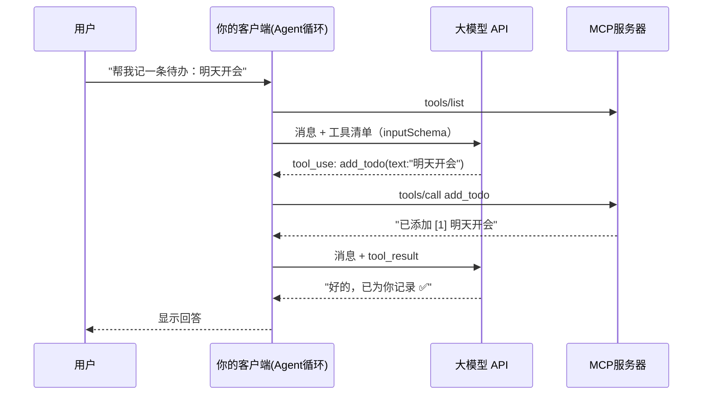

# 07 - 客户端开发实战：把 MCP 工具接入你自己的 AI 应用

> 到现在为止，你的工具只能跑在别人的客户端（Claude/Cursor）里。本篇写你自己的 MCP 客户端——
> 从 SDK 版的"工具聚合器"，到接入大模型的完整 Agent 循环，再到手写客户端的工程化升级。

[← 上一篇：Elicitation 与 MRTR](06-进阶交互Elicitation与MRTR.md) · [目录](README.md) · [下一篇：安全专题 →](08-安全专题.md)

---

## 1. 客户端 = Host 的"肌肉"

回忆 01 篇的三角色：Host 是 AI 应用，Client 是 Host 里面"负责跟服务器说话"的组件。写客户端有两种动机：

1. **做自己的 AI 产品**：给内部系统造一个聊天助手，接公司数据库/GitLab/Jira 的 MCP 服务器；
2. **做工具型产品**：调试器、聚合网关、测试框架（MCPJam 就是这类）。

两种动机的代码骨架完全一样，区别只在外壳（聊天 UI vs CLI）。本章按"最小可用 → 接入大模型 → 工程化"递进。

## 2. SDK Client：最小可用版（已实测）

### 2.1 连接 stdio 服务器

```javascript
// sdk-client.mjs（实测通过：连接 todo 服务器并列出/调用工具）
import { Client } from "@modelcontextprotocol/client";
import { StdioClientTransport } from "@modelcontextprotocol/client/stdio";

const transport = new StdioClientTransport({
  command: "node",
  args: ["build/todo-server.js"],
});

const client = new Client(
  { name: "sdk-demo-client", version: "1.0.0" },        // 你的身份
  { versionNegotiation: { mode: "auto" } },             // 自动协商协议时代
);

await client.connect(transport);
console.error("已连接，服务器信息:", JSON.stringify(await client.getServerVersion()));

const { tools } = await client.listTools();
console.error("工具列表:", tools.map((t) => t.name).join(", "));

const result = await client.callTool({
  name: "add_todo",
  arguments: { text: "用 SDK 客户端跑通一次调用" },
});
console.error("add_todo:", result.content[0].text);

await client.close();
```

**实测输出**：

```
已连接，服务器信息: {"name":"todo","version":"1.0.0"}
工具列表: add_todo, list_todos, complete_todo, delete_todo
add_todo: 已添加 [1] 用 SDK 客户端跑通一次调用
```

API 速查：

| 方法 | 作用 | 备注 |
|---|---|---|
| `new Client(info, options)` | 创建客户端实例 | `versionNegotiation.mode`: `"auto"` 探测双时代 / `"legacy"` 只握手 / `{pin: "2026-07-28"}` 钉死版本 |
| `client.connect(transport)` | 建立连接（stdio 会启动子进程） | 完成协议协商 |
| `client.listTools()` | 发现工具 | 同族还有 `listResources` / `listPrompts` / `readResource` / `getPrompt` |
| `client.callTool({name, arguments})` | 调用工具 | **业务失败不抛异常**，看 `result.isError` |
| `client.getServerVersion()` | 拿服务器身份 | 排错用 |
| `client.close()` | 关闭连接 | stdio 下会终止子进程 |

### 2.2 连接远程 HTTP 服务器

```javascript
import { StreamableHTTPClientTransport } from "@modelcontextprotocol/client";

const transport = new StreamableHTTPClientTransport(new URL("https://example.com/mcp"), {
  requestInit: { headers: { Authorization: "Bearer <token>" } },  // 简单认证
});
// 其余代码完全相同——传输层换掉，业务代码零改动
```

这就是两层模型的直接红利：`Client` 只认识 `Transport` 接口，stdio/HTTP 可互换。

### 2.3 三个客户端必做的防御

```javascript
// ① 业务失败不抛异常——检查 isError
const result = await client.callTool({ name: "query_db", arguments: { sql: "..." } });
if (result.isError) {
  console.error("工具执行失败:", result.content[0].text);  // 把失败原因交给上层（或模型）决策
}

// ② 协议错误才是异常——-32602 等 JSON-RPC error 会 throw
try {
  await client.callTool({ name: "not_exist", arguments: {} });
} catch (e) {
  // e 是 McpError / ProtocolError 家族，e.code 是 JSON-RPC 错误码
}

// ③ 超时与取消
const r = await client.callTool({ name: "slow_job", arguments: {} }, {
  timeout: 60_000,          // 单请求超时
  resetTimeoutOnProgress: true,  // 收到 progress 就重置计时（配合长任务）
});
```

> **错误处理心法**：`isError` 是"工具说它失败了"（可恢复，交给模型重试）；JSON-RPC error 是"协议没走到"（要修代码）。混着处理是新手 bug 高发区。

## 3. Agent 循环：让大模型用上你的工具

现在补上 Host 的"大脑"。目标：用户用自然语言提问 → 模型决定调用哪个 MCP 工具 → 客户端执行 → 结果回传 → 模型组织回答。

### 3.1 循环全景



### 3.2 完整实现（Anthropic API 版）

```typescript
// agent-client.ts —— 需要 ANTHROPIC_API_KEY 环境变量
import Anthropic from "@anthropic-ai/sdk";
import { Client } from "@modelcontextprotocol/client";
import { StdioClientTransport } from "@modelcontextprotocol/client/stdio";

const MODEL = "claude-haiku-5-5";
const MAX_TOOL_TURNS = 10;            // 防止无限循环的护栏

// ---------- 1. 连接 MCP 服务器 ----------
const transport = new StdioClientTransport({ command: "node", args: ["build/todo-server.js"] });
const mcp = new Client({ name: "agent-demo", version: "1.0.0" }, { versionNegotiation: { mode: "auto" } });
await mcp.connect(transport);

// 把 MCP 工具清单翻译成模型 API 的 tools 格式
const { tools: mcpTools } = await mcp.listTools();
const llmTools = mcpTools.map((t) => ({
  name: t.name,
  description: t.description ?? "",
  input_schema: t.inputSchema,        // MCP 的 JSON Schema 直接兼容 Anthropic 的 input_schema
}));

// ---------- 2. 对话循环 ----------
const anthropic = new Anthropic();
const messages: Anthropic.MessageParam[] = [];

async function chat(userText: string) {
  messages.push({ role: "user", content: userText });

  for (let turn = 0; turn < MAX_TOOL_TURNS; turn++) {
    const response = await anthropic.messages.create({ model: MODEL, max_tokens: 4096, tools: llmTools, messages });

    // 模型的这轮输出必须完整回放进历史（含 tool_use 块）
    messages.push({ role: "assistant", content: response.content });

    // 没有工具调用 = 最终回答
    if (response.stop_reason !== "tool_use") {
      console.log(response.content.filter((b) => b.type === "text").map((b) => (b as any).text).join(""));
      return;
    }

    // 执行所有工具调用，结果放进同一条 user 消息
    const toolResults: Anthropic.ToolResultBlockParam[] = [];
    for (const block of response.content) {
      if (block.type !== "tool_use") continue;
      const result = await mcp.callTool({ name: block.name, arguments: block.input as object });
      toolResults.push({
        type: "tool_result",
        tool_use_id: block.id,
        content: result.content.map((c: any) => c.text ?? "").join("\n"),
        is_error: result.isError === true,   // 失败不抛异常，如实标注给模型
      });
    }
    messages.push({ role: "user", content: toolResults });
  }
  console.log("(达到最大轮次上限，停止)");
}

// ---------- 3. REPL ----------
import * as readline from "node:readline";
const rl = readline.createInterface({ input: process.stdin, output: process.stdout });
for (;;) {
  const q: string = await new Promise((res) => rl.question("你> ", res));
  if (q === "exit") break;
  await chat(q);
}
await mcp.close();
```

**四条硬规则**（官方 build-client 教程反复强调，违反必报错）：

1. **完整回放 assistant 回合**——模型的 `tool_use` 块必须原样进历史，不能只挑文本；
2. **所有 tool_result 放进同一条 user 消息**——多个工具调用也是一条（按 tool_use_id 对应）；
3. **每轮都带 `tools` 清单**——不是只在第一轮带；
4. **设置 MAX_TOOL_TURNS 护栏**——模型可能陷入"调用失败→重试→再失败"的死循环。

### 3.3 OpenAI API 对照

OpenAI 的 function calling 格式略不同，翻译规则如下表：

| Anthropic | OpenAI |
|---|---|
| `tools[].input_schema` | `tools[].function.parameters` |
| assistant 的 `tool_use` 块 | assistant 的 `tool_calls`（在 `response.choices[0].message.tool_calls`） |
| user 消息里的 `tool_result` 块 | **独立 role 为 `"tool"` 的消息**（`role:"tool", tool_call_id, content`），不是塞进 user 消息 |
| `stop_reason === "tool_use"` | `finish_reason === "tool_calls"` |

其余循环逻辑一字不差。

### 3.4 多服务器聚合：一个 Host 的现实形态

真实 Host 同时连 N 个服务器。聚合策略：

```typescript
// 简单聚合：把所有服务器的工具收进一张注册表，调用时按"名字→客户端"路由
const registry = new Map<string, Client>();   // toolName -> client
for (const cfg of serverConfigs) {
  const c = await connectClient(cfg);
  const { tools } = await c.listTools();
  for (const t of tools) {
    if (registry.has(t.name)) console.warn(`工具名冲突: ${t.name}`);
    else registry.set(t.name, c);
  }
}
// callTool 时查表路由
```

冲突处理（多个服务器都有 `read_file`）的进阶做法是**服务器名前缀**（`filesystem__read_file`），调用时去前缀——Claude Code 等客户端就是这么做的。规模大时再上 **progressive discovery**（先用少量"索引工具"列出服务器与能力概览，模型按需再深入某个服务器的工具清单），避免一次性把几千个工具塞爆上下文。

## 4. 手写迷你客户端的工程化升级

03 篇的 65 行 mini-client 解决了"理解"，但要上生产还缺五块。每一块都是一个协议层练习：

| 缺口 | 问题 | 升级方案 |
|---|---|---|
| **并发请求** | `request()` 串行 await，工具互卡 | id 立即自增、promise 挂 pending 表（mini-client 已是此结构，去掉外层串行即可） |
| **超时** | 服务器挂死，promise 永远 pending | 发请求时起 setTimeout，超时 reject + 发 `notifications/cancelled`（仅 stdio） |
| **重连** | 服务器崩溃后客户端僵尸 | 监听 `child.on("exit")`，指数退避重启 + 重握手 + 重订阅 |
| **流式响应** | 只处理响应，progress 通知丢弃 | `pending` 表里除了 resolve 还挂 progress 处理器，收到 `notifications/progress` 时按 `progressToken` 路由 |
| **大消息** | 单行 JSON 巨大，内存峰值高 | 传输层不变（协议就一行一条），应用层拆分返回（资源引用代替大 payload） |

升级后的核心结构（骨架，约 120 行，练习留给读者）：

```javascript
class MiniMcpClient {
  #pending = new Map();     // id -> {resolve, reject, progressCb, timer}
  #subscriptions = new Map(); // filter -> callback

  async request(method, params, { timeoutMs = 60_000, onProgress } = {}) {
    const id = ++this.#nextId;
    const entry = { resolve, reject, onProgress, timer: setTimeout(() => this.#timeout(id), timeoutMs) };
    this.#pending.set(id, entry);
    this.#send({ jsonrpc: "2.0", id, method, params });
    // modern 模式别忘了 params 里带 _meta 信封（04 篇实验证明缺了会被拒）
  }

  #onMessage(msg) {
    if (msg.id !== undefined && this.#pending.has(msg.id)) { /* 响应：resolve/reject */ }
    else if (msg.method === "notifications/progress") { /* 按 progressToken 路由到 onProgress */ }
    else if (msg.method === "notifications/tools/list_changed") { /* 触发重拉清单的回调 */ }
    else { /* 其它通知：日志 */ }
  }
}
```

> 判断标准：**SDK Client 就是这套东西的官方实现**。手写一遍的价值在于——当 SDK 出现诡异行为时，你能从协议层推理出"它应该发了什么消息"，再用 03 篇的报文知识验证。

## 5. 客户端最佳实践清单（官方建议 + 实战经验）

1. **能力先声明再使用**：要 elicitation 就在 `capabilities` 里声明（06 篇的 -32021 教训）；
2. **工具结果当不可信输入**：工具返回的文本可能含恶意指令（提示注入），进模型上下文前考虑包裹定界符，08 篇详述；
3. **订阅 + 轮询双保险**：`subscriptions/listen` 收变更通知，同时尊重响应里的 `ttlMs` 缓存提示，通知丢了也能靠 TTL 过期兜底；
4. **连接生命周期跟随业务**：stdio 连接是"每会话一个子进程"，CLI 工具用完即关；长期运行的服务（Web 后端）要管理连接池并处理服务器重启；
5. **日志走 stderr**：连客户端自己也要守规矩——你的客户端日志若打到它自己的 stdout，不影响 MCP（那是它和服务器之间的事），但调试服务器时要能收集**服务器的 stderr**（`StdioClientTransport` 提供 `onStderr` 之类的回调，别让它混进你的 UI）；
6. **版本钉死策略**：生产环境用 `{pin: "2026-07-28"}` 而不是 auto，消除升级期间的协议抖动；SDK 升级后再放开。

## 6. 踩坑 FAQ

**Q1：模型调用了不存在的工具名 / 编造参数？**
先查工具清单是不是最新（服务器刚改过工具？收到 list_changed 了吗？）；再查 description 质量（05 篇描述工程）。模型幻觉是常态，客户端要做"调用前校验"：工具名不在注册表就拒绝并回 `tool_result(is_error)`，让模型重选。

**Q2：`callTool` 抛 `MissingRequiredClientCapabilityError`？**
和 06 篇同源：服务器发起 elicitation 而 ClientOptions 没声明能力。要么声明，要么说服服务器作者降级。

**Q3：stdio 客户端在 Windows 上 spawn 失败？**
`command: "node"` 找不到时写全路径；`.cmd` 脚本用 `{ shell: true }` 或 npm exec 包装。README 章节的 `where node` 确认。

**Q4：多服务器下工具名冲突，模型行为混乱？**
实现前缀命名空间（第 3.4 节），并把"冲突检测"做在启动时 fail-fast，不要等到模型乱调用才发现。

**Q5：官方教程的 Python 客户端和我的 TS 循环逻辑对不上？**
Python 版是官方 quickstart（逻辑相同、API 名不同）。TS 翻译版容易漏的点：assistant 回合必须整个 `response.content` 数组回放（Python 里是 `response.content`，TS 里是 `response.content`，注意都是数组）；thinking 块（如果开启）也要回放。逐块对照官方 [build-client](https://modelcontextprotocol.io/docs/2026-07-28/develop/build-client) 的语言切换标签页。

**Q6：怎么端到端测试我的客户端？**
三级测试：① 协议级——用 mini-client 裸调（03 篇）；② 集成级——用 Inspector 当"标准客户端"交叉验证你的服务器；③ 仿真级——模型 API 用 mock（拦截 `messages.create`，固定返回 tool_use 序列），跑通循环逻辑不花钱。

## 参考链接

- [官方 Quickstart：Build an MCP client](https://modelcontextprotocol.io/docs/2026-07-28/develop/build-client)（Python/TS/Java/Kotlin/C#/Ruby/Rust 多语言）
- [Client Concepts](https://modelcontextprotocol.io/docs/2026-07-28/learn/client-concepts)
- [Client Best Practices（渐进发现等）](https://modelcontextprotocol.io/docs/2026-07-28/develop/clients/client-best-practices)
- [本篇配套代码：SDK 客户端](lab/src/sdk-client.mjs) · [Elicitation 客户端探针](lab/src/probe-elicitation-client.mjs)

---

**下一篇**直面 MCP 世界的黑暗面：工具投毒、提示注入与 confused deputy，以及一份可直接落地的加固清单。

[← 上一篇：Elicitation 与 MRTR](06-进阶交互Elicitation与MRTR.md) · [目录](README.md) · [下一篇：安全专题 →](08-安全专题.md)
