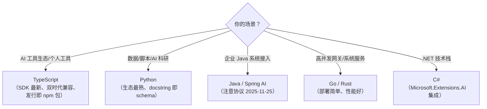

# 09 - 生态、发布与多语言：把你的服务器推向世界

> 系列收官篇：官方参考服务器地图、发布到官方 Registry 的流程、六大语言 SDK 对照（含各自协议版本现状），
> 以及"该用哪个语言写 MCP 服务器"的决策建议。

[← 上一篇：安全专题](08-安全专题.md) · [目录](README.md) · [全系列完]

---

## 1. 官方参考服务器：先抄作业再造轮子

写新服务器之前，先看看官方 [modelcontextprotocol/servers](https://github.com/modelcontextprotocol/servers) 的参考实现——它们是协议用法的活教材：

| 服务器 | 提供什么 | 学习价值 |
|---|---|---|
| `filesystem` | 白名单目录内文件的读写/搜索 | 资源模板、目录限定（08 篇安全实践的标准示范） |
| `fetch` | 抓取网页转 Markdown | 工具返回大内容的处理、错误语义 |
| `memory` | 知识图谱式持久记忆 | 会话外持久化、实体关系建模 |
| `sequentialthinking` | 动态反思式思考工具 | "纯文本工具"的设计（无副作用工具的范例） |
| `gitlab`/`github` | 代码平台操作 | 大型 API 网关型服务器的工具拆分 |
| `slack` | 消息读写 | OAuth 凭证管理 |

社区生态（收录 1.5 万+）：[punkpeye/awesome-mcp-servers](https://github.com/punkpeye/awesome-mcp-servers)——按分类浏览（数据库/开发/金融/浏览器自动化…），找轮子前先搜这里。

## 2. 发布到 MCP Registry

官方 Registry（[registry.modelcontextprotocol.org](https://registry.modelcontextprotocol.org)）已开放自助发布。流程概览：

1. **写 `server.json`**（包根目录）：声明服务器名（反向域名，如 `io.github.yourname/todo-mcp`）、描述、版本、分发方式（npm 包 / PyPI 包 / 远程 URL）、schema 版本；
2. **发布渠道**：npm/PyPI 包走"自动同步"（Registry 校验包名与 server.json 匹配）；远程服务器手动提交 URL；
3. **GitHub Actions 发布**：官方提供 [registry/github-actions](https://modelcontextprotocol.io/registry/github-actions) 集成——CI 里打 tag 自动推 Registry；
4. **审核与更新**：命名冲突有防抢注策略（域名所有权证明）；版本更新重新提交即可。

最小 `server.json` 示意：

```json
{
  "$schema": "https://static.modelcontextprotocol.io/schemas/2025-12-11/server.schema.json",
  "name": "io.github.yourname/todo-mcp",
  "description": "A simple todo list MCP server (tutorial series sample)",
  "version": "1.0.0",
  "packages": [
    { "registryType": "npm", "identifier": "@yourname/todo-mcp", "version": "1.0.0" }
  ]
}
```

> 发布前的自查：① `description` 如实（审核关注投毒）；② 服务器行为与声明一致；③ 有版本号与变更日志。发布不是终点——Registry 条目 + README 里的"客户端接入示例"决定别人会不会用。

## 3. 多语言 SDK 全景对照（2026-11 核实）

**先说结论：协议版本支持参差不齐，选语言前先看这张表**——

| SDK | 包名 | 最新版本 | 协议版本支持 | 备注 |
|---|---|---|---|---|
| **TypeScript** | `@modelcontextprotocol/server` / `client`（v2 拆分） | 2.4.0 | **2026-07-28 全量**（双时代自动兼容） | 唯一全量支持新版协议的官方 SDK；本系列主线 |
| **Python** | `mcp` | 2.3.0（2026-10-02） | 2026-07-28（`MCPServer` 新 API） | Python 3.10+；生态里另有 FastMCP 等三方库 |
| **Java** | Spring AI `spring-ai-starter-mcp-server/client` | 跟随 Spring AI 4.1.x | **2025-11-25**（未跟进 2026-07-28） | 企业 Java 生态主力，注意与新客户端的兼容 |
| **Kotlin** | `io.modelcontextprotocol:kotlin-sdk` | 0.16.0 | 2025-11-25 | Ktor 生态 |
| **Go** | `github.com/modelcontextprotocol/go-sdk/mcp` | 跟随 google 官方节奏 | 新版推进中 | Google+MCP 官方联合维护 |
| **C#** | `ModelContextProtocol`（NuGet） | 跟随 .NET 10 | 新版推进中 | 与 Microsoft.Extensions.AI 深度集成 |
| **Rust** | `rmcp` | 3.4 | 新版推进中（含双时代探测） | 官方快速上手已更新 |
| **Ruby** | `mcp` gem | 跟随 | 新版推进中 | 官方已收录 |

（各语言"新版推进中"指 2026-07-28 特性在跟进中，具体以 [SDK 文档](https://modelcontextprotocol.io/docs/2026-07-28/sdk) 与各仓库 release notes 为准。）

## 4. Java / Spring AI：企业用户的实操对照

Java 是企业后端主力，给一段 Spring AI 的对照实现（**协议 2025-11-25**，与新客户端兼容性见下方说明）：

```java
// WeatherService.java —— Spring AI 的 @Tool 注解自动注册为 MCP 工具
@Service
public class TodoService {

    private final Map<Integer, Todo> todos = new ConcurrentHashMap<>();
    private final AtomicInteger nextId = new AtomicInteger(1);

    @Tool(description = "向待办清单中添加一条新待办事项")
    public String addTodo(
            @ToolParam(description = "待办内容，例如：给客户发周报") String text) {
        int id = nextId.getAndIncrement();
        todos.put(id, new Todo(id, text, false));
        return "已添加 [" + id + "] " + text;
    }

    @Tool(description = "列出当前所有待办事项")
    public String listTodos() {
        return todos.values().stream()
                .map(t -> "[" + t.id() + "] " + (t.done() ? "✅ " : "⬜ ") + t.text())
                .collect(Collectors.joining("\n"));
    }
}

// McpServerApplication.java
@SpringBootApplication
public class McpServerApplication {
    public static void main(String[] args) {
        SpringApplication.run(McpServerApplication.class, args);
    }

    @Bean
    public ToolCallbackProvider todoTools(TodoService todoService) {
        return MethodToolCallbackProvider.builder().toolObjects(todoService).build();
    }
}
```

```properties
# application.properties —— stdio 模式必须关掉 banner 和控制台日志（stdout 雷区！）
spring.main.bannerMode=off
logging.pattern.console=
```

Java 生态三注意：

1. **stdout 雷区在 Java 更容易踩**：Spring Boot 默认往 stdout 打 banner/日志，stdio 模式必须 `bannerMode=off` + 清空 console pattern；
2. **协议代差**：Java/Kotlin SDK 目前只支持 `2025-11-25`。新版客户端（`2026-07-28` only）连不上它——客户端会走 03 篇的"探测-回退"逻辑用 initialize 握手接入，所以**混合生态仍可工作**，但拿不到新特性（元数据头、无状态缓存）；
3. **同步/异步两种服务器风格**：Spring AI 支持 sync 与 async MCP server，长任务用 async 版本。

## 5. Python：FastMCP 风格对照

Python 官方 SDK 2.x 的新 API（与 02 篇 TS 代码一一对应）：

```python
# weather.py —— 官方 quickstart 同款结构（详见官方文档，Python 3.10+）
from typing import Any
import httpx2
from mcp.server import MCPServer
from mcp.server.mcpserver.exceptions import ToolError

mcp = MCPServer("weather")

NWS_API_BASE = "https://api.weather.gov"
USER_AGENT = "weather-app/1.0"

@mcp.tool()
async def get_alerts(state: str) -> str:
    """Get weather alerts for a US state.

    Args:
        state: Two-letter US state code (e.g. CA, NY)
    """
    url = f"{NWS_API_BASE}/alerts/active/area/{state.upper()}"
    async with httpx2.AsyncClient(follow_redirects=True) as client:
        response = await client.get(url, headers={"User-Agent": USER_AGENT}, timeout=30.0)
        response.raise_for_status()
        data = response.json()
    if not data.get("features"):
        return "No active alerts for this state."
    return "\n---\n".join(format_alert(f) for f in data["features"])

if __name__ == "__main__":
    mcp.run(transport="stdio")
```

要点：

- **类型注解 + docstring 就是 inputSchema**——`state: str` 和 docstring 的 `Args:` 段自动转成 JSON Schema（等价于 TS 里 zod 的 `.describe()`）；
- **`ToolError` 异常**会被框架转成 `isError` 响应（05 篇错误语义的 Python 形态）；
- **logging 模块默认走 stderr**，天然安全（stdout 雷区的 Python 解法）；
- `uv add "mcp[cli]"` 安装，`uv run weather.py` 运行。

## 6. 语言选型决策



两条经验法则：

1. **跨语言团队**优先选 TS 或 Python——SDK 最成熟、社区示例最多、排错资料最全；
2. **业务逻辑已有实现**（比如公司已有 Java 服务），用对应语言的 SDK 包装现有服务，而不是为 MCP 重写业务——MCP 服务器只是"适配层"，复用比重写安全得多（也符合 08 篇的最小权限：新代码越少，攻击面越小）。

## 7. 踩坑 FAQ

**Q1：我的 Java 服务器连不上新客户端？**
代差所致。客户端（支持双时代的）会用 legacy initialize 握手接入，正常工作；如果客户端只支持 2026-07-28（少数新客户端配置了 pin），就得升级 Java SDK 或在前面加一层 TS 代理服务器。

**Q2：npm 发布的 MCP 服务器包，用户怎么配置？**
约定俗成的做法：包里 `bin` 字段提供可执行入口，README 给出 `mcpServers` 配置片段（02 篇 6.1 节的格式）。远程服务器则在 README 给 URL + 认证说明。

**Q3：Registry 名字 `io.github.yourname/xxx` 是什么规则？**
防抢注：`io.github.<username>/` 前缀与你的 GitHub 用户名绑定（发布时 Registry 校验所有权）。企业可用自己的反向域名。

**Q4：一个仓库里能同时发 stdio 和 HTTP 两种形态吗？**
能（04 篇 Q5 的双入口模式）。Registry 的 `packages` 数组也支持多分发条目（npm 包 + 远程 URL 并存）。

**Q5：教程完结之后去哪里跟进协议演进？**
官方路线图（[development/roadmap](https://modelcontextprotocol.io/development/roadmap)）+ SEP 列表（规范增强提案，如 SEP-2127 Server Cards、SEP-2322 MRTR、SEP-1686 Tasks）。每个新特性都会先以 SEP 形式公开讨论。

## 参考链接

- [官方参考服务器仓库](https://github.com/modelcontextprotocol/servers) · [Example Servers 页](https://modelcontextprotocol.io/examples)
- [MCP Registry](https://modelcontextprotocol.io/registry/about) · [发布 Quickstart](https://modelcontextprotocol.io/registry/quickstart) · [GitHub Actions 集成](https://modelcontextprotocol.io/registry/github-actions)
- [SDK 总览](https://modelcontextprotocol.io/docs/2026-07-28/sdk) · [Java SDK 文档](https://java.sdk.modelcontextprotocol.io/) · [Spring AI MCP](https://docs.spring.io/spring-ai/reference/api/mcp/mcp-server-boot-starter-docs.html)
- [awesome-mcp-servers](https://github.com/punkpeye/awesome-mcp-servers) · [microsoft/mcp-for-beginners](https://github.com/microsoft/mcp-for-beginners)

---

到这一步，你已经能"做出并发布"一个 MCP 服务器了。最后一篇解决"怎么让它稳定地被别人用"——部署。

[← 上一篇：安全专题](08-安全专题.md) · [目录](README.md) · [下一篇：Linux 部署实战 →](10-Linux部署MCP服务器.md)
