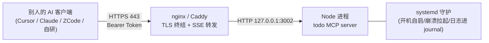

# 10 - Linux 部署实战：把你的 MCP 服务器发布到公网

> 承接第 04 篇（传输层）与第 08 篇（安全）：把本系列写好的 todo 服务器部署到一台 Linux 服务器上，
> 让同事/朋友在任何客户端里通过 HTTPS 直接使用。完整链路：systemd 守护 → nginx 反代 → TLS 证书 → 认证 → 客户端接入。
> 以 **Ubuntu 22.04 / 24.04 LTS** 为例（Debian 同构；CentOS/RHEL 按包管理器替换，差异处已标注）。

[← 上一篇：生态、发布与多语言](09-生态发布与多语言.md) · [目录](README.md) · **全系列完**

---

## 1. 为什么需要单独一篇部署

04 篇已经能在本机跑 HTTP 版 MCP 服务器了——但那是"开发模式"：终端一关进程就死、没有域名证书、谁都能连、日志看不着。"供别人使用"意味着补上生产链路的七件事：

| # | 事项 | 没做会怎样 |
|---|---|---|
| 1 | 进程守护（systemd） | SSH 一断/服务器一重启，服务就没了 |
| 2 | 反向代理（nginx/Caddy） | 没法挂域名、没法统一管理 TLS |
| 3 | HTTPS（TLS 证书） | 客户端普遍拒绝 http:// 远程连接；数据明文裸奔 |
| 4 | 认证 | 公网上任何人都能调用你的工具 |
| 5 | 日志与监控 | 出问题两眼一抹黑 |
| 6 | 升级流程 | 每次改代码都是一次"事故现场" |
| 7 | 防火墙 | 多余端口暴露攻击面 |

### 1.1 目标架构



关键原则（04/08 篇的重申）：**应用只绑 127.0.0.1，公网入口只有 443**。攻击面收敛到 nginx 一层。

## 2. 准备服务器与运行环境

### 2.1 系统初始化

一台最低配云服务器/VPS 就够（MCP 服务器通常很轻，1C1G 起步）。SSH 登录后：

```bash
# 系统更新
sudo apt update && sudo apt upgrade -y

# 基础工具（如无）
sudo apt install -y git curl
```

### 2.2 安装 Node.js 22（LTS）

Ubuntu/Debian 用 NodeSource 官方 apt 源（版本随 LTS 稳定）：

```bash
curl -fsSL https://deb.nodesource.com/setup_22.x | sudo -E bash -
sudo apt install -y nodejs
node --version    # v22.x
npm --version
```

> CentOS/RHEL 替代：`curl -fsSL https://rpm.nodesource.com/setup_22.x | sudo bash -` 后 `sudo yum install -y nodejs`。
> 不想用系统包管理器也可以用 [nvm](https://github.com/nvm-sh/nvm) 装在用户目录（适合多版本共存，但 systemd 服务建议用系统级 node，路径稳定）。

### 2.3 防火墙：只开 22/80/443

```bash
sudo ufw allow OpenSSH
sudo ufw allow 80/tcp     # certbot 验证与跳转
sudo ufw allow 443/tcp    # 业务入口
sudo ufw enable
sudo ufw status
```

**不开 3002**——应用端口只对本机开放，外网流量一律走 nginx。

### 2.4 创建专用运行用户（最小权限）

```bash
sudo useradd -m -s /usr/sbin/nologin mcp    # 不能登录 shell，只能跑服务
```

## 3. 部署应用代码

### 3.1 上传代码

两种常用方式（选一）：

```bash
# 方式 A：git（推荐，配合升级流程）
sudo mkdir -p /opt/todo-mcp && sudo chown mcp:mcp /opt/todo-mcp
sudo -u mcp git clone https://your-git.example/todo-mcp.git /opt/todo-mcp

# 方式 B：从本机 scp 直传
# （Windows 本机 CMD）
scp -r lab\src\* user@your-server:/opt/todo-mcp/src/
```

安装依赖并构建（本系列 lab 是 TS 项目）：

```bash
cd /opt/todo-mcp
sudo -u mcp npm ci --omit=dev && sudo -u mcp npm run build
```

### 3.2 关键改造：绑定地址环境变量化

第 04 篇的 `todo-server-http2.mjs` 把监听地址写死为 `127.0.0.1`。生产部署（尤其是 Docker）需要它是**可配置**的。本系列配套代码已升级为（实测通过）：

```javascript
// 绑定地址可配：默认 127.0.0.1（安全默认值）；
// Docker/容器内部需要 0.0.0.0（容器隔离本身就是边界），再由 -p 127.0.0.1:3002:3002 限制宿主机暴露
const PORT = Number(process.env.PORT || 3002);
const BIND_ADDR = process.env.BIND_ADDR || "127.0.0.1";

createServer(toNodeHandler(handler)).listen(PORT, BIND_ADDR, () => {
  console.error(`todo MCP server (modern Streamable HTTP) listening on http://${BIND_ADDR}:${PORT}/mcp`);
});
```

> **为什么默认 127.0.0.1**：裸机上绑 0.0.0.0 = 公网直接可达（绕过 nginx），违背 1.1 的架构原则。只有容器场景例外——容器内的 0.0.0.0 只是容器命名空间内，宿主机仍由 `-p` 控制（第 8.3 节）。

### 3.3 手动跑一次，先确认能通

```bash
cd /opt/todo-mcp
sudo -u mcp BIND_ADDR=127.0.0.1 PORT=3002 node build/todo-server-http2.mjs &
# 另一个终端，本机自测
curl -s -X POST http://127.0.0.1:3002/mcp \
  -H "Content-Type: application/json" \
  -H "Accept: application/json, text/event-stream" \
  -H "MCP-Protocol-Version: 2026-07-28" \
  -H "Mcp-Method: tools/list" \
  --data-binary @src/tools-list-request.json
# 看到 {"result":{"tools":[...],"resultType":"complete",...}} 即成功
kill %1   # 停掉手动进程，交给 systemd
```

## 4. systemd：让服务器常驻

### 4.1 服务单元文件

`sudo vim /etc/systemd/system/todo-mcp.service`：

```ini
[Unit]
Description=Todo MCP Server (Streamable HTTP)
After=network-online.target
Wants=network-online.target

[Service]
Type=simple
User=mcp
Group=mcp
WorkingDirectory=/opt/todo-mcp
# ExecStart 用 node 绝对路径（systemd 环境不含你的 PATH，写 node 会找不到）
ExecStart=/usr/bin/node /opt/todo-mcp/build/todo-server-http2.mjs
Environment=NODE_ENV=production
Environment=BIND_ADDR=127.0.0.1
Environment=PORT=3002
# Environment=MCP_TOKEN=换成一个长随机串   ← 第 6 节认证启用后打开
Environment=STATE_SECRET=换成长随机串

Restart=on-failure
RestartSec=3
# 崩溃/被杀后自动拉起；StartLimit 由默认策略兜底

# --- 适度安全加固（08 篇最小权限的服务器级延伸） ---
NoNewPrivileges=true
ProtectSystem=full        # /usr /boot /etc 只读
PrivateTmp=true           # 独立 /tmp
ProtectHome=true
RestrictSUIDSGID=true

# 资源上限：防失控进程吃光内存
MemoryMax=512M

[Install]
WantedBy=multi-user.target
```

### 4.2 启动与开机自启

```bash
sudo systemctl daemon-reload
sudo systemctl enable --now todo-mcp
sudo systemctl status todo-mcp          # active (running) 即成功
sudo journalctl -u todo-mcp -f          # 实时看日志（stderr 都进这里）
```

### 4.3 验证守护效果

- `sudo systemctl restart todo-mcp` 后服务 3 秒内回来；
- `kill` 掉 node 进程（`pkill -f todo-server-http2`），几秒后 `status` 显示又拉起来了；
- `sudo reboot` 之后服务自动在线（`enable` 生效）。

这三条就是"进程守护"的全部价值——第 1 节清单的 #1 完成。

## 5. 反向代理与 HTTPS

### 5.1 前置：域名解析

到你的 DNS 服务商加一条 A 记录：`mcp.example.com → 服务器公网 IP`。没有域名可用 sslip.io 类服务（`mcp.<IP>.sslip.io`）测试。

### 5.2 路线 A（推荐）：Caddy —— 自动 HTTPS，配置最少

```bash
sudo apt install -y debian-keyring debian-archive-keyring apt-transport-https curl
curl -1sLf 'https://dl.cloudsmith.io/public/caddy/stable/gpg.key' | sudo gpg --dearmor -o /usr/share/keyrings/caddy-stable-archive-keyring.gpg
curl -1sLf 'https://dl.cloudsmith.io/public/caddy/stable/debian.deb.txt' | sudo tee /etc/apt/sources.list.d/caddy-stable.list
sudo apt update && sudo apt install -y caddy
```

`/etc/caddy/Caddyfile`：

```caddyfile
mcp.example.com {
    reverse_proxy 127.0.0.1:3002 {
        flush_interval -1        # 关键：SSE 立即透传，不缓冲
    }
}
```

```bash
sudo systemctl reload caddy
```

首次请求域名时 Caddy **自动申请并续期** Let's Encrypt 证书，零手工配置。80/443 由 Caddy 接管。

### 5.3 路线 B：nginx —— 熟悉度最高，SSE 配置四要素

```bash
sudo apt install -y nginx certbot python3-certbot-nginx
```

`/etc/nginx/sites-available/todo-mcp`：

```nginx
server {
    listen 80;
    server_name mcp.example.com;

    location /mcp {
        proxy_pass http://127.0.0.1:3002;

        # ── SSE 四要素（缺一个都可能"卡住没响应"）──
        proxy_http_version 1.1;          # ① 保持长连接语义
        proxy_set_header Connection "";  # ② 清空 Connection 头（keep-alive，不是 WebSocket 的 upgrade）
        proxy_buffering off;             # ③ 禁止响应缓冲（SSE 的命门）
        proxy_read_timeout 3600s;        # ④ 订阅流是长连接，默认 60s 会掐断

        proxy_set_header Host $host;
        proxy_set_header X-Real-IP $remote_addr;
        proxy_set_header X-Forwarded-For $proxy_add_x_forwarded_for;
        proxy_set_header X-Forwarded-Proto $scheme;
    }
}
```

```bash
sudo ln -s /etc/nginx/sites-available/todo-mcp /etc/nginx/sites-enabled/
sudo nginx -t && sudo systemctl reload nginx
sudo certbot --nginx -d mcp.example.com    # 自动改写为 443 + 证书 + 自动续期
```

> MCP 的 Streamable HTTP **不是 WebSocket**——不需要 `Upgrade` 头那一套；要防的是缓冲（要素③）和超时（要素④）。如果服务器响应里带了 `X-Accel-Buffering: no`（SDK 默认带，04 篇实测可见），nginx 也会尊重它自动关闭缓冲，但显式配置更稳。

### 5.4 验证：从"外网视角"调通

在你的 Windows 本机（不是服务器上）：

```cmd
curl -s https://mcp.example.com/mcp -H "Content-Type: application/json" -H "Accept: application/json, text/event-stream" -H "MCP-Protocol-Version: 2026-07-28" -H "Mcp-Method: tools/list" --data-binary @lab\src\tools-list-request.json
```

看到与 3.3 相同的 JSON 响应，即：域名 ✓ TLS ✓ 反代 ✓ 应用 ✓ 四层全通。

## 6. 认证：公网服务别裸奔

现在任何人都能调用你的工具——按 08 篇方案给应用加 Bearer Token 校验（服务器端代码，`.env`/systemd `Environment` 提供 `MCP_TOKEN`）：

```javascript
const TOKEN = process.env.MCP_TOKEN;
// 在 createServer(toNodeHandler(...)) 的 http handler 最前面：
if (!TOKEN || req.headers.authorization !== `Bearer ${TOKEN}`) {
  res.writeHead(401, { "WWW-Authenticate": "Bearer" });
  res.end(JSON.stringify({
    jsonrpc: "2.0", id: null,
    error: { code: -32001, message: "Unauthorized: missing or invalid bearer token" },
  }));
  return;
}
```

验证：不带 token → 401；带 `Authorization: Bearer <token>` → 200。

**"供多人使用"的分发模式**（按用户量升级）：

| 模式 | 做法 | 适用 |
|---|---|---|
| 共享 token | 全员一个 token，服务端无用户概念 | 小团队试用 |
| 每人一个 token | token → 用户映射表，按 token 隔离数据（todo 数据按 userId 分桶） | 团队正式使用 |
| 完整 OAuth | 08 篇 4.1 节架构，接入企业 IdP | 多租户/企业 |

> "每人一个 token"的完整实现（token → `authInfo` → 按用户构造服务器实例 → 数据分桶 + SQLite 持久化）在 **11 篇**，可直接运行。

配合 2026-07-28 的设计红利：每个请求的 `_meta` 自带 `clientInfo`（客户端身份），日志里天然可审计"哪个客户端/用户在调用"（08 篇 FAQ #6）。

## 7. 接入客户端：让"别人"真正用上

### 7.1 客户端配置（远程服务器形态）

主流客户端的远程连接都是"URL + 头"形态（以 Cursor / VS Code / ZCode 的通用 `mcpServers` JSON 为例）：

```json
{
  "mcpServers": {
    "todo-team": {
      "url": "https://mcp.example.com/mcp",
      "headers": {
        "Authorization": "Bearer <发给他的token>"
      }
    }
  }
}
```

Claude Desktop：设置 → Connectors → 添加自定义连接器 → 填同一个 URL（浏览器内按提示完成授权/填头）。

对比 02 篇：本地服务器配 `command`/`args`（客户端启动子进程），远程服务器配 `url`（客户端发 HTTP）——**用户侧不再需要 Node 环境**，这正是"部署到服务器"的意义。

### 7.2 用 Inspector 调试远程服务器

```bash
# Web UI：浏览器打开后左侧 Transport 选 Streamable HTTP，填 URL 与认证头
npx -y @modelcontextprotocol/inspector

# CLI：直接对远程 URL 调 tools/list
npx -y @modelcontextprotocol/inspector --cli https://mcp.example.com/mcp \
  --transport http \
  --header "Authorization: Bearer <token>" \
  --method tools/list
```

### 7.3 健康检查（监控用）

```bash
# JSON-RPC ping 探活（规范内置方法）
curl -s -o /dev/null -w "%{http_code}" https://mcp.example.com/mcp \
  -H "Content-Type: application/json" -H "Accept: application/json, text/event-stream" \
  -H "MCP-Protocol-Version: 2026-07-28" -H "Mcp-Method: ping" \
  --data-binary '{"jsonrpc":"2.0","id":1,"method":"ping","params":{"_meta":{"io.modelcontextprotocol/protocolVersion":"2026-07-28","io.modelcontextprotocol/clientInfo":{"name":"healthcheck","version":"1.0.0"},"io.modelcontextprotocol/clientCapabilities":{}}}}'
# 200 = 活着；接 UptimeRobot/cron 告警即可
```

## 8. 日志、升级与容器化

### 8.1 日志

```bash
sudo journalctl -u todo-mcp -f               # 跟随
sudo journalctl -u todo-mcp --since "1 hour ago"
sudo journalctl -u todo-mcp -p err           # 只看错误
```

journald 自动轮转，无需自己配 logrotate。**审计提醒**（08 篇）：工具调用的日志里含参数与发起方 `clientInfo`，注意脱敏后再共享/外发。

### 8.2 升级发布

```bash
cd /opt/todo-mcp
sudo -u mcp git pull
sudo -u mcp npm ci --omit=dev && sudo -u mcp npm run build
sudo systemctl restart todo-mcp
sudo systemctl status todo-mcp --no-pager
```

存成 `deploy.sh` 一次写好反复用。**零停机进阶**：本系列服务器是严格无状态模式（每请求新建实例），起第二个实例（PORT=3003）→ nginx upstream 加权切换 → 停旧实例，即可不中断滚动升级；多机部署时同理加负载均衡。

### 8.3 容器化路线（可选替代 4+5 的裸机方案）

`Dockerfile`：

```dockerfile
FROM node:22-alpine
WORKDIR /app
COPY package*.json ./
RUN npm ci --omit=dev
COPY . .
RUN npm run build
ENV BIND_ADDR=0.0.0.0 PORT=3002     # 容器内绑 0.0.0.0：容器隔离即边界
USER node
CMD ["node", "build/todo-server-http2.mjs"]
```

`docker-compose.yml`：

```yaml
services:
  todo-mcp:
    build: .
    restart: unless-stopped
    ports:
      - "127.0.0.1:3002:3002"     # 关键：只映射到宿主机回环，公网仍由 Caddy/nginx 出面
    environment:
      - MCP_TOKEN=${MCP_TOKEN}
    mem_limit: 512m
```

```bash
docker compose up -d --build
```

**容器绑定陷阱**（3.2 节伏笔的回收）：容器里绑 `127.0.0.1` 会永远连不通（外部无法进入容器回环），必须 `0.0.0.0`；而安全边界由 `ports` 映射的 `127.0.0.1:` 前缀守住——这是新手最常踩的正反两个方向的坑。

## 9. 踩坑 FAQ

**Q1：客户端连上了但请求"卡住"直到超时？**
九成是反代缓冲 SSE（04 篇 Q2 同源）。nginx 确认 `proxy_buffering off`；Caddy 确认 `flush_interval -1`；用了 CDN/WAF 的还要检查 CDN 是否缓冲 event-stream（Cloudflare 需注意缓存规则）。

**Q2：systemd 启动报 `node: command not found`？**
systemd 的环境不含交互 shell 的 PATH。`which node` 拿绝对路径（一般是 `/usr/bin/node`）写进 `ExecStart`，或 `Environment=PATH=/usr/bin:/bin`。nvm 装的 node 路径更深，建议服务器上换系统级安装。

**Q3：外网 curl 返回 403？**
分两类：应用层 Origin 校验拒绝（04 篇护栏）——curl 不发 Origin 头通常能过，浏览器发的 Origin 必须在白名单；nginx 层拒绝（配置了 allow/deny 或 WAF）——看 nginx access log 的 403 来源逐层排查。**分层看日志**：`journalctl -u todo-mcp`（应用）与 nginx 的 `access.log/error.log`（代理）分开确认。

**Q4：证书申请失败 / HTTPS 打不开？**
顺序排查：DNS 是否已生效（`nslookup mcp.example.com`）→ 80 端口是否可达（certbot 验证用）→ 防火墙（2.3 节）→ 证书是否过期（`certbot certificates` / Caddy 日志）。裸 IP + 无域名时直接用 sslip.io 域名形式。

**Q5：服务器 1G 内存，npm build 时卡死/OOM？**
构建吃内存，加 swap 一劳永逸：`sudo fallocate -l 2G /swapfile && sudo chmod 600 /swapfile && sudo mkswap /swapfile && sudo swapon /swapfile`。或者本机构建好 `build/` 直接传上去跳过服务器构建。

**Q6：日志里时间对不上/乱码？**
时区统一：`sudo timedatectl set-timezone Asia/Shanghai`。中文乱码多是终端 locale 问题（`locale` 查看，`sudo apt install locales` 配 UTF-8），不影响功能。

**Q7：多实例部署后，"数据在两次调用之间丢失"？**
每请求新建实例 + 多实例 = 业务状态**必须外置**（文件/数据库/Redis）。本系列 todo 的模块级数组在单进程单实例下有效；上多实例前先把 `todos` 换成 `sqlite`/Redis。**11 篇有完整可运行的改造代码**（含多用户隔离与持久化实测）。

**Q8：别人报"连不上"，我怎么远程排障？**
固定三步走：① 让对方给出确切报错与时间点；② 服务器上按时间点查三层日志（nginx access → 应用 journal → 客户端侧 Inspector 重现）；③ 用 Inspector Web UI 以对方的 URL+token 复现，把"客户端问题"和"服务器问题"二分。

## 参考链接

- [NodeSource 安装文档](https://github.com/nodesource/distributions)
- [systemd.service 手册](https://www.freedesktop.org/software/systemd/man/latest/systemd.service.html)
- [nginx 反向代理与 SSE](https://nginx.org/en/docs/http/ngx_http_proxy_module.html#proxy_buffering)
- [Caddy reverse_proxy（flush_interval）](https://caddyserver.com/docs/caddyfile/directives/reverse_proxy)
- [Certbot（nginx 插件）](https://certbot.eff.org/)
- [MCP 规范：Streamable HTTP 的安全要求](https://modelcontextprotocol.io/specification/2026-07-28/basic/transports/streamable-http)（Origin 校验、绑定 localhost）
- [官方 Security Best Practices](https://modelcontextprotocol.io/docs/2026-07-28/tutorials/security/security_best_practices)

---

## 🎓 你现在的能力清单（第 10 篇完成时）

- ✅ 能讲清 MCP 的架构、原语、版本演进（01）
- ✅ 能写出接入真实客户端的服务器并双时代调试（02）
- ✅ 能读懂并手写协议级消息（03/04）
- ✅ 能工程化设计三原语与错误/进度/通知（05）
- ✅ 能实现 Elicitation/MRTR 双端流程（06）
- ✅ 能写出自己的客户端与 Agent 循环（07）
- ✅ 能按威胁模型加固你的服务器（08）
- ✅ 能选型、发布、跟随生态演进（09）
- ✅ 能把服务器部署成常驻的团队/公网服务（10）
- ⬜ 还差：多用户隔离（11）、分页/取消/多模态（12）、测试与 CI（13）、扩展生态（14）、数据库集成（15）

**但等等——现在这台服务器还是"单人版"**：数据存在模块级变量里，两个用户会互相看到对方的待办，重启就丢。最后一篇把它升级成真正的多人服务。

[← 上一篇：生态、发布与多语言](09-生态发布与多语言.md) · [目录](README.md) · [下一篇：多用户隔离与无状态扩展 →](11-多用户隔离与无状态扩展.md)
