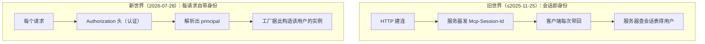
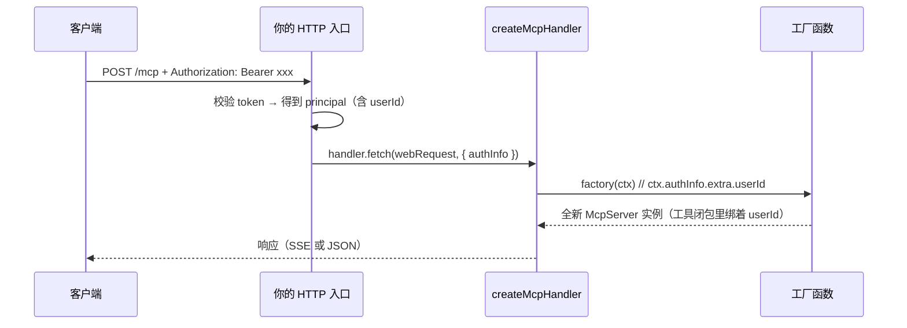
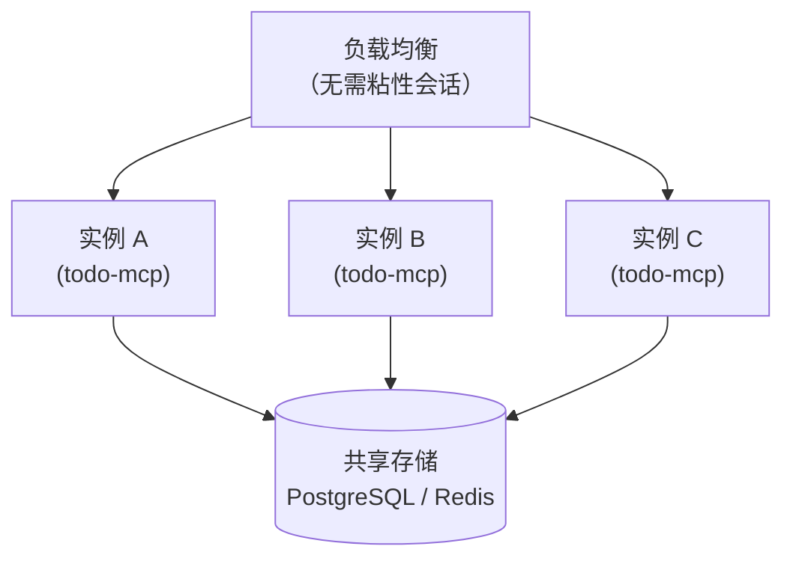

# 11 - 多用户隔离与无状态扩展：从"单人玩具"到"多人服务"

> 第 10 篇把服务器搬上了公网，但当时埋了一个雷：本系列的 todo 服务器用**模块级变量**存数据——
> 一个人用没问题，两个人用就会互相看到对方的待办。本篇补上"多用户"这半边：
> 无状态服务的状态该放哪、会话隔离的四个层面、以及官方 SDK 的多租户标准写法（全部实测）。

[← 上一篇：Linux 部署实战](10-Linux部署MCP服务器.md) · [目录](README.md) · **全系列完**

---

## 1. 先澄清三个"会话"：它们不是一回事

"会话隔离"听起来像一个词，实际横跨三层，混淆它们是设计错误的根源：

| 层次 | 是什么 | 2026-07-28 的状态 | 谁负责 |
|---|---|---|---|
| **传输连接** | 一条 stdio 管道 / 一组 HTTP 请求 | stdio 一连接一进程；HTTP 无连接概念 | 传输层 |
| **协议级会话** | 旧协议的 `Mcp-Session-Id`（≤2025-11-25），服务器凭它识别人 | **已移除**（2026-07-28 改为无状态） | 协议层 |
| **应用级身份** | "这次调用是谁发起的" | 靠每次请求的认证信息（`authInfo`）与 `_meta.clientInfo` | **你的业务代码** |



**核心认知：无状态 ≠ 无身份。** 新协议砍掉的是"服务器记着这个连接是谁"（有状态会话），改成了"每个请求都自带身份证明"（无状态但可认证）。这恰恰让水平扩展变简单：任意实例都能处理任意请求。

## 2. 状态该放哪儿：三种状态，三个去处

写无状态服务时，把状态按生命周期分类，去处就清楚了：

| 状态类型 | 例子 | 正确去处 | 错误做法 |
|---|---|---|---|
| **请求内临时** | 解析参数、组装响应、循环变量 | 局部变量/闭包 | 挂在模块全局上 |
| **业务持久** | 待办、用户配置、审计记录 | 数据库/Redis/文件（带 user 维度） | 内存 Map（重启即丢、多实例不共享） |
| **跨请求会话** | "刚才那个多步向导走到第 2 步了" | MRTR 的 `requestState`（06 篇）或外置存储 | 内存 Map 按连接 id 索引 |

### 2.1 本系列做过的"反面教材"

回顾前 10 篇的 todo 服务器（02 篇）：

```javascript
const todos = [];        // ← 模块级：整个进程共享一份
let nextId = 1;
```

单人使用完全没问题——但部署到公网（10 篇）后：

- Alice 添加的待办，Bob 也能 `list_todos` 看到 → **数据泄露**；
- 重启进程（10 篇 systemd 重启）数据全丢 → **状态没外置**；
- 起第二个实例做负载均衡 → 两个实例各有一份互不相通的数组 → **数据分裂**。

这不是"代码写错了"，而是**单用户示例的合理简化**。生产化时必须升级，这就是本篇要做的。

### 2.2 决策矩阵：什么时候需要外置

| 场景 | 内存（单实例） | 外置 DB |
|---|---|---|
| 个人本地工具（stdio，02 篇形态） | ✅ 够用 | 过度设计 |
| 团队共享、会重启（10 篇形态，单实例） | ⚠️ 重启丢数据 | 推荐 |
| 多实例/容器化水平扩展 | ❌ 数据分裂 | **必须** |
| 多用户（本篇） | ❌ 除非按 key 严格分桶，且接受重启丢失 | 推荐 |

## 3. 多租户的标准姿势：`createMcpHandler` + `authInfo`

SDK 的 handler 工厂签名是 `(ctx: McpRequestContext) => McpServer`，而 `ctx` 里有三个宝：

```typescript
interface McpRequestContext {
  era: "legacy" | "modern";      // 这个实例服务哪个协议时代
  authInfo?: AuthInfo;           // 调用者的认证信息（HTTP 面的调用方传入）
  requestInfo?: Request;         // 原始 HTTP 请求
}

interface AuthInfo {
  token: string;
  clientId: string;
  scopes: string[];
  expiresAt?: number;
  resource?: URL;
  extra?: Record<string, unknown>;  // ← 附加数据（官方字段），我们用它放 userId
}
```

SDK 文档原话：工厂正是为"**按 principal 变化的服务器**（如基于 `authInfo` 的多租户服务器）"而设计的。标准流程：



关键点：**一个 handler 实例，工厂按请求调用**。每个请求都拿到"属于这个用户"的服务器实例，工具函数的闭包里带着 `userId`——业务代码里根本拿不到别人的 id。

## 4. 实操：多用户 todo 服务器（全部实测）

### 4.1 完整代码

`lab/src/todo-server-multiuser.mjs`：

```javascript
import { createServer } from "node:http";
import { toWebRequest } from "@modelcontextprotocol/node";
import { createMcpHandler, McpServer } from "@modelcontextprotocol/server";
import { z } from "zod";

// ---------- 用户目录：token -> userId（生产环境用数据库/IdP） ----------
const TOKENS = {
  "alice-token": "alice",
  "bob-token": "bob",
};

// ---------- 业务状态：在实例之外 ----------
const todosByUser = new Map(); // userId -> Todo[]（内存版，按用户分桶）

// 生产版（DB_MODE=sqlite）：一张表 + user_id 列
let db = null;
if (process.env.DB_MODE === "sqlite") {
  const { DatabaseSync } = await import("node:sqlite");   // Node 22+ 内置，无需装包
  db = new DatabaseSync(process.env.DB_PATH || "todos.db");
  db.exec(`
    CREATE TABLE IF NOT EXISTS todos (
      id INTEGER PRIMARY KEY AUTOINCREMENT,
      user_id TEXT NOT NULL,
      text TEXT NOT NULL,
      done INTEGER NOT NULL DEFAULT 0
    );
  `);
}

function addTodoFor(userId, text) {
  if (db) {
    const info = db.prepare("INSERT INTO todos (user_id, text) VALUES (?, ?)").run(userId, text);
    return { id: Number(info.lastInsertRowid), text, done: 0 };
  }
  const list = todosByUser.get(userId) ?? [];
  const todo = { id: list.length + 1, text, done: 0 };
  list.push(todo);
  todosByUser.set(userId, list);
  return todo;
}

function listTodosFor(userId) {
  if (db) {
    return db.prepare("SELECT id, text, done FROM todos WHERE user_id = ? ORDER BY id").all(userId);
  }
  return todosByUser.get(userId) ?? [];
}

// ---------- 工具工厂：userId 经闭包绑进这个用户的实例 ----------
function createTodoServer(userId) {
  const server = new McpServer({ name: "todo-multiuser", version: "1.0.0" });

  server.registerTool(
    "add_todo",
    {
      title: "新增待办",
      description: "向当前用户的待办清单中添加一条新待办事项",
      inputSchema: z.object({ text: z.string().min(1).describe("待办内容") }),
    },
    async ({ text }) => {
      const todo = addTodoFor(userId, text);   // ← 只写当前用户的数据
      return { content: [{ type: "text", text: `已添加 [${todo.id}] ${text}` }] };
    },
  );

  server.registerTool(
    "list_todos",
    {
      title: "列出待办",
      description: "列出当前用户的所有待办事项",
      inputSchema: z.object({}),
    },
    async () => {
      const rows = listTodosFor(userId);
      const lines = rows.map((t) => `[${t.id}] ${t.done ? "✅" : "⬜"} ${t.text}`);
      return { content: [{ type: "text", text: lines.join("\n") || "（空）" }] };
    },
  );

  return server;
}

// ---------- 一个 handler：工厂从 ctx.authInfo 读取调用者身份（多租户标准姿势） ----------
const handler = createMcpHandler((ctx) => {
  const userId = ctx.authInfo?.extra?.userId;
  if (!userId) throw new Error("missing authenticated principal");
  return createTodoServer(userId);
});

// ---------- HTTP 入口：校验 token → 构造 authInfo → 交给 handler ----------
const BIND_ADDR = process.env.BIND_ADDR || "127.0.0.1";
const PORT = Number(process.env.PORT || 3004);

createServer(async (req, res) => {
  const auth = req.headers.authorization ?? "";
  const token = auth.startsWith("Bearer ") ? auth.slice(7) : null;
  const userId = token ? TOKENS[token] : null;

  if (!userId) {
    res.writeHead(401, { "WWW-Authenticate": "Bearer" });
    res.end(JSON.stringify({
      jsonrpc: "2.0", id: null,
      error: { code: -32001, message: "Unauthorized: unknown bearer token" },
    }));
    return;
  }

  const response = await handler.fetch(await toWebRequest(req), {
    authInfo: { token, clientId: userId, scopes: ["todos"], extra: { userId } },
  });

  // Response（可能是 SSE 流）逐块写回 Node 响应
  res.writeHead(response.status, Object.fromEntries(response.headers));
  if (response.body) {
    for await (const chunk of response.body) res.write(chunk);
  }
  res.end();
}).listen(PORT, BIND_ADDR, () => {
  console.error(`todo MCP server (multiuser) listening on http://${BIND_ADDR}:${PORT}/mcp`);
});
```

### 4.2 代码里的四个设计决策

**① 令牌校验在 handler 之外**（HTTP 入口层）。SDK 明示 `authInfo` 是"strictly pass-through，handler 从不从请求头填充它，也不做任何 token 校验"——**校验是你的责任**。生产环境换成 JWT 验签/OAuth introspection。

**② 身份经由闭包注入，而不是每个工具自己去查。** `createTodoServer(userId)` 里的工具函数天然只能操作这个用户的数据——**"忘记过滤 user_id"这个经典漏洞在结构上就不可能发生**。这比"在每次查询里记得加 where"可靠得多。

**③ 状态在实例外，且按用户分桶。** `todosByUser` 是 `Map<userId, Todo[]>`；SQLite 版是 `todos` 表的 `user_id` 列。每请求新建的 server 实例是无状态的（04 篇原则）。

**④ 用 `node:sqlite` 而非第三方包**：Node 22+ 内置（实验性但可用，本机 v22.23.1 实测）。生产可换 better-sqlite3/PostgreSQL/Redis，接口层不变。

### 4.3 实测：隔离效果四连

启动（默认内存模式）：

```cmd
node src/todo-server-multiuser.mjs
```

**实验 1：Alice 写入**

```cmd
curl -s -X POST http://127.0.0.1:3004/mcp -H "Content-Type: application/json" -H "Accept: application/json, text/event-stream" -H "MCP-Protocol-Version: 2026-07-28" -H "Mcp-Method: tools/call" -H "Mcp-Name: add_todo" -H "Authorization: Bearer alice-token" --data-binary @src/call-modern-add.json
```

实测响应：

```json
{"result":{"content":[{"type":"text","text":"已添加 [1] Alice 的私事待办"}],"resultType":"complete",...},"jsonrpc":"2.0","id":1}
```

**实验 2/3：各自查看**

| 调用方 | 实测结果 |
|---|---|
| Alice（`Bearer alice-token`） | `[1] ⬜ Alice 的私事待办` ← 看到自己的 |
| Bob（`Bearer bob-token`） | `（空）` ← **看不到 Alice 的** ✅ |

**实验 4：无 token**

```cmd
curl -s -o nul -w "HTTP %{http_code}" -X POST http://127.0.0.1:3004/mcp ...（不带 Authorization）
```

实测：`HTTP 401`（响应体带 `-32001` 错误码与 `WWW-Authenticate: Bearer`）。

### 4.4 实测：状态外置 + SQLite 持久化

```cmd
:: 第一次启动（SQLite 模式），Alice 写入一条
set DB_MODE=sqlite&& set DB_PATH=lab-todos.db&& node src/todo-server-multiuser.mjs
:: 写入成功后【完全杀掉进程】，再重启，再查
```

实测：**进程完全重启后，Alice 的待办依然在**（`[1] ⬜ Alice 的私事待办`）。这一条就是"状态在进程外"的直接证据——10 篇的 systemd 重启、滚动升级、多实例部署都依赖它。

> 注意：`node:sqlite` 会打印 ExperimentalWarning，不影响使用。生产建议换稳定驱动。

## 5. 会话隔离的四个层面（不止数据）

只隔离数据不够。完整的多租户隔离要覆盖四个层面：

| 层面 | 隔离什么 | 做法 |
|---|---|---|
| **身份** | 谁在调用 | token → principal（`authInfo`），工具内可读 `scopes` 做权限判断 |
| **数据** | 能读写哪些记录 | 查询强制带 `user_id`（本篇：闭包注入 + where 条件） |
| **工具面** | 能看到哪些工具 | 工厂里**按用户裁剪 `registerTool`**——管理员多几个工具，普通用户少几个 |
| **资源/提示** | 能读哪些资源 | 资源 URI 带用户维度（`todo://user/{userId}/item/{id}`），read 回调校验归属 |

第三层最容易被忽略，但很实用：

```javascript
function createTodoServer(userId, scopes) {
  const server = new McpServer({ name: "todo-multiuser", version: "1.0.0" });

  // 所有人都有
  server.registerTool("list_todos", { /* ... */ }, handler);

  // 只有 admin scope 才注册危险工具——"看不见"比"看见了但拒绝"更安全
  if (scopes.includes("todos:admin")) {
    server.registerTool("purge_all_todos", {
      description: "清空全部待办（管理员）",
      inputSchema: z.object({ confirm: z.literal(true) }),
    }, async () => { /* ... */ });
  }
  return server;
}
```

这利用了一个协议特性：**工具清单是每请求动态生成的**（`tools/list` 的响应就是工厂的产物），所以"不同用户看到不同工具集"天然成立，且不需要在工具内部再做权限分支（08 篇"最小权限"的落地形态）。

第四层的资源隔离：

```javascript
server.registerResource(
  "todo-item",
  new ResourceTemplate(`todo://user/${userId}/item/{id}`, { list: undefined }),
  { title: "单条待办", mimeType: "application/json" },
  async (uri, { id }) => {
    const row = db.prepare("SELECT * FROM todos WHERE id = ? AND user_id = ?").get(Number(id), userId);
    if (!row) throw new Error("not found");   // ← 双重条件：id + user_id
    return { contents: [{ uri: uri.href, text: JSON.stringify(row) }] };
  },
);
```

**审计**（08 篇 #6）也随之变简单：日志里记 `authInfo.clientId` + 工具名 + 参数，一行就是一条可追溯的记录。

## 6. 水平扩展：无状态带来的真正红利

现在可以正面回答"为什么 2026-07-28 要去掉协议级会话"：



| 问题 | 旧协议（有会话） | 新协议（无状态） |
|---|---|---|
| 负载均衡 | 需要粘性会话，否则请求打到别的实例就不认识你 | 任意实例都能处理任意请求 |
| 缩容/滚动升级 | 实例上挂着的会话要先迁移 | 直接杀，客户端下次请求打新实例 |
| 缓存 | 各实例各算 | 响应带 `ttlMs`/`cacheScope`，客户端可缓存、多实例可共享 |

**要做的三件事**（本篇代码已覆盖其中两件）：

1. 业务状态外置（本篇 SQLite/Redis）；
2. 身份每请求校验（本篇 `authInfo`）；
3. 长任务/多步流程的状态，用 MRTR 的 `requestState`（06 篇，注意 HMAC）或外置 job 表（06 篇第 4 节的应用层 jobId 方案）。

**一个必须知道的例外**：stdio 传输天然是"一连接一进程"，没有水平扩展概念——但也**不共享**任何东西：每个客户端各自拉起自己的进程。所以 stdio 服务器的"隔离"来自进程边界，问题是**同一用户开两个编辑器会看到两份数据**（各自内存）。要跨客户端共享，就走 HTTP + 外置存储。

## 7. 与旧协议会话模式的对照（读老代码必备）

如果你维护的是 2025-era 服务器，会话隔离是另一套写法：

| 维度 | 2025-era（`Mcp-Session-Id`） | 2026-07-28 |
|---|---|---|
| 会话建立 | `initialize` 响应头返回 session id | 无会话 |
| 后续请求 | 每次带 `Mcp-Session-Id` 头 | 不需要 |
| 服务器侧状态 | 内存 Map<sessionId, {user, 数据}> | 外置存储 + `authInfo` |
| 结束会话 | `DELETE` 端点 | 无（连接即销毁） |
| 多实例 | 需要粘性会话或会话共享存储 | 无需 |

老代码里 `sessionIdGenerator: () => randomUUID()` 那套（04 篇的 legacy 入口）就是在开启协议级会话。**迁移建议**：保留认证信息在会话里 → 改为每请求 `authInfo`；会话里的业务数据 → 迁到 DB；会话里的"多步流程状态" → MRTR `requestState`。

## 8. 隔离强度自检清单

上线前逐项打勾：

1. ☐ **无共享全局业务状态**：`grep` 一下模块级 `let/const` 数组/Map，确认它们要么只读配置，要么带用户维度
2. ☐ **身份来自认证而非参数**：`userId` 绝不从工具参数里读（模型可以填任意值！）
3. ☐ **所有查询带用户条件**：`WHERE user_id = ?` 出现在每条 SQL/每次 Map 访问里
4. ☐ **工具面按权限裁剪**：危险工具对无权限用户根本不注册
5. ☐ **资源 URI 含用户维度**，read 回调做归属校验
6. ☐ **拒绝路径有测试**：A 访问 B 的数据必须失败（本篇实验 2/3 的最小版）
7. ☐ **状态外置验证过**：杀进程重启后数据还在（本篇 4.4）
8. ☐ **日志含 principal**：审计可追溯到具体用户/客户端

## 9. 踩坑 FAQ

**Q1：我把 `userId` 放进工具参数让模型传，不行吗？**
**绝对不行**。工具参数是模型生成的（08 篇 2.6），攻击者可以诱导模型填别人的 id——这是最典型的越权漏洞（IDOR）。身份必须来自认证层（`authInfo`），工具参数里只允许出现"你拥有的资源 id"，且查询仍要带 `user_id` 条件做双重校验。

**Q2：`handler.fetch` 我直接 `return` 了 Response 没写回 `res`，请求就挂住了？**
我实测踩过。`toWebRequest` 只负责 Node→Web 转换，**响应要自己写回**：

```javascript
const response = await handler.fetch(await toWebRequest(req), { authInfo });
res.writeHead(response.status, Object.fromEntries(response.headers));
for await (const chunk of response.body) res.write(chunk);   // 流式写，SSE 也能过
res.end();
```

或者用 `toNodeHandler(handler)` 包一层（04 篇写法）——但那不支持逐请求传 `authInfo`，多租户场景要用上面的手工写法。

**Q3：`ctx.authInfo` 是 undefined？**
三种可能：① 你用的是 `toNodeHandler`（它不传 authInfo）；② 忘了在 `handler.fetch` 第二参数里传 `{ authInfo }`；③ 走的是 stdio 传输（`serveStdio` 永远不设置 authInfo）。多租户只存在于 HTTP 入口。

**Q4：内存 Map 版能上生产吗？**
单实例 + 可接受重启丢数据 + 用户数很少 → 勉强可以，但务必按 key 严格分桶（本篇写法）。否则用 SQLite（零依赖）或 Redis。决定因素是"能否接受重启丢失"与"是否多实例"（2.2 决策矩阵）。

**Q5：多实例 + SQLite 行不行？**
SQLite 是文件数据库，多实例共享同一文件在 NFS 上不可靠、写入并发也受限。**多实例场景用 PostgreSQL/MySQL/Redis**；SQLite 只适合单实例。

**Q6：不同用户的数据隔离了，但"同一用户多个客户端"呢？**
那是另一回事：同一账号在 Cursor 和 ZCode 各开一个连接——本篇方案下它们天然共享数据（都映射到同一 `userId`），这正是团队协作想要的效果。如果你要"同一用户不同设备不共享"，需要更细的维度（设备 id），把 `userId` 换成 `principal + deviceId`。

**Q7：能不能不改代码，用网关做隔离？**
网关能做**认证与路由**（token → 后端实例），但**数据隔离必须落在业务层**——网关不知道你的 SQL 该怎么写。常见架构是"网关认证 + 注入用户头 + 服务器读头"：本质上和本篇 `authInfo` 是同一件事，只是注入点不同。

## 参考链接

- [MCP 规范：无状态设计与 `_meta` 信封（2026-07-28）](https://modelcontextprotocol.io/specification/2026-07-28/basic/index#statelessness)
- [规范：Authorization](https://modelcontextprotocol.io/specification/2026-07-28/basic/authorization)（认证主体概念）
- [官方 Security Best Practices（最小权限、审计）](https://modelcontextprotocol.io/docs/2026-07-28/tutorials/security/security_best_practices)
- [Node.js 内置 `node:sqlite`](https://nodejs.org/api/sqlite.html)
- [本篇配套代码](lab/src/todo-server-multiuser.mjs)

---

**全系列完结**：从"什么是 MCP"到"多人可用的无状态服务"，完整链路已经打通。
**下一程建议**：把这台服务器接上真实数据库与业务工具 → 发布到 Registry（09 篇）→ 按 10 篇部署上线。

[← 上一篇：Linux 部署实战](10-Linux部署MCP服务器.md) · [目录](README.md) · **全系列完**
