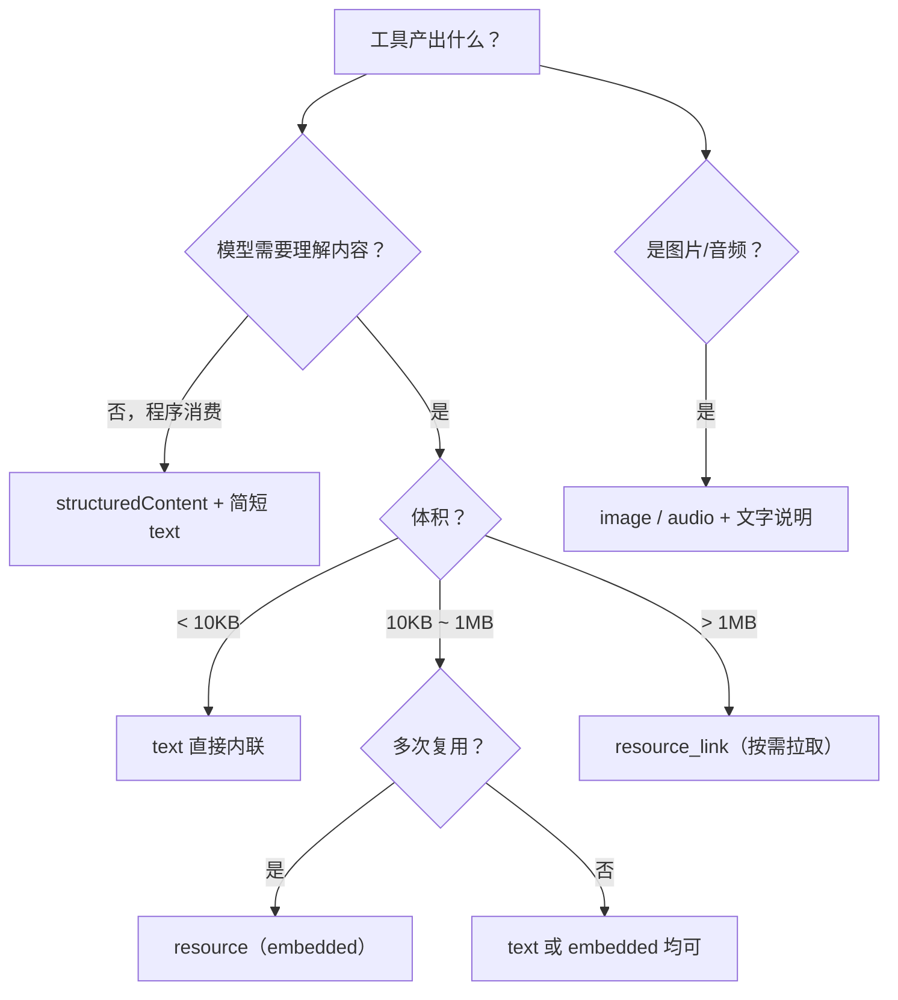

# 12 - 分页、取消与大结果：把协议工具集补齐

> 前 11 篇解决了"能不能用"，本篇解决"数据量大、任务慢、结果不是纯文本"这三个真实世界的难题。
> 分页、取消、多模态内容——全部实测，含两个只有踩过才知道的接线坑。

[← 上一篇：多用户隔离与无状态扩展](11-多用户隔离与无状态扩展.md) · [目录](README.md) · [下一篇：测试与质量保障 →](13-测试与质量保障.md)

---

## 1. 三个"小场景"，三个大坑

| 场景 | 天真做法 | 会发生什么 |
|---|---|---|
| 工具查回 5 万条日志 | 一次性全塞进 `content.text` | 撑爆模型上下文、客户端超时、token 费用爆炸 |
| 用户点了"取消"或关了窗口 | 服务器继续跑完 10 分钟任务 | 白烧 CPU/配额；再次进入时状态混乱 |
| 工具要返回一张图表/一份 PDF | 转成 Base64 塞进文本 | 模型看不懂，体积膨胀 33% |

对应三套机制：**分页**（结果切片）、**取消**（断开即停）、**结构化/多模态内容**（按类型传输）。本篇逐个讲透。

## 2. 分页：先分清"协议级"和"应用级"

MCP 里有两种分页，名字一样、机制完全不同，混淆是常见的设计错误：

| | 协议级分页 | 应用级分页 |
|---|---|---|
| 分什么页 | `tools/list`、`resources/list`、`prompts/list` 的**清单** | 工具**返回的业务数据** |
| 谁定义 | 规范（`cursor` 参数 + `nextCursor` 字段） | 你自己（工具参数与返回结构） |
| 客户端感知 | SDK 自动聚合 | 模型/应用显式翻页 |

### 2.1 协议级分页：规范有，但 SDK 不一定用

规范原文：列表方法接受可选 `cursor`，结果可带 `nextCursor`；**服务器可以选择不分页**（一次返回全部）。这是"允许"而非"必须"。

**实测**（`lab/src/probe-pagination-*.mjs`）：注册 15 个工具，用裸协议客户端请求：

```
== tools/list 无 cursor ==
  返回工具数: 15
  顶层字段: tools
  nextCursor: undefined
== tools/list 带非法 cursor ==
  结果: {"tools":[{"name":"tool_01",...}]}   ← 仍返回全部，cursor 被忽略
```

三个结论（很反直觉，但这就是现实）：

1. **TS SDK 的 `McpServer` 不做协议级分页**：15 个工具一次给全，不带 `nextCursor`；
2. **非法 `cursor` 也不报错**——被静默忽略（说明实现里根本没有游标逻辑）；
3. 所以"协议级分页"对**服务器作者**基本透明：你按 `registerTool` 注册，SDK 怎么给清单是它的事。

那规范为什么定义它？两个原因：① 给超大目录型服务器（上千个资源）留优化空间；② 客户端 SDK 要**能处理**分页。后者是真实要求：

```javascript
// 客户端 SDK 的 listTools() 默认自动聚合所有页（文档明示 auto-aggregating）
const { tools } = await client.listTools();   // 内部处理 nextCursor，你拿到完整清单
```

> 工程结论：**别在协议级分页上花时间**（除非你在写底层 handler），把精力放在应用级分页——那才是用户能感知的。

### 2.2 应用级分页：工具结果的游标模式

真实需求：`list_logs` 有 5 万条，模型一次只能消化几十条。标准做法是**把分页暴露为工具参数**：

```javascript
server.registerTool(
  "list_items",
  {
    description: "分页列出条目。返回 nextCursor 表示还有下一页（传入它继续翻页）",
    inputSchema: z.object({
      limit: z.number().int().min(1).max(10).default(5).describe("每页条数（1-10）"),
      cursor: z.string().optional().describe("上一页返回的 nextCursor；首页不传"),
    }),
    outputSchema: z.object({
      items: z.array(z.object({ id: z.number(), name: z.string() })),
      nextCursor: z.string().nullable().describe("下一页游标；null 表示已到末页"),
    }),
  },
  async ({ limit, cursor }) => {
    const start = cursor ? Number(Buffer.from(cursor, "base64url").toString()) : 0;
    const page = ITEMS.slice(start, start + limit);
    const nextStart = start + page.length;
    const nextCursor = nextStart < ITEMS.length
      ? Buffer.from(String(nextStart)).toString("base64url")
      : null;
    const structured = { items: page, nextCursor };
    const text = page.map((i) => `${i.id}. ${i.name}`).join("\n") +
      (nextCursor ? `\n--- 还有更多，nextCursor=${nextCursor}` : "\n--- 已到末页");
    return { content: [{ type: "text", text }], structuredContent: structured };
  },
);
```

**实测（Inspector CLI，两页）**：

第一页 `--tool-arg limit=5`：

```json
{
  "content": [{ "type": "text", "text": "1. item-01\n…\n5. item-05\n--- 还有更多，nextCursor=NQ" }],
  "structuredContent": { "items": [ …5 条… ], "nextCursor": "NQ" }
}
```

第二页 `--tool-arg limit=5 --tool-arg cursor=NQ`：

```json
{
  "content": [{ "type": "text", "text": "6. item-06\n…\n10. item-10\n--- 还有更多，nextCursor=MTA" }],
  "structuredContent": { "items": [ …5 条… ], "nextCursor": "MTA" }
}
```

设计要点：

1. **`nextCursor: null` 是终止信号**（而非省略字段）——模型看到 null 就知道到头了，不会无限翻；
2. **游标不透明**：`NQ` 是 `"5"` 的 base64url。模型不需要理解它，只需要原样回传。**不要用"第几页"这种可猜测的语义**——游标可猜测会让越权/遍历更容易，也让你以后改实现时无法兼容；
3. **同时给 text 和 structuredContent**（05 篇双通道原则）：文本给模型读懂"还有更多"，结构体给程序精确消费；
4. **在 description 里教模型怎么翻页**："返回 nextCursor 表示还有下一页（传入它继续翻页）"——不写这句，模型很可能翻一页就停。

### 2.3 三种游标实现与各自陷阱

| 实现 | 游标内容 | 优点 | 陷阱 |
|---|---|---|---|
| **offset** | `base64(offset)` | 最简单 | **数据漂移**：翻页期间有新增/删除会漏读或重复 |
| **keyset** | `base64(lastId)`，查询用 `WHERE id > ?` | 稳定、可利用索引 | 排序键必须唯一且有序；复合排序要带全部键 |
| **时间戳** | `base64(lastTime + lastId)` | 适合日志/事件流 | 同毫秒多条必须用 `(time, id)` 组合键去重 |

生产选 **keyset**。本篇演示用 offset 只为代码短——真实实现建议：

```javascript
// keyset 版：游标 = 上一页最后一条的 id
const after = cursor ? Number(Buffer.from(cursor, "base64url").toString()) : 0;
const rows = db.prepare(
  "SELECT id, name FROM items WHERE user_id = ? AND id > ? ORDER BY id LIMIT ?"
).all(userId, after, limit);
const nextCursor = rows.length === limit
  ? Buffer.from(String(rows[rows.length - 1].id)).toString("base64url")
  : null;
```

### 2.4 别让模型"翻到底"

分页的隐藏风险：模型可能为了回答一个问题翻 20 页，每页都是一次工具调用（时间 + token）。三个护栏：

- **limit 上限写死在 schema**（`.max(10)`），模型不能要 1000 条；
- **description 里给"够用就停"的指引**："通常前 1-2 页足够；除非用户明确要求全量"；
- **给 `total` 或 `hasMore` 提示**，让模型判断规模（`nextCursor !== null` 已含此信息）。

## 3. 取消：断开连接就必须停

### 3.1 规范怎么定义

2026-07-28 把取消简化成"传输层信号"：

| 传输 | 取消方式 |
|---|---|
| **Streamable HTTP** | **关闭 SSE 响应流 = 取消该请求**（不需要任何消息）；服务器应尽快停止，且不再发送该请求的任何消息 |
| **stdio** | 客户端发 `notifications/cancelled`（带要取消的请求 id） |

注意一个细节：HTTP 上**没有** `notifications/cancelled`（04 篇规范精读提过）——断流本身就是信号。

### 3.2 工具侧怎么写：`extra.mcpReq.signal`

```javascript
server.registerTool("slow_job", { … }, async ({ label }, extra) => {
  const signal = extra.mcpReq.signal;          // AbortSignal
  for (let i = 1; i <= 40; i++) {
    if (signal?.aborted) {
      // 清理：回滚事务、删除临时文件、释放锁
      return { content: [{ type: "text", text: `已取消（第 ${i} 步）` }] };
    }
    await new Promise((r) => setTimeout(r, 500));
  }
  return { content: [{ type: "text", text: "完成" }] };
});
```

**检查点要放在循环里**（每步都查），而不是只在开头查一次——长任务的价值就在于"随时能停"。

### 3.3 两个接线坑（我实测踩到的）

**坑 1：手工 HTTP 桥接不接 signal，取消永远不生效。**

我第一次的写法：

```javascript
const ac = new AbortController();
req.on("close", () => ac.abort());     // ❌ 错
const response = await handler.fetch(await toWebRequest(req, undefined, { signal: ac.signal }));
```

结果：curl 3 秒断开，服务器**跑满 20 秒**。两个原因：

- `req.on("close")` 在**请求体读完**时就触发（不是连接断开），过早 abort；
- 更根本的是：`toWebRequest(req)` **默认不会**把连接断开映射成 `Request.signal`，必须显式传 `{ signal }`。

正确写法（实测生效）：

```javascript
const ac = new AbortController();
res.on("close", () => {                 // ✅ 监听响应/连接终止
  if (!res.writableEnded) ac.abort();   // 排除正常结束
});
const response = await handler.fetch(
  await toWebRequest(req, undefined, { signal: ac.signal }),   // ✅ 显式接线
);
```

**实测日志**（curl `--max-time 3`）：

```
[cancel-test] 开始执行
[cancel-test] 进度 4/40
[server] 检测到客户端断开，触发 abort
[cancel-test] 检测到取消，已停止（第 7 步，耗时 3055ms）
```

3 秒断连 → **3055ms** 感知并停止。这才叫"取消生效"。

**坑 2：用 `toNodeHandler(handler)` 时取消是自动接好的。**
反过来说：如果你用 04 篇的 `toNodeHandler` 一行写法，不需要自己接 signal（适配器内部做了）。**只有手工 `toWebRequest` + `handler.fetch` 组合才需要自己接线**——这个差异不看源码很难猜到，写进你的检查清单。

### 3.4 取消的正确语义：三个"必须"

- **必须做清理**：数据库事务回滚、临时文件删除、分布式锁释放——取消不是"什么都不做"，是"安全地不做完"；
- **必须区分"取消"与"失败"**：取消返回的是**正常响应**（带说明文本），不是 `isError`，更不是抛异常——用户主动取消不是错误；
- **必须可重复执行**：取消后同一请求可能被重试，工具要幂等（05 篇原则）。

## 4. 大结果与多模态：四种交付形态

工具返回什么形态，取决于"谁消费、多大、什么类型"：

| 形态 | content 类型 | 何时用 | 体积代价 |
|---|---|---|---|
| **纯文本** | `text` | 模型要读的内容，< 10KB | 小 |
| **结构化** | `structuredContent` | 程序要处理的 JSON（05 篇） | 中（同时建议配文本摘要） |
| **内联资源** | `resource`（embedded） | 需要一次性带走的中小文件（< 1MB） | 随内容线性增长 |
| **资源链接** | `resource_link` | 大文件/可能用不上的内容——**按需再拉** | 仅一个 URI |
| **图片/音频** | `image` / `audio` | 视觉/听觉内容 | Base64 膨胀 33% |

### 4.1 图片：`image` 内容块（实测）

```javascript
async () => ({
  content: [
    { type: "text", text: "这是一张 1x1 红色 PNG：" },
    { type: "image", data: RED_PNG_BASE64, mimeType: "image/png" },
  ],
})
```

实测 Inspector 输出：

```json
{ "type": "text", "text": "这是一张 1x1 红色 PNG：" },
{ "type": "image", "data": "iVBORw0KGgoAAAANSUhEUgAAAAEAAAAB…", "mimeType": "image/png" }
```

**注意**：不是所有模型都能看图（官方明确提醒"not every model accepts all of these types"）。**给图片配一句文字说明**，让纯文本模型也能理解发生了什么——这是最实用的兼容技巧。

### 4.2 资源链接：`resource_link`（实测）

```javascript
{ type: "resource_link", uri: "todo://report/2026-11", name: "2026年11月待办报告",
  mimeType: "text/markdown", description: "点击/按需读取才会传输内容，适合大文件" }
```

实测输出确认 `type: "resource_link"`、`uri`、`name` 齐全。

这是**大结果的正确答案**：工具只返回"指针"，客户端/模型需要时再 `resources/read` 拉正文。收益：

- 上下文不爆炸（链接只占几十 token）；
- 同一份数据可被多次读取（不用重复调用工具）；
- 服务器可以给资源加缓存提示（`ttlMs`）。

### 4.3 内联资源：`resource`（embedded，实测）

```javascript
{ type: "resource", resource: { uri: "todo://report/embedded",
  mimeType: "text/markdown", text: "# 待办报告\n\n- 完成 3 项…" } }
```

实测输出：`type: "resource"` + `mimeType: "text/markdown"`。

与 `resource_link` 的区别一句话：**`resource` 是"内容随响应一起走"，`resource_link` 是"给你地址，要用再去拿"**。

### 4.4 选择决策树



## 5. 大结果的服务器侧工程

分页与内容类型解决"怎么传"，还有"怎么产"：

1. **流式产出**：边查边发 `notifications/progress`（05 篇），让客户端知道"还在干活"而不是"死了"；
2. **截断 + 提示**：硬上限（如 200 行/50KB），截断时明确告知："结果超过上限，已截断，请缩小查询范围或使用 cursor"——**静默截断是最糟的设计**，模型会以为数据完整；
3. **摘要 + 明细分离**：`list_todos` 返回统计+前 N 条；需要全量时再走分页工具；
4. **别在工具里做"全量导出"**：导出是资源（`resource_link` 指向一个可下载 URI）或长任务（Tasks / jobId 模式），不是工具返回值。

## 6. 踩坑 FAQ

**Q1：我按规范加了 `cursor`/`nextCursor` 到 `tools/list`，怎么 SDK 不认？**
`McpServer` 不做协议级分页（本篇 2.1 实测）。要在清单层分页得用底层 `Server` 自定义 handler——绝大多数场景不需要。你的业务分页走工具参数。

**Q2：客户端发 `notifications/cancelled` 但我的 HTTP 服务器没反应？**
HTTP 上传这个通知在 2026-07-28 已不被定义（04 篇 4.3 对照表）。HTTP 的取消就是断流；如果你需要兼容旧客户端（会发 cancelled），在底层 handler 里处理——或者干脆升级 SDK。

**Q3：`signal.aborted` 一直是 false？**
按 3.3 检查两项：① 手工桥接是否传了 `toWebRequest(..., { signal })`；② 你监听的是 `req` 还是 `res` 的 `close`。用 `toNodeHandler` 则无需自己接线，若仍不生效，确认你读的是 `extra.mcpReq.signal`（不是 `extra.signal`）。

**Q4：`resource_link` 返回后，模型说"我打不开这个链接"？**
这是正常的——`resource_link` 需要**客户端**支持"按 URI 拉取"（通常是客户端把 `resources/read` 结果回填给模型）。如果你的客户端不支持，就退回 `resource` 内联，或者用工具显式提供 `read_report(uri)` 两段式。

**Q5：图片太大（几 MB）怎么办？**
`image` 内容块不适合大图：Base64 膨胀 33% 且全部进内存。用 `resource_link` 指向图片资源（`resources/read` 返回 `blob`），或提供缩略图（`image`）+ 原图链接。

**Q6：分页 + 多用户，游标要不要带用户信息？**
要。游标是不透明串没关系，但**服务端必须校验游标属于当前用户**：比如游标里签名包含 userId（HMAC），或服务端把 offset 与 userId 一起校验。否则攻击者改游标就能翻别人的数据（08 篇 `requestState` 同一类问题）。

**Q7：翻页期间数据变了（新增/删除），会怎样？**
offset 游标会漏读/重复（2.3）。用 keyset 游标可避免大部分问题；对"必须一致的快照"场景，用快照 id（第一次查询时固定一个时间点/版本号，后续翻页都读那个快照）。

## 参考链接

- [规范：分页工具（cursor/nextCursor）](https://modelcontextprotocol.io/specification/2026-07-28/server/utilities/pagination)
- [规范：取消](https://modelcontextprotocol.io/specification/2026-07-28/basic/patterns/cancellation)
- [规范：Tools 内容类型（text/image/audio/resource_link/resource）](https://modelcontextprotocol.io/specification/2026-07-28/server/tools)
- [规范：Resources](https://modelcontextprotocol.io/specification/2026-07-28/server/resources)
- [Streamable HTTP：断流即取消](https://modelcontextprotocol.io/specification/2026-07-28/basic/transports/streamable-http#cancellation)
- [本篇配套代码：分页探针](lab/src/probe-pagination-client.mjs) · [内容类型探针](lab/src/probe-content-types.mjs) · [取消探针](lab/src/probe-cancel-server.mjs)

---

**下一篇**：怎么证明你的服务器"写对了"？单元测试、集成测试、模拟 LLM 的 Agent 测试，以及 CI 里跑的一条命令。

[← 上一篇：多用户隔离与无状态扩展](11-多用户隔离与无状态扩展.md) · [目录](README.md) · [下一篇：测试与质量保障 →](13-测试与质量保障.md)
