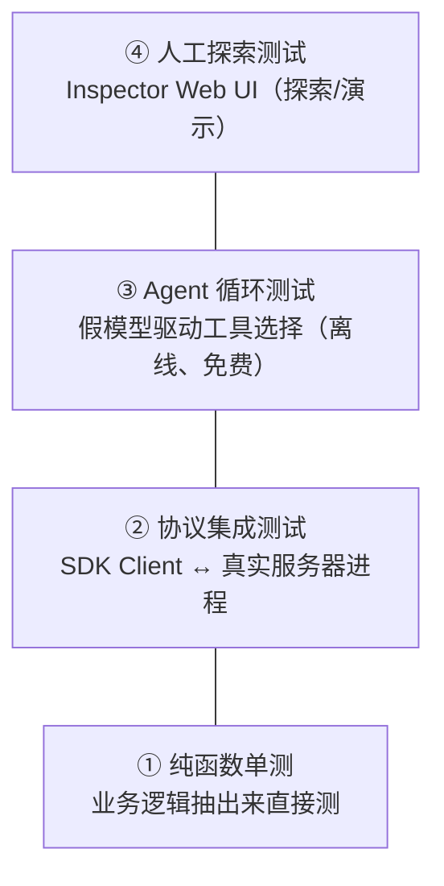

# 13 - 测试与质量保障：从"我手动点过"到 CI 全绿

> "用 Inspector 点了一下能跑"不叫质量保障。本篇搭起 MCP 服务器的四层测试：
> 纯函数单测 → 协议集成测试 → 模拟 LLM 的 Agent 测试 → 人工探索。
> 全部用 Node 内置 `node:test`，零额外依赖，`node --test` 一条命令跑完（实测 11 个用例全绿）。

[← 上一篇：分页、取消与大结果](12-分页取消与大结果多模态.md) · [目录](README.md) · [下一篇：MCP Apps 与扩展生态 →](14-MCPApps与扩展生态.md)

---

## 1. 为什么 MCP 服务器特别需要自动化测试

三个 MCP 特有的原因：

1. **调用方是模型，不是人**。人点按钮不会传 `id: "abc"`，模型会。参数校验、错误语义（`isError` vs 异常）必须被测到，否则模型会陷入"重试死循环"（07 篇的 `MAX_TOOL_TURNS` 就是兜底）。
2. **工具描述是"接口契约"**。描述改了、schema 改了，模型的行为就变了——这类回归**肉眼看不出来**，只能靠断言固化。
3. **行为跨协议时代**。同一服务器要同时服务 modern/legacy 客户端（02 篇双 era 测试），手工点两遍容易漏。

## 2. 四层测试金字塔



| 层 | 测什么 | 成本 | 频率 |
|---|---|---|---|
| ① 纯函数单测 | 业务逻辑（过滤、格式化、游标编解码） | 极低 | 每次改代码 |
| ② 协议集成测试 | 工具清单/schema/调用/错误语义 | 低（本地子进程） | 每次改代码 |
| ③ Agent 测试 | "模型拿到工具后会怎么用" | 低（假模型） | 每次改描述/schema |
| ④ 人工探索 | UX、真实客户端兼容 | 高 | 里程碑前 |

**关键设计**：① 能把逻辑从工具回调里抽出来；②③ 用**同一套 SDK Client**（07 篇）对着**真实服务器进程**跑——不 mock 协议层，测的就是真实行为。

## 3. 实操：集成测试套件（`lab/test/todo.test.mjs`）

### 3.1 一次连接，多个用例

stdio 服务器是"有状态"的（工具间有先后依赖），所以测试文件内**共享一个连接**：

```javascript
import { test, describe, before, after } from "node:test";
import assert from "node:assert/strict";
import { Client } from "@modelcontextprotocol/client";
import { StdioClientTransport } from "@modelcontextprotocol/client/stdio";

let client;

before(async () => {
  client = new Client(
    { name: "test-runner", version: "1.0.0" },
    { versionNegotiation: { mode: "auto" } },
  );
  await client.connect(new StdioClientTransport({
    command: "node",
    args: ["build/todo-server.js"],
  }));
});

after(async () => {
  await client?.close();   // 关连接会终止子进程，避免测试进程悬挂
});
```

> **为什么不用 mock**：mock 掉 `callTool` 等于测了个假东西。真实子进程 + 真实 JSON-RPC 才叫集成测试，而它只花几十毫秒。

### 3.2 四类断言（覆盖真实回归面）

**① 清单契约**——工具名、描述、schema 都要断言：

```javascript
test("暴露 4 个工具且都有描述", async () => {
  const { tools } = await client.listTools();
  assert.equal(tools.length, 4);
  assert.deepEqual(tools.map((t) => t.name).sort(),
    ["add_todo", "complete_todo", "delete_todo", "list_todos"]);
  for (const t of tools) {
    assert.ok(t.description, `${t.name} 缺少描述`);       // 描述是给模型的，不能空
    assert.equal(t.inputSchema?.type, "object");
  }
});

test("add_todo 的 schema 声明了必填 text", async () => {
  const { tools } = await client.listTools();
  const add = tools.find((t) => t.name === "add_todo");
  assert.deepEqual(add.inputSchema.required, ["text"]);
  assert.equal(add.inputSchema.properties.text.type, "string");
});
```

**② 行为与副作用**——调用后查真实状态：

```javascript
test("complete_todo 改变状态", async () => {
  await client.callTool({ name: "add_todo", arguments: { text: "待完成" } });
  await client.callTool({ name: "complete_todo", arguments: { id: 2 } });

  const open = await client.callTool({ name: "list_todos", arguments: { filter: "open" } });
  assert.doesNotMatch(open.content[0].text, /待完成/);      // 已完成不在 open 里

  const done = await client.callTool({ name: "list_todos", arguments: { filter: "done" } });
  assert.match(done.content[0].text, /待完成/);
});
```

**③ 错误语义**——这是 MCP 最容易写错的地方（05 篇三种结局）：

```javascript
test("complete 不存在的 id 返回 isError（不抛异常）", async () => {
  const r = await client.callTool({ name: "complete_todo", arguments: { id: 9999 } });
  assert.equal(r.isError, true);
  assert.match(r.content[0].text, /找不到编号为 9999 的待办/);
});
```

**④ 参数校验**——本篇新增的重要发现（见 3.3）。

### 3.3 实测发现：参数校验失败是 `isError`，不是异常

我最初按"协议错误会抛异常"写了断言，结果**两条测试失败**。实测三种非法入参的真实行为：

```
[空字符串] 未抛异常 → isError=true
  content: "Input validation error: Invalid arguments for tool add_todo:
            text: Too small: expected string to have >=1 characters"
[缺字段]   未抛异常 → isError=true
  content: "... text: Invalid input: expected string, received undefined"
[类型错]   未抛异常 → isError=true
  content: "... text: Invalid input: expected string, received number"
```

**结论**：TS SDK 把 zod 校验失败包装成**带详细原因的 `isError` 响应**。这正是给模型设计的——模型读到 "expected string, received number" 会自己纠正参数重试；如果抛 JSON-RPC 异常，很多客户端会直接中断整个对话。

对应的测试写法：

```javascript
test("text 为空串 → isError 且说明原因", async () => {
  const r = await client.callTool({ name: "add_todo", arguments: { text: "" } });
  assert.equal(r.isError, true);
  assert.match(r.content[0].text, /validation error/i);
  assert.match(r.content[0].text, />=1 characters/);
});

test("类型错（id 传字符串）→ isError", async () => {
  const r = await client.callTool({ name: "complete_todo", arguments: { id: "abc" } });
  assert.equal(r.isError, true);
  assert.match(r.content[0].text, /expected number, received string/);
});
```

> 这条"反直觉"值得写进你的测试规范：**业务失败 + 参数校验失败都走 `isError`，只有协议级故障（未知方法等）才抛异常**。

## 4. Agent 循环测试：用假模型验证"模型会怎么用"

### 4.1 为什么不用真 LLM 测

真模型测试（evals）有价值，但**不适合放进 CI**：慢、要钱、不确定。日常回归用**假模型**：把你期望的"模型决策规则"写成确定性函数，专测**循环逻辑与错误回填**。

### 4.2 完整实现（`lab/test/agent-loop.test.mjs`）

```javascript
// 假模型：确定性规则代替 LLM
function fakeModel(messages, tools) {
  const last = messages[messages.length - 1];
  const userText = messages.find((m) => m.role === "user")?.content ?? "";

  if (last.role === "tool_result") {
    return { type: "final", text: `完成：${last.content}` };   // 拿到结果 → 收尾
  }
  if (/添加|记一条/.test(userText)) {
    const text = userText.replace(/^.*?[:：]/, "").trim() || userText;
    return { type: "tool_use", name: "add_todo", arguments: { text } };
  }
  if (/列出|查看/.test(userText)) {
    return { type: "tool_use", name: "list_todos", arguments: { filter: "all" } };
  }
  return { type: "final", text: "我不明白" };
}

// Agent 循环（07 篇结构，把模型换成 fakeModel）
async function runAgent(client, userText, maxTurns = 5) {
  const messages = [{ role: "user", content: userText }];
  for (let turn = 0; turn < maxTurns; turn++) {
    const decision = fakeModel(messages, []);
    if (decision.type === "final") return decision.text;

    const result = await client.callTool({ name: decision.name, arguments: decision.arguments });
    messages.push({
      role: "tool_result",
      content: result.content.map((c) => c.text ?? "").join("\n"),
      isError: result.isError === true,
    });
  }
  throw new Error("超过最大轮次");
}

test("Agent 循环：意图 → add_todo → 最终回答", async () => {
  const client = new Client({ name: "agent-loop-test", version: "1.0.0" },
    { versionNegotiation: { mode: "auto" } });
  await client.connect(new StdioClientTransport({ command: "node", args: ["build/todo-server.js"] }));

  const answer = await runAgent(client, "帮我添加：写单元测试");
  assert.match(answer, /完成：已添加 \[1\] 写单元测试/);

  // 关键：验证副作用真的发生了（不能只信返回值）
  const listed = await client.callTool({ name: "list_todos", arguments: { filter: "all" } });
  assert.match(listed.content[0].text, /写单元测试/);

  await client.close();
});
```

**这套模式的价值**：

- 验证**循环终止条件**（拿到 tool_result 就收尾，不会无限转）；
- 验证**错误回填**（`isError` 是否如实进历史）；
- 验证**意图→工具映射**的边界（正则没匹配上时返回"我不明白"，不瞎调工具）；
- 全部离线、免费、确定性，可进 CI。

### 4.3 真模型 evals（可选，里程碑用）

假模型测不了"描述写得好不好"。评估工具描述质量的方法：

| 方法 | 做法 |
|---|---|
| **工具选择准确率** | 准备 20 条用户意图 + 期望工具，用真模型跑，统计命中率；改描述前后对比 |
| **参数填充准确率** | 检查模型填的参数是否符合 schema（尤其枚举、格式） |
| **失败恢复率** | 注入 `isError`，看模型第 2 轮是否纠正（这是"描述+错误消息"质量的综合指标） |

这类 evals 用脚本跑、结果存档，不进每次 CI（成本高），发版前或大改描述时跑一次。

## 5. 一条命令跑完：`node --test`

```cmd
cd lab
node --test
```

实测输出：

```
# tests 11
# pass 11
# fail 0
```

**踩坑提醒**（我实测踩的）：`node --test test/`（带目录参数）在 Node 22 + Windows 下会报 `Cannot find module ...\test`。两种正确写法：

```cmd
node --test                    :: 自动发现 test/**/*.test.mjs（推荐）
node --test test/todo.test.mjs :: 显式指定文件
```

`package.json` 加脚本：

```json
{
  "scripts": {
    "build": "tsc",
    "test": "node --test"
  }
}
```

然后 `npm test` 即可。

## 6. CI：GitHub Actions 模板

`.github/workflows/mcp-test.yml`：

```yaml
name: mcp-server-tests
on: [push, pull_request]

jobs:
  test:
    runs-on: ubuntu-latest
    strategy:
      matrix:
        node: [20, 22]          # 最低支持版本 + 当前 LTS 都测
    steps:
      - uses: actions/checkout@v5
      - uses: actions/setup-node@v5
        with:
          node-version: ${{ matrix.node }}
          cache: npm
      - run: npm ci
      - run: npm run build
      - run: npm test
      # 可选：协议双时代冒烟（用 Inspector CLI）
      - name: Protocol smoke (modern + legacy)
        run: |
          npx -y @modelcontextprotocol/inspector --cli node build/todo-server.js \
            --protocol-era modern --method tools/list
          npx -y @modelcontextprotocol/inspector --cli node build/todo-server.js \
            --protocol-era legacy --method tools/list
```

三个 CI 要点：

1. **矩阵测最低 Node 版本**（20）——SDK 声称支持不等于你用得对；
2. **双 era 冒烟**放在 CI 里（02 篇的双时代测试命令），防止升级 SDK 后 legacy 兼容悄悄坏掉；
3. **不跑真模型 evals**（成本/波动），只跑确定性的 ①②③ 层。

## 7. 测试用的"陷阱清单"

| 陷阱 | 表现 | 解法 |
|---|---|---|
| **状态串扰** | 用例顺序一变就失败（`todos` 是模块级的） | 每个 `describe` 用独立服务器进程，或工具支持 `reset`（仅测试环境注册） |
| **进程悬挂** | `node --test` 跑完不退出 | `after` 里必须 `client.close()`；stdio 连接 = 子进程 |
| **断言太松** | 只断言 `!isError`，改坏逻辑也通过 | 断言**具体文本片段**与**副作用**（查询二次验证） |
| **只测 happy path** | 上线才发现错误分支崩 | 每个工具至少一条失败用例（不存在 id、非法参数） |
| **用 mock 替代进程** | 测了个假的 | 集成层永远用真实子进程 + SDK Client |
| **目录参数** | `node --test test/` 报错 | 用 `node --test` 自动发现 |

## 8. 质量门禁：上线前跑一遍

把前 12 篇的验证点串成一份"发布检查表"：

| 层 | 检查项 | 来源 |
|---|---|---|
| 协议 | `--protocol-era modern` 与 `legacy` 都能 `tools/list` | 02 篇 |
| 协议 | `tools/call` 带 `_meta` 正常；缺 `_meta` 报 -32602（预期行为） | 03/04 篇 |
| 行为 | 每个工具：成功路径 + 失败路径（isError） | 本篇 3.2 |
| 参数 | 空值/缺字段/类型错 → isError 且原因可读 | 本篇 3.3 |
| 输出 | 声明 `outputSchema` 的工具返回 `structuredContent` | 05 篇 |
| 长任务 | 取消后 5 秒内停止（本篇 12 篇 3.3 的探针） | 12 篇 |
| 分页 | 首页 + 用 `nextCursor` 翻第二页 + 末页 `null` | 12 篇 |
| 安全 | 无 token → 401；A 用户查不到 B 的数据 | 10/11 篇 |
| 部署 | systemd 重启后数据仍在（状态外置） | 10/11 篇 |

## 9. 踩坑 FAQ

**Q1：测试里 `client.callTool` 卡住不动？**
最常见：服务器往 stdout 打了日志（polluted stdio，02 篇雷区）——子进程的 stderr 要接出来看（`StdioClientTransport` 可配 stderr 处理）。其次：工具在等用户输入（Elicitation），而测试客户端没声明能力 → 见 06 篇。

**Q2：一个测试改的数据影响了后面测试？**
stdio 会话内共享状态。方案：① 测试内自己造数据、用返回的 id，别硬编码；② 或每个 suite 独立连接；③ 或工具里加"仅当 `NODE_ENV=test` 注册"的 `_reset` 工具。

**Q3：要不要给 `tools/list` 的文案也写断言？**
要——至少断言"描述非空"。描述是行为契约，改坏了模型就不选这个工具（而且很难归因）。想更严：把关键描述做快照测试（snapshot），改动时人工确认。

**Q4：`assert.rejects` 用不上，全变成 `isError` 了？**
这是 SDK 的**设计**（本篇 3.3）。只有协议级故障（未知方法 `-32601`、缺 `_meta` `-32602`）才会抛异常——把这两类也写成测试，作为"协议契约"固化。

**Q5：CI 里 Inspector 每次下载很慢？**
把 Inspector 钉成 devDependency（`npm i -D @modelcontextprotocol/inspector`），CI 用 `npx inspector` 走本地安装而非 `-y` 临时下载；或者干脆用 SDK Client 写冒烟脚本（不依赖 Inspector）。

**Q6：多语言服务器怎么测？**
同一套思路：Python 用 `pytest` + `mcp` SDK 的 Client；Java 用 JUnit + SDK 的 `McpClient`（官方 quickstart 有示例，09 篇对照表）。**测试逻辑（清单/行为/错误语义/双 era）与语言无关**。

## 参考链接

- [Node.js 内置测试运行器（node:test）](https://nodejs.org/api/test.html)
- [官方 Debugging 指南](https://modelcontextprotocol.io/docs/2026-07-28/tools/debugging)
- [Inspector CLI（CI 冒烟用）](https://modelcontextprotocol.io/docs/2026-07-28/tools/inspector/cli)
- [本篇配套代码：集成测试](lab/test/todo.test.mjs) · [Agent 循环测试](lab/test/agent-loop.test.mjs) · [校验行为探针](lab/src/probe-validation.mjs)

---

**下一篇**把视野抬到生态层：MCP Apps（服务器提供交互式 UI）、Extensions 框架，以及 08 篇没讲完的 CIMD/DCR 客户端注册。

[← 上一篇：分页、取消与大结果](12-分页取消与大结果多模态.md) · [目录](README.md) · [下一篇：MCP Apps 与扩展生态 →](14-MCPApps与扩展生态.md)
