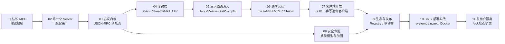

# MCP 开发系列教程 —— 从零基础到深入理解

> **Model Context Protocol（模型上下文协议）开发实战系列**
> 理论 + 实操结合，全部代码在本机 Windows 10 + Node v22 环境实测通过。

---

## 这套教程解决什么问题

2024 年 11 月 Anthropic 发布了 MCP（Model Context Protocol），到今天它已经成了 AI 应用连接外部世界的事实标准：Claude、ChatGPT、Cursor、VS Code、ZCode 等主流 AI 客户端全都支持，社区服务器数量早已过万。

但市面上的 MCP 中文教程普遍存在三个问题：

1. **过时**：MCP 协议在 2026 年 7 月发布了 `2026-07-28` 版本，是一次大改版——`initialize` 握手被 `server/discover` 取代、协议改成无状态设计、通知改为订阅制、 Roots/Sampling/Logging 被弃用。大量教程还在教 2025 年的老协议，读者按老教程写代码会遇到新客户端连不上、新报错看不懂的问题。
2. **只聊概念**：讲"什么是 USB-C 时刻"头头是道，动手代码只有半截伪代码，跑不起来。
3. **缺协议层理解**：只教"调 SDK 三行代码"，不解释底下 JSON-RPC 消息长什么样、握手怎么协商、传输层怎么转发——遇到真实问题（为什么服务器打印日志就连不上？为什么 HTTP 客户端报 -32020？）就卡死。

本系列的写法：**每一篇都是"为什么 → 是什么 → 怎么做 → 怎么验证 → 踩坑 FAQ"的完整闭环**，代码全部完整可抄改，并且都以 2026-07-28 最新协议为主线，同时明确标注新旧协议差异，帮你同时读懂"网上老教程"和"最新规范"。

## 读者画像与前置知识

- 你没写过大模型应用没关系——MCP 服务器开发**不需要调用任何大模型 API**，它只是"给 AI 用的 API"。
- 前置要求只有一条：**会一点 JavaScript/TypeScript**（会函数、对象、`async/await` 即可）。其他语言的对照篇在最后。
- 需要安装：Node.js ≥ 20（推荐 22 LTS）。第二章开始带你一步步装。

## 学习路线图



- **入门线（01→02）**：什么都不懂也能跟着做完第一个能跑的服务器。
- **协议线（03→04）**：搞懂 MCP 底下的消息世界，这是"深入理解"的分水岭。
- **进阶线（05→07）**：工程化开发服务器和客户端，覆盖官方 SDK 全部能力。
- **实战线（08→09）**：安全加固、生态选型、发布到官方 Registry。

## 版本约定（2026-11-19 核实）

本系列所有代码在以下版本组合上**实际运行验证过**，请尽量保持一致：

| 组件 | 版本 | 说明 |
|---|---|---|
| MCP 协议 | `2026-07-28` | 最新正式版（本系列主线）；历史版本：`2024-11-05`、`2025-03-26`、`2025-06-18`、`2025-11-25` |
| TypeScript SDK | `@modelcontextprotocol/server` `2.4.0`<br>`@modelcontextprotocol/client` `2.4.0`<br>`@modelcontextprotocol/node` `2.1.2` | SDK v2 已把 server / client 拆成两个包；旧的 v1 线 `@modelcontextprotocol/sdk`（1.32.2）不再推荐 |
| MCP Inspector | `@modelcontextprotocol/inspector` `2.16.0` | 官方调试工具，支持 `--protocol-era modern/legacy` 双时代测试 |
| Node.js | `v22.23.1`（实测） | 要求 ≥ 20；Windows 10 实测 |
| Python SDK（对照篇） | `mcp` `2.3.0` | Python ≥ 3.10，2026-10-02 发布 |
| Java SDK（对照篇） | Spring AI MCP starter | 协议 `2025-11-25`，**尚未支持 2026-07-28** |
| Go SDK（对照篇） | `github.com/modelcontextprotocol/go-sdk/mcp` | 官方 Go SDK |
| Rust SDK（对照篇） | `rmcp` `3.4` | 官方 Rust SDK |

> ⚠️ **重要**：SDK 和协议都在快速演进。如果你的报错和教程对不上，先检查三样东西：协议版本（`2026-07-28`？）、SDK 大版本（v2 还是 v1？）、你的客户端是否支持新协议。第 03 篇会专门讲"新旧协议时代"（era）的兼容模型。

## 配套代码

本仓库的 `lab/` 目录就是教程的全部实操代码，均已验证：

```
lab/
├── package.json
├── tsconfig.json
└── src/
    ├── todo-server.ts            # 02 篇：第一个 MCP 服务器（4 个工具）
    ├── todo-server-http.mjs      # 04 篇：Streamable HTTP（legacy 风格）
    ├── todo-server-http2.mjs     # 04 篇：Streamable HTTP（2026-07-28 现代风格，含 BIND_ADDR/PORT 环境变量，10 篇部署用）
    ├── init-request.json 等 4 个 # 04 篇：curl 请求样例
    ├── mini-client.mjs           # 03/07 篇：65 行手写 MCP 客户端（无 SDK）
    ├── sdk-client.mjs            # 07 篇：官方 SDK 客户端
    ├── probe-extra.mjs           # 05 篇：extra 参数/进度/结构化输出探针
    ├── probe-elicitation-*.mjs   # 06 篇：Elicitation/MRTR 双端探针
    └── todo-server-multiuser.mjs # 11 篇：多用户隔离 + SQLite 状态外置
```

快速体验（在 `lab/` 目录下）：

```bash
npm install        # 安装依赖
npx tsc            # 编译
node src/mini-client.mjs build/todo-server.js    # 手写客户端对话服务器
```

## 目录

| 篇 | 标题 | 一句话内容 |
|---|---|---|
| 01 | [认识 MCP](01-认识MCP.md) | 为什么需要它、架构是什么、版本演进史（重点：2026-07-28 大改版） |
| 02 | [第一个 MCP Server](02-第一个MCPServer.md) | 从零写出待办清单服务器，用 Inspector 调试，接入 Claude/ZCode |
| 03 | [协议内核：JSON-RPC 与消息流](03-协议内核JSONRPC与消息流.md) | 手写 JSON-RPC 消息，看懂握手、`_meta`、无状态设计 |
| 04 | [传输层：stdio 与 Streamable HTTP](04-传输层stdio与StreamableHTTP.md) | 两种传输深入对比，curl 直接调试 MCP，本地到远程 |
| 05 | [服务器进阶：三大原语深入](05-服务器进阶三大原语深入.md) | Tools/Resources/Prompts 的工程化设计，结构化输出与通知 |
| 06 | [进阶交互：Elicitation、MRTR 与长任务](06-进阶交互Elicitation与MRTR.md) | 服务器怎么向用户提问、怎么把长任务变成可轮询的 Task |
| 07 | [客户端开发实战](07-客户端开发实战.md) | SDK 客户端 + Agent 循环，再手写 65 行迷你客户端打通协议 |
| 08 | [安全专题](08-安全专题.md) | 工具投毒、提示注入、confused deputy 与 8 条加固清单 |
| 09 | [生态、发布与多语言](09-生态发布与多语言.md) | 官方服务器地图、发布到 Registry、Java/Python/Go/Rust 对照 |
| 10 | [Linux 部署实战](10-Linux部署MCP服务器.md) | systemd 守护、nginx/Caddy + HTTPS、认证分发、升级与容器化，部署成团队服务 |
| 11 | [多用户隔离与无状态扩展](11-多用户隔离与无状态扩展.md) | `authInfo` 多租户、数据/工具面/资源四层隔离、SQLite 状态外置、水平扩展 |

---

**建议**：01 是纯理论，可以快速过；02 必须动手；03 是全系列的灵魂——哪怕后面跳读，也请务必读完 03。

*本系列参考并整合了 [MCP 官方文档](https://modelcontextprotocol.io)、[官方规范 2026-07-28](https://modelcontextprotocol.io/specification)、[microsoft/mcp-for-beginners](https://github.com/microsoft/mcp-for-beginners)、[punkpeye/awesome-mcp-servers](https://github.com/punkpeye/awesome-mcp-servers) 等公开资料，结合实测重写。每篇末尾附参考链接。*
